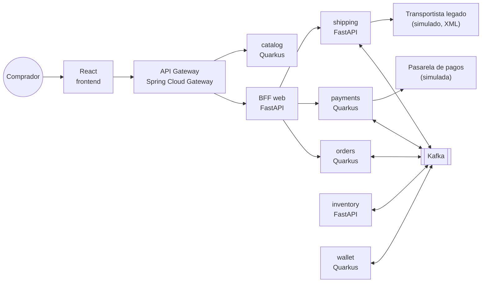
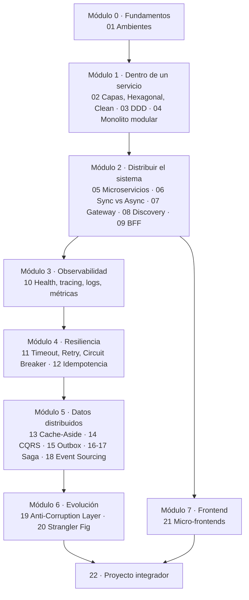

# 🧭 Guía práctica de patrones de arquitectura

> Aprende patrones de arquitectura **levantándolos, rompiéndolos y viendo cómo se recuperan**.
> Cada laboratorio arranca con `docker compose up`.

**Stack:** Quarkus 3.40 (Java 25) · FastAPI (Python 3.13 + uv) · React 19 + TypeScript · Kafka 4 · PostgreSQL 17 · Redis 8 · Docker Compose

> [!NOTE]
> **Estado: en construcción.** Los laboratorios se publican uno a uno; la columna **Estado** del [catálogo](#6-catálogo-de-patrones-y-casos) dice cuáles ya puedes levantar. Las decisiones tomadas sin consultar al autor están en [`SUPUESTOS.md`](SUPUESTOS.md).
>
> Leyenda: 🗓️ Planificado · 🚧 En construcción · ✅ Listo

---

## Contenido

1. [¿Qué es esta guía?](#1-qué-es-esta-guía)
2. [El dominio: Mercado de Inventos](#2-el-dominio-mercado-de-inventos)
3. [Cómo usar la guía](#3-cómo-usar-la-guía)
4. [Ambientes: local, dev y prod](#4-ambientes-local-dev-y-prod)
5. [Ruta de aprendizaje](#5-ruta-de-aprendizaje)
6. [Catálogo de patrones y casos](#6-catálogo-de-patrones-y-casos)
7. [Estilos de arquitectura: qué cubre la guía](#7-estilos-de-arquitectura-qué-cubre-la-guía)
8. [Decisiones y pendientes](#8-decisiones-y-pendientes)
9. [Referencias](#9-referencias)

---

## 1. ¿Qué es esta guía?

Es una guía para developers backend o fullstack que ya construyen APIs y quieren entender **cuándo y por qué** usar cada patrón de arquitectura, y no solo cómo se llama.

Cada patrón se trabaja siempre con el mismo ciclo:

1. **El problema:** una situación real del dominio.
2. **La versión ingenua:** código razonable que falla. Lo levantas y lo ves fallar.
3. **El patrón:** la misma funcionalidad, resuelta con el patrón.
4. **Rómpelo:** experimentos guiados que provocan fallas para ver al patrón trabajar.
5. **El costo:** qué complejidad agrega y cuándo **no** usarlo.
6. **¿Qué cambia en dev y prod?:** cómo se comporta el patrón en cada ambiente.
7. **Ejercicio:** una extensión para resolver por tu cuenta.

**Lo que no es:** no es un framework ni un sistema listo para producción. Los labs simplifican cosas (seguridad, escalado, alta disponibilidad) para que el patrón se vea con claridad. Cada simplificación aparece marcada con ⚠️ en el README del lab.

---

## 2. El dominio: Mercado de Inventos

Todos los labs usan el mismo dominio. Así aprendes el negocio una sola vez y te concentras en los patrones.

**Mercado de Inventos** es un marketplace: los inventores publican inventos y los compradores los piden, los pagan y los reciben.

| Contexto | Servicio | Stack | Responsabilidad |
|---|---|---|---|
| Catálogo | `catalog` | Quarkus | Inventos publicados, precios, búsqueda |
| Pedidos | `orders` | Quarkus | Ciclo de vida del pedido |
| Inventario | `inventory` | FastAPI | Stock y reservas |
| Pagos | `payments` | Quarkus | Cobros y reembolsos |
| Envíos | `shipping` | FastAPI | Despacho con el transportista |
| Monedero | `wallet` | Quarkus | Saldo del usuario (Event Sourcing) |
| Web | `bff-web` + `frontend` | FastAPI + React | Experiencia del comprador |
| Simulados | `legacy-shop`, `legacy-carrier`, `payment-provider` | FastAPI | Sistemas externos con controles de caos |



*El diagrama muestra el dominio completo. Cada lab levanta solo la parte que necesita.*

### ¿Por qué dos lenguajes en el backend?

Los patrones de arquitectura viven en los **contratos entre servicios** (HTTP, eventos, esquemas), no en el framework. Si ves una saga funcionar entre un servicio Quarkus y uno FastAPI conectados por Kafka, queda claro que el patrón no depende de la tecnología.

### Regla de stack

En Java, **Quarkus es la opción por defecto**. Spring entra solo cuando Quarkus tiene una limitación real, y cada uno de esos casos queda documentado:

| Necesidad | Decisión | Motivo |
|---|---|---|
| API Gateway (labs 07 y 20) | **Spring Cloud Gateway** (Spring Boot 4) | Quarkus no ofrece un gateway equivalente: enrutamiento declarativo, filtros, rate limiting y enrutamiento por pesos. |
| Verificación de módulos (lab 04) | Quarkus + ArchUnit | El equivalente en Spring sería Spring Modulith. ArchUnit cubre lo necesario, así que no hace falta cambiar. |
| Service discovery (lab 08) | Quarkus + SmallRye Stork | Stork soporta Consul y Eureka, así que no hace falta Spring Cloud. |
| Saga con motor de workflows (lab 17, opcional) | Quarkus + Temporal (extensión de Quarkiverse) | Sin limitación. |

### Convención de idioma

El **código está en inglés** y la **documentación en español**. Los nombres de código (eventos, estados, clases) se muestran tal cual, por ejemplo `OrderCreated`, y se explican en español la primera vez que aparecen.

---

## 3. Cómo usar la guía

### 3.1 Requisitos

| Herramienta | Versión | Para qué |
|---|---|---|
| Docker Engine o Docker Desktop | Compose **v2.24+** | Levantar los labs (`include:` y `!reset` requieren 2.24 o superior) |
| Git | cualquiera | Clonar el repositorio |
| RAM asignada a Docker | 8 GB mínimo, 16 GB recomendado | Los labs con Kafka y observabilidad son los más pesados |
| JDK 25, Maven 3.9+, Python 3.13+ con [uv](https://docs.astral.sh/uv/) y Node 22+ | *opcional* | Solo para el modo desarrollo (3.5) y para correr los tests fuera de Docker |

No necesitas instalar Java, Python ni Node para seguir la guía. Todo se compila dentro de los contenedores con Dockerfiles multi-stage.

### 3.2 Estructura del repositorio

```
guia-patrones-arquitectura/
├── README.md                  ← estás aquí
├── docs/
│   ├── como-usar-la-guia.md
│   ├── ambientes.md           ← local, dev y prod en detalle
│   ├── estilos.md             ← estilos de arquitectura sin laboratorio
│   ├── glosario.md
│   └── plantilla-lab.md       ← estructura que sigue cada lab
├── shared/                    ← código y scripts que usan varios labs (sin copiarlos)
├── old/pip/                   ← la versión anterior de los servicios Python, con pip
├── infra/                     ← bloques de Compose reutilizables
│   ├── postgres.yaml
│   ├── kafka.yaml             ← Kafka (KRaft) + Kafka UI
│   ├── debezium.yaml
│   ├── redis.yaml
│   ├── mongodb.yaml
│   ├── keycloak.yaml
│   ├── consul.yaml
│   └── observability.yaml     ← Grafana LGTM
└── labs/
    ├── 01-ambientes/
    ├── 02-capas-hexagonal-clean/
    ├── ...
    └── 22-integrador/
```

Cada lab es **independiente**: tiene sus propios servicios y su propio `compose.yaml`. Por eso verás código parecido repetido entre labs (por ejemplo, el servicio de pedidos aparece en varios): es intencional, para que cada lab se lea y se levante sin depender de otro. La infraestructura común (Postgres, Kafka, etc.) se define una sola vez en `infra/` y cada lab la importa con `include:`.

### 3.3 Anatomía de un laboratorio

```
labs/15-transactional-outbox/
├── README.md                ← problema, patrón, experimentos, ejercicio
├── compose.yaml             ← base: servicios del lab + include de infra/
├── compose.override.yaml    ← ambiente local (se carga solo con `docker compose up`)
├── compose.dev.yaml         ← ambiente dev
├── compose.prod.yaml        ← ambiente prod
├── .env.example             ← copiar a .env
├── requests.http            ← peticiones listas para VS Code REST Client o IntelliJ
├── services/
│   ├── orders/              ← Quarkus
│   └── ...
└── frontend/                ← solo en los labs con interfaz
```

El README de cada lab tiene siempre estas secciones: **Problema · Versión ingenua · El patrón · Arquitectura del lab · Levántalo · Rómpelo · ¿Qué cambia en dev y prod? · Costo y cuándo no usarlo · Ejercicio · Referencias.**

### 3.4 Cómo levantar un laboratorio

```bash
git clone <url-del-repo> guia-patrones-arquitectura
cd guia-patrones-arquitectura/labs/15-transactional-outbox
cp .env.example .env
docker compose up --build
```

Cuando todos los servicios estén `healthy`, abre las URLs que lista el README del lab. Para probar los servicios puedes usar:

- `requests.http` con peticiones ya armadas.
- Swagger UI: `/q/swagger-ui` en Quarkus y `/docs` en FastAPI.

**Ver el problema que resuelve el patrón:**

```bash
docker compose --profile naive up --build
```

**Limpiar antes de pasar al siguiente lab:**

```bash
docker compose down -v
```

`-v` borra los volúmenes, es decir, los datos. Hazlo entre labs para evitar choques de puertos y datos viejos.

### 3.5 Modo desarrollo (opcional)

Si vas a modificar código y quieres recarga en caliente, levanta solo la infraestructura con Compose y ejecuta el servicio en tu máquina:

```bash
docker compose up -d postgres kafka              # solo infraestructura
cd services/orders && ./mvnw quarkus:dev         # Quarkus con recarga en caliente
cd services/inventory && uv run uvicorn app.main:create_app --factory --reload   # uv crea el entorno solo
cd frontend && npm run dev
```

Este modo también es un ambiente, distinto de "local con Compose". El lab 01 explica la diferencia y cómo evitar que se mezclen. Por ejemplo, los *Dev Services* de Quarkus levantan contenedores por su cuenta.

### 3.6 Rutas de aprendizaje

| Ruta | Labs | Para quién |
|---|---|---|
| **Completa** | 01 → 22 en orden | Quien quiere el panorama entero |
| **Arquitectura interna** | 01 · 02 · 03 · 04 | Quien quiere ordenar mejor un solo servicio |
| **Saga a fondo** | 01 · 05 · 06 · 10 · 12 · 15 · 16 · 17 | Quien necesita transacciones entre servicios |
| **Datos distribuidos** | 05 · 06 · 12 · 13 · 14 · 15 · 16 · 17 · 18 | Quien trabaja con consistencia eventual |
| **Migrar un legado** | 05 · 07 · 19 · 20 | Quien tiene un monolito que modernizar |

El README de cada lab indica qué labs previos asume.

### 3.7 Convención de puertos

Los puertos son los mismos en todos los labs:

| Puerto | Qué |
|---|---|
| 3000 | Frontend React |
| 3001 | Grafana |
| 8080 | API Gateway |
| 8101 | `catalog` |
| 8102 | `orders` |
| 8103 | `inventory` |
| 8104 | `payments` |
| 8105 | `shipping` |
| 8106 | `wallet` |
| 8108 | `order-history` (lado de consultas de CQRS) |
| 8110 | `bff-web` |
| 8120 · 8121 · 8122 | Simulados: `legacy-shop` · `legacy-carrier` · `payment-provider` |
| 8083 | Kafka Connect (Debezium) |
| 8090 | Kafka UI |
| 8180 | Keycloak |
| 8500 | Consul |
| 5432 · 6379 · 9092 · 27017 | Postgres · Redis · Kafka · MongoDB |

---

## 4. Ambientes: local, dev y prod

Un patrón no se comporta igual en todos los ambientes. El intervalo de sondeo de la outbox, los umbrales del circuit breaker o el factor de replicación de Kafka cambian entre tu máquina y producción. Por eso la guía enseña ambientes **como parte de aprender cada patrón**, y no como un tema aparte.

### Principios (The Twelve-Factor App)

- **Construir una vez, desplegar muchas:** la misma imagen viaja de local a prod. Solo cambia la configuración.
- **Configuración en el entorno:** se usan variables de entorno y archivos montados, nunca valores en el código.
- **Secretos fuera de Git:** `.env.example` se versiona y `.env` se ignora. En prod, los secretos se montan como archivos con `secrets:` de Compose.
- **Paridad entre ambientes:** las mismas tecnologías en todos lados. Nada de H2 en local y Postgres en prod.
- **Fallar rápido:** si falta una variable obligatoria, el servicio no arranca y dice cuál falta.

### Cómo se simulan

Los tres ambientes se simulan **en tu máquina** con *overlays* de Compose. El objetivo es entender qué cambia de uno a otro, no desplegar en la nube.

| Ambiente | Archivos | Comando |
|---|---|---|
| **local** | `compose.yaml` + `compose.override.yaml` + `.env` | `docker compose up --build` |
| **dev** | `compose.yaml` + `compose.dev.yaml` + `.env.dev` | `docker compose -f compose.yaml -f compose.dev.yaml --env-file .env.dev up` |
| **prod** | `compose.yaml` + `compose.prod.yaml` + `.env.prod` + `secrets/` | `docker compose -f compose.yaml -f compose.prod.yaml --env-file .env.prod up` |

### Qué cambia entre ambientes

| Aspecto | local | dev | prod |
|---|---|---|---|
| Imagen | build local | misma imagen, con tag de versión | misma imagen, con tag de versión |
| Logs | texto legible, `INFO` | JSON, **`DEBUG`** (solo aquí: puede mostrar datos sensibles) | JSON, `INFO`/`WARN` |
| Puertos expuestos | todos (BD, Kafka UI, Swagger) | servicios y herramientas | solo gateway y frontend |
| Secretos | valores falsos por defecto | variables obligatorias que pasa quien despliega | archivos en `secrets/` |
| Swagger y herramientas | activas | activas | desactivadas |
| Recursos | sin límites | límites suaves | `deploy.resources.limits`, `restart: unless-stopped` |
| Datos | semilla de ejemplo, se borra con `down -v` | semilla | sin semilla, volúmenes persistentes |
| Kafka | 1 broker, replicación 1 | 1 broker | ≥ 3 brokers con replicación 3; el lab 06 lo simula de forma **opcional** |
| Observabilidad | opcional | activa | activa, con alertas |

### Configuración por stack

- **Quarkus:** perfiles en `application.properties` con prefijos (`%prod.`), seleccionados con `QUARKUS_PROFILE`, y validación al arrancar con `@ConfigMapping`. ⚠️ El *modo dev* de Quarkus (`quarkus:dev`) no es lo mismo que el *ambiente dev*. El lab 01 explica cómo no confundirlos.
- **FastAPI:** `pydantic-settings` con `APP_ENV`. Si falta una variable, falla al arrancar.
- **React (Vite):** ⚠️ las variables `import.meta.env` se resuelven **al compilar**, lo que rompe la regla de "construir una vez". La guía usa configuración en tiempo de ejecución: un `/config.js` que genera el entrypoint de nginx a partir de variables de entorno.

**Fuera de alcance:** Kubernetes y la nube. Quedan como posible módulo futuro.

---

## 5. Ruta de aprendizaje



**¿Por qué observabilidad va antes que resiliencia y datos?** Porque lo primero que pierdes al distribuir un sistema es la visibilidad. A partir del lab 10, todos los labs traen trazas, y una saga sin trazas es muy difícil de depurar.

**¿Por qué idempotencia y outbox van antes que saga?** Porque una saga confiable se construye sobre ellos: cada paso publica con outbox y cada participante consume de forma idempotente.

---

## 6. Catálogo de patrones y casos

### Resumen

| # | Patrón(es) | Problema que resuelve | Caso en Mercado de Inventos | Stack | Infra extra | Estado |
|---|---|---|---|---|---|---|
| [01](labs/01-ambientes/) | Externalized Configuration · Twelve-Factor | "En mi máquina funciona"; config y secretos en el código | Catálogo, inventario y web en local/dev/prod con la misma imagen | Quarkus · FastAPI · React | — | ✅ |
| [02](labs/02-capas-hexagonal-clean/) | Capas · Hexagonal · Clean | Lógica de negocio atada al framework y a la BD | Publicar un invento: el mismo servicio en 3 arquitecturas | Quarkus · FastAPI | — | ✅ |
| [03](labs/03-ddd/) | DDD: Aggregate · Value Object · Domain Event · Bounded Context | Modelos anémicos e invariantes rotas | Agregado Pedido con sus reglas | Quarkus | — | ✅ |
| [04](labs/04-monolito-modular/) | Monolito modular | Microservicios prematuros vs. *big ball of mud* | La tienda completa en un deployable con módulos verificados | Quarkus | — | ✅ |
| [05](labs/05-microservicios/) | Microservicios · Database per Service | Equipos y despliegues acoplados por una BD compartida | Separar pedidos, inventario y pagos | Quarkus · FastAPI | — | ✅ |
| [06](labs/06-sync-vs-async/) | Messaging · Pub/Sub · Competing Consumers · Dead Letter Channel | Acoplamiento temporal: si uno cae, caen todos | Confirmar un pedido: REST vs. evento | Quarkus · FastAPI | Kafka | ✅ |
| 07 | API Gateway · Access Token · Rate Limiting | El frontend conoce N servicios; auth repetida | Punto de entrada único con JWT y límite por usuario | Spring Cloud Gateway · Quarkus | Keycloak · Redis | 🗓️ |
| 08 | Service Registry · Client/Server-side Discovery | Instancias dinámicas | Pedidos encuentra las instancias de inventario | Quarkus (Stork) · FastAPI | Consul | 🗓️ |
| 09 | BFF · API Composition | Una pantalla necesita datos de N servicios | "Mis pedidos" en la web | FastAPI · React | — | 🗓️ |
| [10](labs/10-observabilidad/) | Health Check API · Distributed Tracing · Log Aggregation · Metrics | No se ve dónde falla una petición distribuida | Seguir un pedido de orders a inventory pasando por Kafka | Quarkus · FastAPI | Grafana LGTM · Kafka | ✅ |
| 11 | Timeout · Retry · Circuit Breaker · Bulkhead · Fallback | Fallas en cascada por una dependencia lenta | Pasarela de pagos externa inestable | Quarkus · FastAPI | Grafana LGTM | 🗓️ |
| [12](labs/12-idempotencia/) | Idempotency Key · Idempotent Consumer | Reintentos que cobran dos veces | Doble clic en "Pagar" y mensajes duplicados | Quarkus · FastAPI | Kafka | ✅ |
| 13 | Cache-Aside | BD saturada por lecturas | Catálogo muy consultado | Quarkus | Redis | 🗓️ |
| 14 | CQRS | El modelo de escritura no sirve para consultar | Historial de pedidos con datos de 3 servicios | Quarkus · FastAPI · React | Kafka · MongoDB | 🗓️ |
| [15](labs/15-transactional-outbox/) | Transactional Outbox · Polling Publisher · Log Tailing | Guardar y publicar no es atómico | Pedido creado sin su evento | Quarkus | Kafka · Debezium | ✅ |
| [16](labs/16-saga-coreografia/) | Saga (coreografía) | Una transacción de negocio entre 4 BD | Flujo de compra completo con compensaciones | Quarkus · FastAPI · React | Kafka | ✅ |
| [17](labs/17-saga-orquestacion/) | Saga (orquestación) | Lo mismo, con el flujo explícito y visible | El mismo flujo con orquestador | Quarkus · FastAPI · React | Kafka | ✅ |
| 18 | Event Sourcing | El estado actual pierde la historia | Monedero cuyo saldo se deriva de eventos | Quarkus | — | 🗓️ |
| 19 | Anti-Corruption Layer | El modelo de un legado contamina el tuyo | Integración con un transportista legado (XML) | FastAPI | — | 🗓️ |
| 20 | Strangler Fig | Reescribir todo de una vez falla | Migrar la tienda legada ruta por ruta | Spring Cloud Gateway · Quarkus · FastAPI | — | 🗓️ |
| 21 | Micro-frontends | Un frontend, varios equipos | Shell más remotos de catálogo y pedidos | React | — | 🗓️ |
| 22 | Proyecto integrador | Decidir qué patrón usar dónde | Todo junto en los 3 ambientes | Todos | Todo | 🗓️ |

PostgreSQL está en todos los labs, así que no figura en la columna *Infra extra*.

---

### Módulo 0 · Fundamentos

#### 01 · Ambientes y configuración externalizada

✅ [Ir al lab](labs/01-ambientes/)

- **Patrones:** Externalized Configuration · The Twelve-Factor App (factores III *Config*, V *Build, release, run* y X *Dev/prod parity*).
- **Problema:** la URL de la base de datos está en el código, la API key está en Git y para pasar a producción hay que recompilar con otros valores. "En mi máquina funciona".
- **Caso:** el catálogo (Quarkus), el inventario (FastAPI) y la web (React) se despliegan en local, dev y prod **con las mismas imágenes**. Entre ambientes cambian las credenciales, el nivel y el formato de log, la disponibilidad de Swagger UI, los puertos expuestos y un *feature flag* ("mostrar inventos destacados").
- **Versión ingenua:** valores hardcodeados y una imagen distinta por ambiente. La web tiene la URL del backend fija desde el build.
- **Rómpelo:**
  - Compara `docker compose config` en los tres ambientes y explica cada diferencia.
  - Quita una variable obligatoria: el servicio no arranca y te dice cuál falta (*fail fast*).
  - Cambia un secreto de prod sin reconstruir ninguna imagen.
- **Aprendes:** perfiles de Quarkus vs. *modo dev*, `pydantic-settings`, configuración en tiempo de ejecución para React, secretos de Compose y overlays de Compose.

---

### Módulo 1 · Arquitectura dentro de un servicio

#### 02 · Capas vs. Hexagonal vs. Clean

✅ [Ir al lab](labs/02-capas-hexagonal-clean/)

- **Patrones:** Layered Architecture · Hexagonal (Ports & Adapters) · Clean Architecture / Onion.
- **Problema:** las reglas de negocio están mezcladas con anotaciones de JPA y con los controladores REST. Para probar una regla hay que levantar la BD, y cambiar de canal (de REST a mensajería) obliga a tocar el dominio.
- **Caso:** *publicar un invento*, con estas reglas: el precio es mayor que 0, el nombre es único por inventor, cada inventor tiene como máximo 3 borradores y no se publica sin imagen. El mismo servicio se implementa tres veces y las tres versiones corren en paralelo:
  - `catalog-layered` (Quarkus): controller → service → repository.
  - `catalog-hexagonal` (Quarkus): dominio y casos de uso en el centro, puertos, y adaptadores REST, Postgres y en memoria.
  - `catalog-hexagonal-py` (FastAPI): la misma arquitectura en Python, para ver que el patrón no depende del lenguaje.
- **Rómpelo:**
  - Cambia el adaptador de Postgres por el de memoria con una variable de entorno, sin tocar el dominio.
  - Agrega un segundo adaptador de entrada (un CLI) y cuenta cuántos archivos cambiaste en cada versión.
  - Compara cuánto tardan los tests de dominio y los de integración.
- **Clean vs. Hexagonal vs. Onion:** las tres comparten la *regla de dependencia* (todo apunta hacia el dominio). El README del lab compara sus diferencias de vocabulario y de organización.
- **Cuándo no:** en un CRUD sin reglas de negocio, las capas bastan.

#### 03 · Domain-Driven Design táctico y estratégico

✅ [Ir al lab](labs/03-ddd/)

- **Patrones:** Aggregate · Entity · Value Object · Domain Event · Repository · Bounded Context · Context Map.
- **Problema:** un pedido *anémico* (solo getters y setters) con las reglas repartidas en varios servicios. Un endpoint recalcula el total y otro se olvida de hacerlo.
- **Caso:** el agregado **Pedido** (`Order`) con los estados `DRAFT → CONFIRMED → PAID → SHIPPED` (o `CANCELLED`).
  - Invariantes: el total es siempre la suma de las líneas, las líneas solo se editan mientras el pedido es un borrador, hay un máximo de 10 unidades por invento y todas las líneas van en la moneda del pedido.
  - Value objects: `Money` (monto más moneda, nunca `double`) y `Quantity`.
  - Evento de dominio: `OrderConfirmed`.
- **Lado estratégico:** el mapa de contextos de Mercado de Inventos. "Invento" significa algo distinto en Catálogo (descripción, precio), en Inventario (SKU, stock) y en Envíos (peso, dimensiones). Esa diferencia es la razón para separarlos.
- **Rómpelo:** intenta violar cada invariante por la API. La versión ingenua acepta un pedido con el total incorrecto; la versión DDD lo rechaza.
  Además, lanza escrituras simultáneas sobre el mismo pedido: el modelo anémico pierde o duplica líneas sin avisar, y el agregado (con `@Version`) responde `409`.
- **Cuándo no:** dominios sin reglas complejas.

#### 04 · Monolito modular

✅ [Ir al lab](labs/04-monolito-modular/)

- **Patrones:** Modular Monolith, con un módulo por bounded context.
- **Problema:** empezar con microservicios desde el día uno trae toda la complejidad distribuida sin sus beneficios. Pero un monolito sin límites termina en una *big ball of mud*.
- **Caso:** Mercado de Inventos completo (catálogo, pedidos, inventario y pagos) en **un solo deployable** Quarkus, organizado como proyecto Maven multi-módulo.
  - Cada módulo expone una API pública y tiene su propio esquema en la BD.
  - Los módulos se comunican por interfaces o por eventos dentro del proceso.
  - Unos tests de ArchUnit hacen fallar el build si un módulo toca los internos de otro.
- **Versión ingenua:** paquetes sin límites. Pedidos hace un `JOIN` directo a las tablas de inventario.
- **Rómpelo:**
  - Importa una clase interna de otro módulo y mira cómo falla el build.
  - Haz una compra. Aquí es una transacción local, fácil. Esa facilidad es lo que pierdes en el lab 05 y recuperas con Saga en los labs 16 y 17.

---

### Módulo 2 · Distribuir el sistema

#### 05 · Microservicios y Database per Service

✅ [Ir al lab](labs/05-microservicios/)

- **Patrones:** Microservice Architecture · Database per Service · Shared Database (antipatrón).
- **Problema:** varios equipos despliegan el mismo artefacto, y una BD compartida acopla los esquemas y los despliegues.
- **Caso:** extraer pedidos (Quarkus), inventario (FastAPI) y pagos (Quarkus) del monolito del lab 04. Cada servicio es dueño de su base de datos y nadie lee la BD de otro.
- **Versión ingenua** (`--profile naive`): los tres servicios usan la misma BD. Inventario renombra una columna y pedidos se rompe en tiempo de ejecución.
- **Rómpelo:**
  - Despliega una nueva versión de inventario sin tocar los otros servicios.
  - Intenta la consulta "pedidos con su stock", que en el monolito era un `JOIN`. Ya no se puede, y eso motiva los labs 09 (API Composition) y 14 (CQRS).
- **Lección de ambientes:** en local se usa un solo contenedor Postgres, con una base y un usuario por servicio y sin permisos cruzados, para ahorrar RAM. En prod serían instancias separadas.
- **Cuándo no:** con un equipo pequeño o con un dominio cuyos límites todavía no entiendes. En ese caso, empieza por el lab 04.

#### 06 · Comunicación síncrona vs. asíncrona

✅ [Ir al lab](labs/06-sync-vs-async/)

- **Patrones:** Remote Procedure Invocation · Messaging · Publish/Subscribe · Competing Consumers · Dead Letter Channel · Event Notification vs. Event-Carried State Transfer.
- **Problema:** acoplamiento temporal. Si pedidos llama por REST a inventario y inventario se cae, confirmar pedidos también falla.
- **Caso:** al confirmar un pedido, inventario tiene que enterarse. En la versión A, pedidos hace una llamada REST. En la versión B, publica el evento `OrderConfirmed` en Kafka.
- **Rómpelo:**
  - Ejecuta `docker compose stop inventory` en ambas versiones y compara lo que ve el usuario.
  - Escala los consumidores (`--scale inventory=3`) y observa en Kafka UI cómo se reparten las particiones.
  - Publica un mensaje malformado y síguelo hasta la *dead letter queue*.
- **Stack:** Quarkus Messaging (Kafka) en Java, y un cliente Kafka para FastAPI (FastStream o aiokafka).

#### 07 · API Gateway

- **Patrones:** API Gateway · Access Token · Rate Limiting · Gateway Offloading.
- **Problema:** el frontend conoce la URL de cada servicio, y cada servicio repite la autenticación, la configuración de CORS y los límites.
- **Caso:** un punto de entrada único para Mercado de Inventos. El gateway:
  - Enruta `/api/catalog/**`, `/api/orders/**`, etc.
  - Valida el JWT emitido por Keycloak y propaga la identidad.
  - Limita las peticiones por usuario con Redis.

  Además, los servicios Quarkus vuelven a validar el token con `quarkus-oidc` (defensa en profundidad).
- **⚠️ Por qué Spring:** Quarkus no ofrece un gateway equivalente. Aplicando la regla de stack, este lab usa **Spring Cloud Gateway sobre Spring Boot 4**. El README del lab lo compara con alternativas como Traefik, Kong y Envoy.
- **Rómpelo:** haz llamadas sin token (`401`), con un token sin el rol necesario (`403`) y en ráfaga hasta superar el límite (`429`). Después tumba un servicio que está detrás del gateway.

#### 08 · Service Registry y Discovery

- **Patrones:** Service Registry · Client-side Discovery · Server-side Discovery · Self Registration.
- **Problema:** las instancias aparecen y desaparecen al escalar, y sus IPs cambian.
- **Caso:** pedidos encuentra las instancias de inventario de dos formas:
  - **Server-side:** con el DNS interno de Docker. Es el mismo modelo que usa Kubernetes.
  - **Client-side:** con **Consul + SmallRye Stork** y balanceo round-robin. Los health checks sacan del registro a las instancias caídas.

  El README del lab compara ambas formas con Eureka, que es lo que usa Spring Cloud Netflix.
- **Rómpelo:** ejecuta `--scale inventory=3`, mata una instancia y mira en la UI de Consul cómo sale del registro.
- **Cuándo no:** en Kubernetes casi nunca necesitas un registry propio.

#### 09 · Backend for Frontend y API Composition

- **Patrones:** Backend for Frontend (BFF) · API Composition.
- **Problema:** la pantalla "Mis pedidos" necesita datos de pedidos, pagos y envíos. El navegador hace N llamadas, recibe más datos de los que necesita y tiene que manejar los errores parciales.
- **Caso:** un **BFF web en FastAPI** compone pedido, pago y envío en una sola respuesta, hecha a la medida de la pantalla React. Las llamadas van en paralelo (`asyncio.gather`) con timeout. Si un servicio no contesta, la respuesta es parcial.
- **Rómpelo:**
  - Detén envíos: la UI muestra "estado de envío no disponible" en lugar de una página de error.
  - Compara la latencia de las llamadas en cascada con la de las llamadas en paralelo.
- **Cuándo no:** con un solo cliente de necesidades simples, el gateway basta.

---

### Módulo 3 · Observabilidad

#### 10 · Observabilidad distribuida

✅ [Ir al lab](labs/10-observabilidad/)

- **Patrones:** Health Check API · Distributed Tracing · Log Aggregation · Application Metrics · Correlation ID.
- **Problema:** una petición cruza el gateway, dos lenguajes y Kafka. Cuando algo va lento o falla, no sabes dónde.
- **Caso:** seguir un pedido de punta a punta: de React al gateway, de ahí a pedidos (Quarkus), luego a Kafka y al final a inventario (FastAPI).
  - Todos los servicios usan OpenTelemetry, y el contexto de traza se propaga por HTTP y por los headers de Kafka.
  - Todo se ve en **Grafana LGTM**, en un solo contenedor: Tempo para trazas, Loki para logs y métricas compatibles con Prometheus.
- **Health checks:** liveness vs. readiness (`/q/health/live` y `/q/health/ready` en Quarkus, `/health` en FastAPI). Compose los usa con `healthcheck` y `depends_on: condition: service_healthy`.
- **Rómpelo:**
  - Inyecta latencia en inventario y encuéntrala en la traza.
  - Tumba la BD: readiness falla mientras liveness sigue OK. El README del lab explica por qué.
- **A partir de este lab,** todos los siguientes traen la observabilidad activada.

---

### Módulo 4 · Resiliencia

#### 11 · Timeout, Retry, Circuit Breaker, Bulkhead y Fallback

- **Patrones:** Timeout · Retry con backoff exponencial y jitter · Circuit Breaker · Bulkhead · Fallback.
- **Problema:** una dependencia lenta agota hilos y conexiones, y la falla se propaga en cascada a servicios que no tenían nada que ver.
- **Caso:** pagos (Quarkus) llama a una **pasarela de pagos externa simulada** (FastAPI). La pasarela tiene controles de caos para inyectar latencia, un porcentaje de errores o una caída total.
  - Los patrones se aplican uno a uno con SmallRye Fault Tolerance.
  - El fallback deja el pago en `PENDING_CONFIRMATION` para reintentarlo después.
  - El BFF en Python aplica lo mismo con `tenacity`.
- **Versión ingenua:** sin timeout, los hilos quedan colgados. Con reintentos sin backoff, se multiplica la carga sobre una pasarela que ya estaba caída (*retry storm*).
- **Rómpelo:** genera carga con k6 (perfil `load` de Compose) y mira en Grafana cómo el circuito pasa de *closed* a *open* y luego a *half-open*.
- **⚠️ Ojo:** reintentar una operación que no es idempotente puede cobrar dos veces. Por eso sigue el lab 12.

#### 12 · Idempotencia

✅ [Ir al lab](labs/12-idempotencia/)

- **Patrones:** Idempotency Key · Idempotent Consumer (Inbox).
- **Problema:** las redes fallan y los clientes reintentan. Además, Kafka entrega cada mensaje *al menos una vez*. El resultado son cobros duplicados.
- **Caso:**
  - **En la API:** `POST /payments` recibe el header `Idempotency-Key`. Se guardan la clave, el hash del body y la respuesta. Con la misma clave y el mismo body se devuelve la misma respuesta. Con la misma clave y otro body se responde `422`.
  - **En la mensajería:** inventario recibe `OrderConfirmed` dos veces. Una tabla `processed_messages`, escrita en la misma transacción que el efecto, descarta el duplicado.
- **Versión ingenua:** un doble clic en "Pagar" genera dos cobros.
- **Rómpelo:** lanza un script que hace 5 reintentos en paralelo con la misma clave. Reenvía un mensaje desde Kafka UI.

---

### Módulo 5 · Datos y consistencia distribuida

#### 13 · Cache-Aside

- **Patrones:** Cache-Aside · TTL e invalidación · Protección contra *cache stampede*.
- **Problema:** el catálogo se lee miles de veces más de lo que se escribe, y la BD se satura.
- **Caso:** el catálogo (Quarkus) con Redis.
  - Al leer, se busca en la caché. Si no está, se lee de la BD y se guarda en la caché.
  - Al escribir, se actualiza la BD y se invalida la caché.
  - Se compara una caché local (en memoria) con una distribuida (Redis) al escalar a 2 instancias.
- **Rómpelo:**
  - Mide la latencia con y sin caché usando k6.
  - Cambia un precio y busca el dato viejo.
  - Expira una clave muy pedida bajo carga (*stampede*) y aplica la mitigación.
  - Escala a 2 instancias con caché local y observa respuestas inconsistentes.

#### 14 · CQRS

- **Patrones:** Command Query Responsibility Segregation · Read Model / Projection · Polyglot Persistence.
- **Problema:** el modelo que valida escrituras (agregados normalizados) es malo para consultar: filtros, búsquedas, vistas con datos de varios servicios.
- **Caso:** el **historial de pedidos**, con filtros y datos desnormalizados (nombre del invento, estado del pago, estado del envío).
  - El lado de comandos es pedidos (Quarkus + Postgres).
  - El lado de consultas es `order-history` (FastAPI + MongoDB). Guarda un documento por pedido, listo para la pantalla, y lo actualiza con los eventos de pedidos, pagos y envíos que llegan por Kafka.
- **Dos niveles de CQRS:**
  - *Nivel 1:* misma app, misma BD, tablas separadas y eventos dentro del proceso.
  - *Nivel 2 (este lab):* un read store separado y una proyección asíncrona.
- **Rómpelo:**
  - Crea un pedido y observa en React que el historial no lo muestra de inmediato (consistencia eventual). Compara tres técnicas para manejarlo: polling, UI optimista y *read-your-writes* con número de versión.
  - Detén el proyector, crea pedidos y vuelve a levantarlo para ver cómo se pone al día.
  - Borra el read store y reconstrúyelo releyendo los topics desde el principio.
- **Cuándo no:** si un CRUD con un par de índices responde las consultas, CQRS es costo sin beneficio.

#### 15 · Transactional Outbox

✅ [Ir al lab](labs/15-transactional-outbox/)

- **Patrones:** Transactional Outbox · Polling Publisher · Transaction Log Tailing (CDC).
- **Problema:** *dual write*. Guardar en la BD y publicar en Kafka son dos operaciones separadas. Si el proceso muere entre una y otra, el sistema queda inconsistente.
- **Caso:** pedidos guarda un pedido y tiene que publicar `OrderCreated`.
- **Versión ingenua:** primero `save()` y después `send()`. Una variable de caos mata el proceso justo después del commit y queda un pedido sin su evento. Si se invierte el orden, queda un evento sin su pedido.
- **El patrón:** el evento se escribe en una tabla `outbox` **en la misma transacción** que el pedido. Luego se publica de una de dos formas:
  - **Polling Publisher:** un job de Quarkus lee la outbox con `SELECT … FOR UPDATE SKIP LOCKED`.
  - **Transaction Log Tailing:** Debezium (sobre Kafka Connect) lee el WAL de Postgres y lo enruta con el *Outbox Event Router*.
- **Rómpelo:**
  - Detén el publicador, crea pedidos y mira cómo se acumulan en la outbox y luego se drenan.
  - Comprueba que la garantía es *al menos una vez*. Por eso los consumidores tienen que ser idempotentes (lab 12).
  - Comprueba que se mantiene el orden de los eventos de cada pedido, porque el id del agregado se usa como key de partición.

#### 16 · Saga por coreografía

✅ [Ir al lab](labs/16-saga-coreografia/)

- **Patrones:** Saga · Choreography · Compensating Transaction · Semantic Lock.
- **Problema:** "hacer un pedido" toca 4 servicios con 4 bases de datos, y no existe una transacción ACID que los abarque a todos. 2PC/XA no es una opción práctica: bloquea recursos, reduce la disponibilidad y la mayoría de brokers y bases NoSQL no lo soportan.
- **Caso:** el flujo de compra.
  1. **Pedidos** crea el pedido en estado `PENDING`. Es un paso compensable: se puede cancelar.
  2. **Inventario** reserva el stock. Es compensable: se puede liberar.
  3. **Pagos** cobra. Es el **pivote**: a partir de aquí, la saga solo avanza.
  4. **Envíos** programa el despacho. Es un paso reintentable.
  5. **Pedidos** aprueba el pedido.

  Cada servicio reacciona al evento del anterior y publica el suyo. Las compensaciones también son eventos (`StockReleased`, `PaymentRefunded`, `OrderCancelled`). Todos los servicios publican con outbox (lab 15) y consumen de forma idempotente (lab 12). La UI React muestra la línea de tiempo de cada pedido mientras avanza (consulta cada segundo).
- **Rómpelo:** reproduce los casos de la [matriz de casos de la saga](#los-casos-de-la-saga).

#### 17 · Saga por orquestación

✅ [Ir al lab](labs/17-saga-orquestacion/)

- **Patrones:** Saga · Orchestration · Saga Execution Coordinator · Command/Reply Channels.
- **Problema:** en la coreografía, el flujo completo no está escrito en ningún lugar. A medida que se agregan pasos, es difícil de seguir y de cambiar.
- **Caso:** el mismo flujo de compra, coordinado por un orquestador que vive dentro de `orders` (Quarkus). Es una **máquina de estados persistida**: una tabla `saga_instance` guarda el paso actual y los datos. El orquestador envía comandos (`ReserveStock`, `ChargePayment`, `ScheduleShipment`) y espera las respuestas. Maneja timeouts y se reanuda después de una caída.
- **Extensión opcional:** el mismo orquestador construido con **Temporal**, un motor de workflows durables, para comparar una saga hecha a mano con una construida sobre un motor.
- **Rómpelo:** la misma matriz de casos que el lab 16, para comparar cómo responde cada estilo.

**Coreografía vs. orquestación**

| | Coreografía | Orquestación |
|---|---|---|
| Dónde vive el flujo | Repartido entre los servicios | En el orquestador |
| Acoplamiento | Cada servicio conoce los eventos de otros | Cada participante solo conoce sus propios comandos |
| Visibilidad | Hace falta tracing para ver el flujo | El estado de la saga se consulta directamente |
| Punto único de falla | No hay | El orquestador (mitigado con estado persistido) |
| Conviene para | Flujos cortos (2 a 4 pasos) y estables | Flujos largos, con ramas, timeouts o cambios frecuentes |

#### Los casos de la saga

Una saga no se aprende solo con el camino feliz. Estos son los casos que reproducen los labs 16 y 17. Cada uno se provoca con un comando o con un control de caos.

| # | Caso | Qué pasa | Cómo se resuelve |
|---|---|---|---|
| S1 | Camino feliz | Todos los pasos tienen éxito | El pedido queda `APPROVED` |
| S2 | Sin stock | Inventario rechaza la reserva | El pedido queda `REJECTED`. No hay nada que compensar |
| S3 | Pago rechazado | Fondos insuficientes o tarjeta rechazada | Se compensa en orden inverso: liberar stock y cancelar el pedido |
| S4 | Transportista caído temporalmente | Envíos falla después del pivote | No se compensa: el paso es reintentable y se reintenta con backoff hasta que funcione |
| S5 | El transportista rechaza el envío definitivamente | Dirección fuera de cobertura | Es una decisión de negocio: compensación semántica posterior al pivote (reembolso, liberar stock y avisar al cliente) |
| S6 | Timeout del pago | No se sabe si se cobró | No se compensa a ciegas: se consulta el estado con la misma idempotency key y se reconcilia |
| S7 | Mensaje duplicado | Kafka reentrega un evento | Consumidor idempotente (lab 12) |
| S8 | Mensajes fuera de orden | `OrderCancelled` llega antes que `StockReserved` | La máquina de estados rechaza las transiciones inválidas, y el id del pedido se usa como key de partición |
| S9 | Falla una compensación | Inventario está caído cuando hay que liberar el stock | Las compensaciones son idempotentes y reintentables. Tras N intentos, el mensaje va a una DLQ, se genera una alerta y alguien interviene manualmente |
| S10 | El coordinador se cae a mitad de la saga | El proceso muere entre dos pasos | En orquestación, el estado está persistido y la saga se reanuda. En coreografía, los offsets de Kafka permiten retomar |
| S11 | El cliente cancela durante la saga | Llega una cancelación mientras la saga avanza | *Semantic lock*: el estado del pedido decide si se acepta la cancelación y qué hay que compensar |
| S12 | Dos sagas compiten por la última unidad | Falta de aislamiento (lecturas sucias) | La reserva actúa como semantic lock. Además se usan actualizaciones conmutativas y *reread value* |
| S13 | Un participante nunca responde | La saga queda colgada | Un timeout global de saga la pasa a `EXPIRED` y se compensa |

#### 18 · Event Sourcing

- **Patrones:** Event Sourcing · Event Store · Snapshot · Projection · Event Upcasting.
- **Problema:** guardar solo el estado actual borra la historia. ¿Por qué el saldo es este? ¿Cuál era el saldo el 1 de noviembre? Además, dos retiros concurrentes pueden pisarse (*lost update*).
- **Caso:** el **monedero** de cada usuario. El saldo no se guarda: se calcula a partir de los eventos (`WalletOpened`, `FundsDeposited`, `FundsWithdrawn`, `WithdrawalRejected`).
  - **Event store:** una tabla append-only en Postgres, con `UNIQUE(stream_id, version)` para la concurrencia optimista.
  - **Snapshots:** uno cada N eventos.
  - **Proyecciones:** saldo actual y movimientos por mes.
- **Versión ingenua:** `UPDATE balance = balance - 100`.
- **Rómpelo:**
  - Lanza dos retiros concurrentes: uno falla por versión y se reintenta.
  - Reconstruye una proyección desde cero.
  - Consulta el saldo en una fecha pasada (*time travel*).
  - Cambia el esquema de un evento y escribe un *upcaster* de v1 a v2.
- **Cuándo no:** en la mayoría de los CRUD, porque los eventos hay que versionarlos para siempre. Event Sourcing y CQRS suelen ir juntos, pero ninguno de los dos requiere al otro.

---

### Módulo 6 · Evolución y sistemas legados

#### 19 · Anti-Corruption Layer

- **Patrones:** Anti-Corruption Layer · Adapter / Translator.
- **Problema:** al integrarte con un sistema legado o externo, su modelo termina contaminando el tuyo.
- **Caso:** envíos (FastAPI) se integra con un **transportista legado simulado**. Su API es XML, con códigos crípticos (`EST=3`, `TPO_SRV=EXP`), pesos en libras y fechas en formato `dd/MM/yy`. El ACL traduce todo eso al modelo de dominio `Shipment`. Queda aislado en un solo adaptador y tiene tests de contrato.
- **Versión ingenua:** los códigos del legado llegan hasta la UI.
- **Rómpelo:** el legado cambia un código de estado. En la versión con ACL solo cambia el adaptador.

#### 20 · Strangler Fig

- **Patrones:** Strangler Fig · Canary Release (enrutamiento por pesos).
- **Problema:** reescribir un sistema completo de una sola vez (*big bang*) casi siempre falla. Hay que migrar mientras el negocio sigue operando.
- **Caso:** una **tienda legada** (un monolito FastAPI con su propia BD) atiende el catálogo y los pedidos. El gateway (Spring Cloud Gateway) la "estrangula" por etapas:
  1. Funciona como proxy transparente.
  2. `/catalog` pasa al nuevo servicio Quarkus.
  3. Canary: el 10 % del tráfico de `/orders` va al servicio nuevo.
  4. Los datos se sincronizan durante la transición.
  5. Se apaga el legado.
- **Rómpelo:** cambia los pesos del canary sin reiniciar nada. Haz un rollback inmediato devolviendo la ruta al legado.

---

### Módulo 7 · Frontend

#### 21 · Micro-frontends

- **Patrones:** Micro-frontends · Module Federation · Shell (App Host).
- **Problema:** un frontend monolítico en el que trabajan varios equipos acopla los despliegues de todos.
- **Caso:** un **shell React** que carga dos remotos, *catálogo* y *pedidos*, con Module Federation (Vite).
  - Cada remoto vive en su propio contenedor y se despliega por separado.
  - Comparten React (como singleton) y un design system.
  - Se comunican por eventos del navegador y por la URL.
- **Rómpelo:**
  - Despliega una versión nueva del remoto de pedidos sin reconstruir el shell.
  - Tumba un remoto: el shell muestra un fallback (*error boundary*).
- **Cuándo no:** con un solo equipo. Casi siempre la respuesta es no.

---

### 22 · Proyecto integrador (opcional)

Mercado de Inventos completo: React, gateway, BFF, saga orquestada, outbox, CQRS, observabilidad y resiliencia, levantado en local, dev y prod. Sirve para practicar decisiones: qué patrón usar en cada lugar y, sobre todo, dónde **no** usar ninguno.

---

## 7. Estilos de arquitectura: qué cubre la guía

Los patrones anteriores se aplican dentro de **estilos** de arquitectura más amplios. Algunos estilos tienen laboratorio y otros solo se explican en `docs/estilos.md`.

| Estilo | En la guía | Dónde |
|---|---|---|
| Capas (layered) | ✅ Lab | 02 |
| Monolito modular | ✅ Lab | 04 |
| Microkernel (plugins) | 📖 Explicado | Candidato a lab futuro |
| Pipeline (pipes & filters) | 📖 Explicado | Candidato a lab futuro |
| Basado en servicios (service-based) | 📖 Explicado | Punto intermedio entre los labs 04 y 05 |
| Event-driven | ✅ Lab | 06 y 15 a 18 |
| Microservicios | ✅ Lab | Del 05 en adelante |
| Space-based | 📖 Explicado | Requiere un data grid en memoria; no es práctico en Compose |
| SOA orquestada (ESB) | 📖 Explicado | Contexto histórico |
| Serverless | 📖 Explicado | No encaja con Compose |
| Service Mesh / Sidecar | 📖 Explicado | Requiere Kubernetes; módulo futuro |

---

## 8. Decisiones y pendientes

**Decididas:**

- En Java se usa Quarkus. Spring solo entra ante una limitación real de Quarkus, y queda documentada.
- En Python se usa FastAPI, y el frontend es React.
- Cada lab se levanta con `docker compose up`.
- La guía enseña los ambientes local, dev y prod como parte del aprendizaje de cada patrón.

**Propuestas (por confirmar, detalle en [`SUPUESTOS.md`](SUPUESTOS.md)):**

- Un solo dominio para todos los labs: Mercado de Inventos.
- **Kafka** (modo KRaft) como broker. Permite releer eventos para reconstruir proyecciones en CQRS y Event Sourcing, y se integra de forma nativa con Debezium. RabbitMQ se menciona como alternativa.
- Keycloak como proveedor de identidad (lab 07).
- Grafana LGTM para observabilidad.
- MongoDB como read store en CQRS (lab 14).
- Temporal como extensión opcional del lab 17.
- Estructura del repositorio: labs independientes con bloques de infraestructura compartidos en `infra/`.

**Fuera de alcance:**

- Kubernetes y despliegue en la nube.
- Patrones de diseño GoF (Strategy, Factory, etc.).
- Seguridad en profundidad, más allá de los tokens en el gateway.

---

## 9. Referencias

- Chris Richardson: *Microservices Patterns* (Manning) y [microservices.io](https://microservices.io)
- Sam Newman: *Building Microservices* (2.ª ed.) y *Monolith to Microservices*
- Mark Richards y Neal Ford: *Fundamentals of Software Architecture*
- Eric Evans: *Domain-Driven Design*. Vaughn Vernon: *Implementing Domain-Driven Design*
- Alistair Cockburn: *Hexagonal Architecture*. Robert C. Martin: *Clean Architecture*
- Gregor Hohpe y Bobby Woolf: *Enterprise Integration Patterns*
- Michael Nygard: *Release It!* (2.ª ed.)
- Martin Fowler: artículos sobre CQRS, Event Sourcing y Strangler Fig en [martinfowler.com](https://martinfowler.com)
- Hector Garcia-Molina y Kenneth Salem: *Sagas* (1987)
- [The Twelve-Factor App](https://12factor.net)
