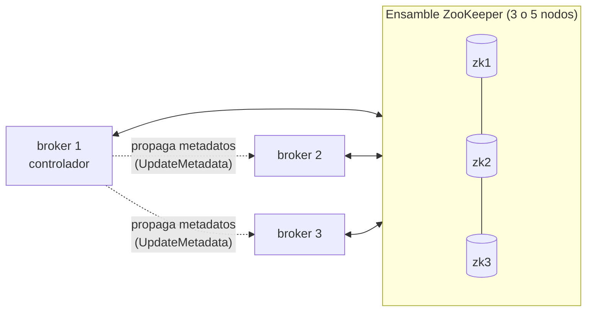
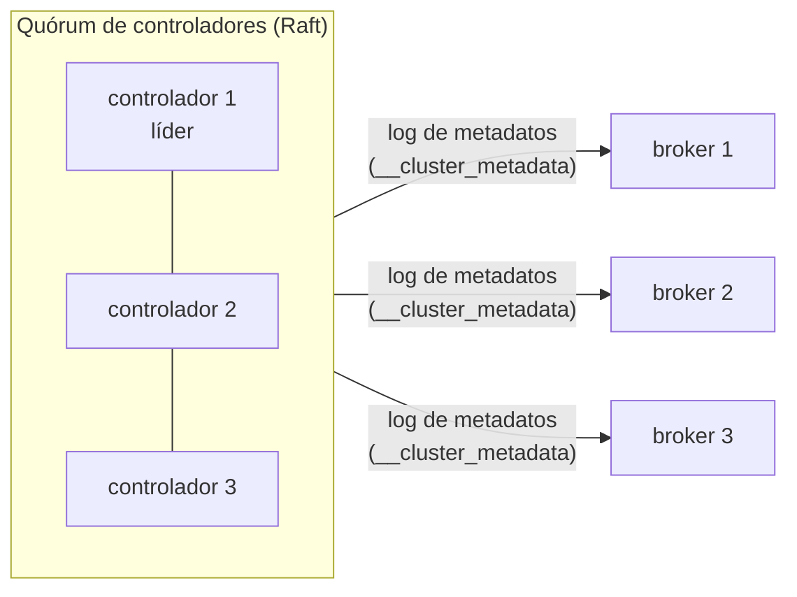

# Kafka: KRaft vs. ZooKeeper

Todos los labs usan Kafka en modo **KRaft** ([`infra/kafka.yaml`](../infra/kafka.yaml)). Esta página explica el modo anterior, **ZooKeeper**, que todavía vas a encontrar en clústeres legados, y deja una versión opcional para probarlo: [`infra/optional/kafka-zookeeper.yaml`](../infra/optional/kafka-zookeeper.yaml).

## El problema que resuelven los dos

Un clúster de Kafka necesita **metadatos** compartidos entre todos los brokers:

- Qué brokers están vivos.
- Qué topics existen, cuántas particiones tienen y su configuración.
- Quién es el **líder** de cada partición y qué réplicas están sincronizadas (ISR).
- Quién es el **controlador**: el broker que toma las decisiones (reasignar líderes cuando uno cae).

La diferencia está en **dónde viven** esos metadatos.

## Modo ZooKeeper (hasta Kafka 3.x)



- Los metadatos viven en **ZooKeeper**, un sistema distribuido **aparte**, con su propio protocolo de consenso (ZAB), sus propios puertos, su configuración y su monitoreo.
- Cada broker se registra como un *znode* efímero en `/brokers/ids/<id>`. Si el broker muere, el znode desaparece.
- Un broker gana la carrera por crear `/controller` y se convierte en el controlador. Lee **todo** el estado desde ZooKeeper y lo propaga al resto.
- Cuando el controlador cae, el nuevo tiene que **recargar todos los metadatos** desde ZooKeeper. Con cientos de miles de particiones, eso tarda minutos.

## Modo KRaft (Kafka 3.3+ en producción; único modo desde Kafka 4.0)



- Los metadatos son un **log de Kafka** más (`__cluster_metadata`), replicado entre un **quórum de controladores** con el protocolo **Raft**.
- Los brokers **consumen** ese log, igual que un consumidor cualquiera, y siempre tienen los metadatos en memoria.
- Un nodo puede ser solo controlador, solo broker o ambos (`KAFKA_PROCESS_ROLES=broker,controller`, como en los labs).
- Si el controlador líder cae, otro del quórum ya tiene el log al día: el cambio es **casi instantáneo**.

## Diferencias que importan

| | ZooKeeper | KRaft |
|---|---|---|
| Sistemas que operar | 2 (Kafka + ZooKeeper) | 1 |
| Dónde viven los metadatos | En ZooKeeper (*znodes*) | En un log de Kafka (`__cluster_metadata`) |
| Consenso | ZAB (ZooKeeper) | Raft (dentro de Kafka) |
| Cambio de controlador | Recarga todo desde ZooKeeper (lento con muchas particiones) | El nuevo líder ya tiene el log (casi instantáneo) |
| Límite práctico de particiones | ~200 000 por clúster | Millones |
| Configuración del broker | `zookeeper.connect`, `broker.id` | `process.roles`, `node.id`, `controller.quorum.voters`, listener `CONTROLLER` |
| Primer arranque | El broker arranca directamente | Hay que **formatear** el almacenamiento con un `cluster.id` (`kafka-storage.sh format`) |
| Seguridad | Hay que asegurar dos sistemas (ACLs de ZooKeeper aparte) | Un solo modelo de seguridad |
| Soporte | Deprecado en 3.x y **eliminado en Kafka 4.0** | El único modo desde 4.0 |

Compara la configuración lado a lado:
- ZooKeeper: [`infra/optional/kafka-zookeeper/server.properties`](../infra/optional/kafka-zookeeper/server.properties).
- KRaft: las variables `KAFKA_*` de [`infra/kafka.yaml`](../infra/kafka.yaml).

## Pruébalo

Cualquier lab con Kafka puede usar la variante ZooKeeper cambiando un `include` en su `compose.yaml`:

```yaml
include:
  - ../../infra/postgres.yaml
  - ../../infra/optional/kafka-zookeeper.yaml   # en vez de ../../infra/kafka.yaml
```

Las aplicaciones **no cambian**: siguen conectándose a `kafka:9092`. La diferencia es solo de operación. Con el lab levantado, mira los metadatos dentro de ZooKeeper:

```bash
docker compose exec zookeeper zkCli.sh ls /brokers/ids      # [1]: el broker registrado
docker compose exec zookeeper zkCli.sh ls /brokers/topics   # los topics viven aquí
docker compose exec zookeeper zkCli.sh get /controller      # {"brokerid":1,...}: quién es el controlador
```

### ⚠️ Por qué este archivo usa Kafka 3.9 y arranca distinto

- **Kafka 4.0 eliminó ZooKeeper.** Para este modo, la última versión posible es la 3.9.
- **El arranque estándar de la imagen `apache/kafka` formatea el almacenamiento para KRaft**, y con ZooKeeper falla con `Formatting is only supported for clusters in KRaft mode`. Por eso el bloque monta un `server.properties` clásico y arranca `kafka-server-start.sh` directamente.

## ¿Migrar un clúster con ZooKeeper?

Kafka 3.x trae un modo de migración: se agrega un quórum KRaft, los controladores copian los metadatos desde ZooKeeper, los brokers pasan a KRaft uno a uno y al final se retira ZooKeeper. Hay que hacerlo **en una versión 3.x** (3.9 es la recomendada) antes de subir a 4.x. Un clúster con ZooKeeper no puede actualizarse directamente a Kafka 4.
