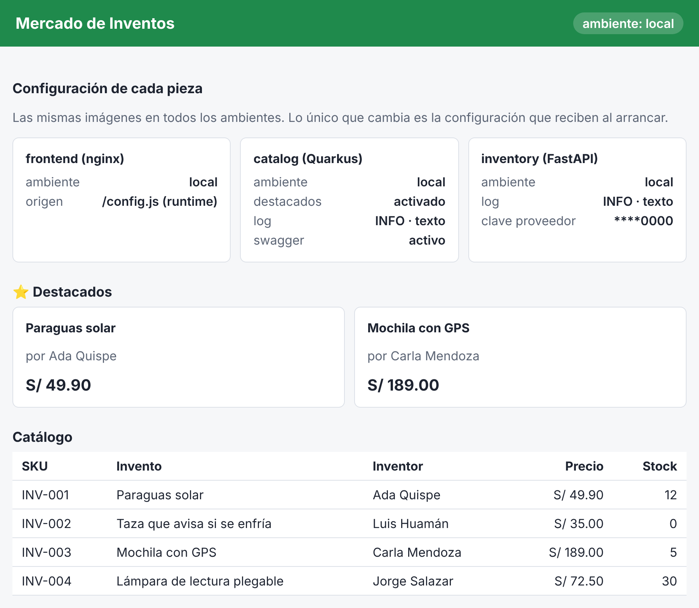
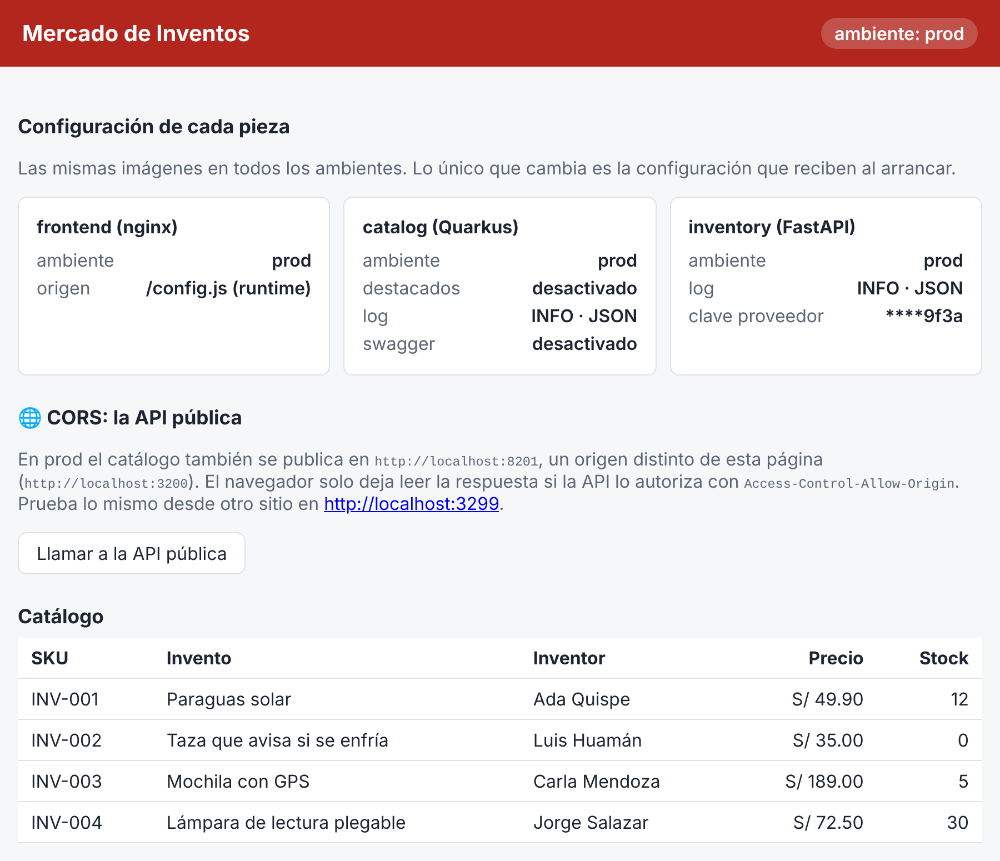
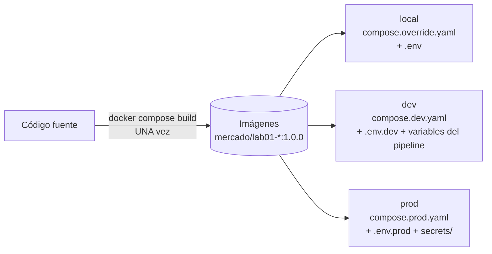
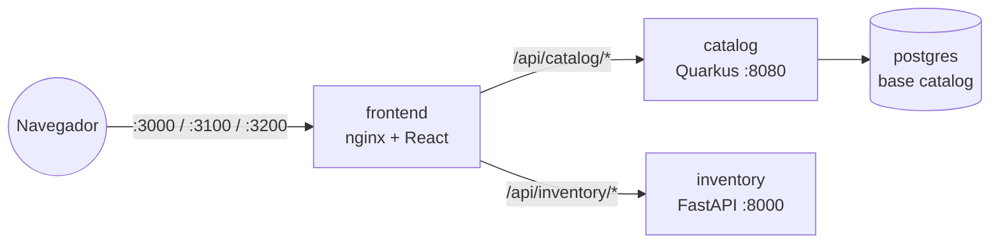
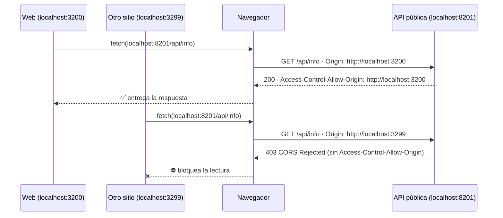
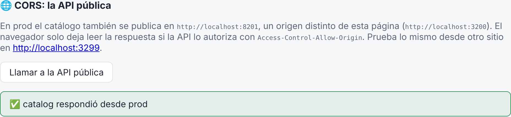
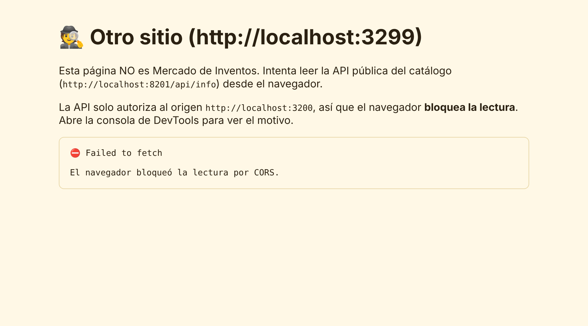

# 01 · Ambientes y configuración externalizada

> La misma imagen, desplegada en local, dev y prod, se comporta distinto **solo** porque recibe otra configuración.

**Patrones:** Externalized Configuration · The Twelve-Factor App (III *Config*, V *Build, release, run*, X *Dev/prod parity*)
**Stack:** Quarkus · FastAPI (uv) · React + TypeScript + nginx · **Infra:** PostgreSQL · **Tiempo estimado:** 1 a 1,5 h · **Requiere:** nada (es el primer lab)

| local | prod |
|---|---|
|  |  |

---

## El problema

Mercado de Inventos tiene tres piezas: el **catálogo** (Quarkus + Postgres), el **inventario** (FastAPI) y la **web** (React). Las tres tienen que correr en tu máquina, en un ambiente de pruebas compartido (dev) y en producción. Entre ambientes cambian varias cosas:

- La contraseña de la base de datos y la API key del proveedor.
- El nivel de detalle de los logs y su formato.
- Si Swagger UI está disponible.
- Un *feature flag*: la sección "Destacados" ya se prueba en dev, pero todavía no se libera en prod.

La pregunta del lab: **¿dónde vive todo eso para que el código no cambie entre ambientes?**

## La versión ingenua

Lo que muchos proyectos hacen al empezar:

```java
// ❌ Valores escritos en el código
private static final String DB_URL = "jdbc:postgresql://prod-db:5432/catalog";
private static final String DB_PASSWORD = "SuperSecreta123";   // ...y ahora está en Git para siempre
private static final boolean FEATURED = !System.getenv("HOSTNAME").contains("prod");
```

```js
// ❌ En el frontend: la URL queda fija DENTRO del bundle al compilar
const API_URL = import.meta.env.VITE_API_URL
```

Qué sale mal:

1. **El secreto queda en el historial de Git.** Aunque lo borres después, sigue en los commits anteriores.
2. **Una imagen distinta por ambiente.** Para pasar a prod hay que recompilar, así que lo que despliegas en prod **no es** lo que probaste en dev.
3. **El código "sabe" en qué ambiente está** (`if prod`) y se llena de ramas que nadie prueba.
4. **Configuración incompleta en silencio:** si falta un valor, la app arranca igual y falla después, en el peor momento.

## El patrón

**Configuración externalizada:** el código lee la configuración del **entorno** donde corre (variables de entorno o archivos montados) y nunca la trae escrita. Se complementa con tres reglas de *The Twelve-Factor App*:

- **Build, release, run:** se construye **una** imagen (*build*), se combina con la configuración de un ambiente (*release*) y se ejecuta (*run*). La imagen es la misma en todos los ambientes.
- **Config:** todo lo que cambia entre ambientes está fuera del código.
- **Dev/prod parity:** las mismas tecnologías en todos lados (Postgres también en local, no H2).



### Las piezas clave

| Qué | Dónde | Por qué así |
|---|---|---|
| Configuración tipada que falla al arrancar si falta algo | [`AppConfig.java`](services/catalog/src/main/java/com/mercadoinventos/catalog/AppConfig.java), [`config.py`](services/inventory/app/config.py) | *Fail fast*: un error claro al iniciar es mejor que un `null` en producción. |
| Propiedades que se leen del entorno | [`application.properties`](services/catalog/src/main/resources/application.properties) | `app.environment=${APP_ENV}` no tiene valor por defecto **a propósito**. |
| Secretos como archivos (convención `*_FILE`) | [`docker-entrypoint.sh`](../../shared/docker/docker-entrypoint.sh) | Es la misma convención de las imágenes oficiales de Postgres: el contenedor ve la ruta y no el secreto. |
| Configuración del frontend en tiempo de ejecución | [`40-runtime-config.sh`](frontend/nginx/40-runtime-config.sh), [`config.ts`](frontend/src/config.ts) | `import.meta.env` se fija al compilar. `/config.js` se genera al **arrancar**, así que la imagen sirve para cualquier ambiente. |
| Un archivo base y un overlay por ambiente | [`compose.yaml`](compose.yaml) + [`override`](compose.override.yaml) / [`dev`](compose.dev.yaml) / [`prod`](compose.prod.yaml) | El base dice qué es igual en todos lados; cada overlay dice qué cambia. |

### Tres formas de entregar un secreto (una por ambiente)

| Ambiente | Cómo llega | Dónde se ve el valor |
|---|---|---|
| local | Variable con un valor falso por defecto en `compose.override.yaml` | En todas partes, y no importa: es falso |
| dev | Variable que pone quien despliega (en la vida real, el pipeline de CI/CD). `${DB_PASSWORD:?…}` hace que Compose **se niegue** a arrancar si falta | En `docker inspect` |
| prod | **Archivo** montado en `/run/secrets/…` (`secrets:` de Compose) | Solo dentro del contenedor |

**¿Por qué tres formas distintas y no una?** Porque cada ambiente tiene un riesgo distinto y alguien distinto que entrega el secreto:

- **Local:** la prioridad es que `docker compose up` funcione sin pasos previos. Los valores son falsos y no abren nada real, así que no hay nada que proteger.
- **Dev:** el secreto lo pone el **pipeline de CI/CD** (GitHub Actions, GitLab CI...), que guarda sus secretos cifrados y los inyecta como variables. `:?` hace que un pipeline mal configurado falle **antes** de arrancar, en lugar de arrancar sin contraseña.
- **Prod:** una variable de entorno se ve en `docker inspect`, en `/proc/<pid>/environ`, la heredan los procesos hijos y suele terminar en logs de errores. Un archivo montado solo lo lee el proceso que lo necesita, y se puede rotar o traer de un gestor de secretos (Vault, AWS Secrets Manager) sin cambiar la app: la convención `*_FILE` es la misma.

En los tres casos **el código es el mismo**: la app lee `DB_PASSWORD` o `DB_PASSWORD_FILE` y no sabe de dónde vino. Los valores reales nunca están en este repo: viven fuera (el pipeline, un gestor de secretos o un repositorio privado de credenciales).

## Arquitectura del lab



El navegador solo habla con nginx. nginx reenvía `/api/catalog/*` y `/api/inventory/*` a cada servicio por la red interna de Compose. Así el navegador nunca conoce los puertos internos y, como todo sale del mismo origen, **no hace falta CORS**. En prod, además, el catálogo se publica como API pública en otro origen, y ahí sí entra CORS (ver [CORS en prod](#cors-en-prod)).

| Ambiente | Proyecto de Compose | Web | catalog | inventory | Postgres |
|---|---|---|---|---|---|
| local | `lab01-ambientes` | http://localhost:3000 | :8101 | :8103 | :5432 |
| dev | `lab01-ambientes-dev` | http://localhost:3100 | :8111 | :8113 | (interno) |
| prod | `lab01-ambientes-prod` | http://localhost:3200 | :8201 (API pública, con CORS) | (interno) | (interno) |

Cada ambiente es un **proyecto de Compose distinto** (`name:` en cada overlay): tiene sus propios contenedores, red y volúmenes. Por eso los tres pueden correr a la vez sin pisarse los datos.

## Levántalo

### 1. Local (construye las imágenes)

```bash
cd labs/01-ambientes
docker compose up --build -d
./smoke.sh
```

Abre http://localhost:3000. Deberías ver la cabecera **verde**, la sección de destacados y los logs en `INFO`.

`cp .env.example .env` es opcional: sin `.env`, Compose usa los mismos valores por defecto.

### 2. Dev (reutiliza las imágenes)

```bash
DB_PASSWORD=dev-pass SUPPLIER_API_KEY=sk-dev-1234 \
  docker compose -f compose.yaml -f compose.dev.yaml --env-file .env.dev up -d
./smoke.sh dev
```

Abre http://localhost:3100: cabecera **ámbar** y logs en JSON y en `DEBUG` (el único ambiente con DEBUG). Los destacados siguen visibles, porque el flag está activo en dev.

### 3. Prod (reutiliza las imágenes, con secretos en archivos)

```bash
cp secrets/db_password.txt.example secrets/db_password.txt
cp secrets/supplier_api_key.txt.example secrets/supplier_api_key.txt
docker compose -f compose.yaml -f compose.prod.yaml --env-file .env.prod up -d
./smoke.sh prod
```

Abre http://localhost:3200: cabecera **roja**, sin destacados, con Swagger desactivado y con la sección **CORS: la API pública**. Abre también http://localhost:3299, el "otro sitio" que intenta leer la misma API.

### Limpiar

```bash
docker compose down -v
docker compose -f compose.yaml -f compose.dev.yaml --env-file .env.dev down -v
docker compose -f compose.yaml -f compose.prod.yaml --env-file .env.prod down -v
```

El comando de dev pide `DB_PASSWORD` incluso para bajar el ambiente. Antepón `DB_PASSWORD=x SUPPLIER_API_KEY=x` y funciona.

## Rómpelo

1. **Las imágenes son las mismas.** Ejecuta `docker compose images` en cada ambiente (con sus `-f`) y compara el *IMAGE ID*: es idéntico. Dev y prod **no compilaron nada**. Tienen `build: !reset null` y `pull_policy: never`. Para comprobarlo, borra una imagen (`docker rmi mercado/lab01-catalog:1.0.0`) e intenta levantar prod: falla porque no existe, en lugar de compilar a escondidas.

2. **Fail fast.** Corre una imagen sin configuración:
   ```bash
   docker run --rm mercado/lab01-catalog:1.0.0
   docker run --rm mercado/lab01-inventory:1.0.0
   ```
   Quarkus responde `Could not expand value APP_ENV in property app.environment`. FastAPI responde `2 validation errors for Settings: app_env, supplier_api_key`. Ninguno arranca "a medias".

3. **El secreto no se ve.** Compara:
   ```bash
   docker inspect lab01-ambientes-inventory-1      --format '{{json .Config.Env}}'
   docker inspect lab01-ambientes-prod-inventory-1 --format '{{json .Config.Env}}'
   ```
   En local aparece `SUPPLIER_API_KEY=sk-local-fake-0000`. En prod solo aparece `SUPPLIER_API_KEY_FILE=/run/secrets/supplier_api_key`.

4. **Falta un secreto en prod.** Baja prod con `down`, borra `secrets/supplier_api_key.txt` y vuelve a levantarlo. El contenedor que necesita ese secreto no arranca y el error dice qué archivo falta (`bind source path does not exist: …/secrets/supplier_api_key.txt`).

   Ojo: si prod ya estaba corriendo, Compose no recrea nada y no te enteras hasta el próximo despliegue. Esto también es una lección: **validar la configuración antes de desplegar** es mejor que descubrir el problema durante el despliegue.

5. **Dev sin variables.** Levanta dev sin `DB_PASSWORD`: verás `required variable DB_PASSWORD is missing a value`. Es el mismo *fail fast*, pero un nivel más arriba, en Compose.

6. **Logs según el ambiente.** Recarga la página en dev y en prod, y compara:
   ```bash
   DB_PASSWORD=dev-pass SUPPLIER_API_KEY=sk-dev-1234 \
     docker compose -f compose.yaml -f compose.dev.yaml --env-file .env.dev logs catalog
   docker compose -f compose.yaml -f compose.prod.yaml --env-file .env.prod logs catalog
   ```
   En dev verás `"level":"DEBUG"`: la línea `Listando 4 inventos`, pero también el SQL de Hibernate y los detalles internos de Vert.x y de uvicorn. En prod (y en local) solo `INFO`. El nivel aplica a **todo**, no solo a nuestro código: por eso DEBUG queda solo en dev, donde los datos no son reales. En prod, DEBUG puede filtrar datos sensibles (consultas con parámetros, headers) a un sistema de logs al que accede más gente.

7. **Cambiar configuración sin recompilar.** Edita `.env.prod` y pon `FEATURED_ENABLED=true`. Luego aplica el cambio:
   ```bash
   docker compose -f compose.yaml -f compose.prod.yaml --env-file .env.prod up -d
   ```
   Compose solo recrea los contenedores cuya configuración cambió. Recarga http://localhost:3200: aparecen los destacados. No hubo build.

8. **Ambientes cruzados.** Edita `compose.dev.yaml` y haz que el frontend de dev apunte al catálogo de **prod**: es un error real y peligroso. La web muestra el aviso "El frontend corre en dev, pero estos servicios reportan otro ambiente". Pista: los dos proyectos tienen redes distintas, así que primero tendrás que conectarlos. Ese esfuerzo extra también es parte de la lección.

9. **CORS a mano.** Con prod levantado, simula lo que hace el navegador:
   ```bash
   curl -si -H 'Origin: http://localhost:3200' localhost:8201/api/info | grep -i access-control
   curl -si -H 'Origin: http://localhost:3299' localhost:8201/api/info | grep -i access-control
   ```
   El primero trae `Access-Control-Allow-Origin`; el segundo responde `403 CORS Rejected - Invalid origin`, sin el header. Ahora agrega `http://localhost:3299` a `CORS_ORIGINS` en `.env.prod` (separado por coma), aplica con `up -d` y recarga http://localhost:3299: el otro sitio ya puede leer. Configuración, sin recompilar.

## ¿Qué cambia en dev y prod?

| Aspecto | local | dev | prod |
|---|---|---|---|
| Imagen | se construye aquí | la de local | la de local |
| `APP_ENV` | `local` | `dev` | `prod` |
| Logs | `INFO`, texto | **`DEBUG`**, JSON | `INFO`, JSON |
| Destacados | activado | activado | **desactivado** |
| Swagger UI | activo | activo | **desactivado** |
| Secretos | valores falsos por defecto | variables obligatorias (`:?`) | archivos en `/run/secrets` |
| Puertos expuestos | todos | web y servicios | **la web y la API pública del catálogo** |
| CORS | no aplica (un solo origen) | no aplica (un solo origen) | **solo el origen de la web** |
| Recursos | sin límite | sin límite | 1 CPU, 512 MB, `restart: unless-stopped` |

### CORS en prod

En local y dev, el navegador habla con **un solo origen**: nginx reenvía `/api/*` a los servicios. Sin llamadas entre orígenes, CORS no aplica.

En prod el catálogo **también** se publica como API pública en `http://localhost:8201`, como haría `api.mercado.com` frente a `www.mercado.com`. Cuando la web (`http://localhost:3200`) llama a esa API, el navegador hace una pregunta antes de entregarle la respuesta: *¿esta API permite que `http://localhost:3200` la lea?*



La configuración está en [`compose.prod.yaml`](compose.prod.yaml) y [`.env.prod`](.env.prod):

```yaml
QUARKUS_HTTP_CORS_ENABLED: "true"
QUARKUS_HTTP_CORS_ORIGINS: ${CORS_ORIGINS}   # http://localhost:3200: una lista explícita, nunca "*"
```

| Captura | Qué muestra |
|---|---|
|  | Desde `localhost:3200`, el botón "Llamar a la API pública" funciona. |
|  | Desde `localhost:3299`, el navegador bloquea la lectura. En DevTools: *No 'Access-Control-Allow-Origin' header is present on the requested resource*. |

Tres cosas que suelen confundirse:

- **CORS no protege la API.** Con `curl` (sin navegador) cualquiera la lee: `curl localhost:8201/api/info`. CORS protege a los **usuarios**: evita que un sitio malicioso abierto en su navegador lea datos de otra API usando su sesión. La autenticación (lab 07) es lo que protege la API.
- **La petición sí llega al servidor.** Para un `GET` simple, el navegador la envía. Muchos servidores la procesan y solo omiten el header, y es el navegador el que **bloquea la lectura**. Quarkus es más estricto: responde `403 CORS Rejected - Invalid origin` sin ejecutarla. Para métodos con efectos (`POST` con JSON, `PUT`, `DELETE`), el navegador primero hace un *preflight* (`OPTIONS`); si la API no autoriza el origen, la petición real ni se envía.
- **Nunca `*` con credenciales.** `Access-Control-Allow-Origin: *` deja leer a cualquier sitio; con cookies o tokens, el navegador ni siquiera lo acepta. Una lista explícita por ambiente es la forma correcta, y por eso es **configuración** y no código.

### Perfiles de Quarkus ≠ ambientes

Quarkus tiene tres *perfiles* integrados: `dev`, `test` y `prod`. Describen **cómo** se ejecuta la app, no **dónde**:

- `%dev` se activa con `./mvnw quarkus:dev`: recarga en caliente, y **Dev Services** levanta un Postgres temporal sin que configures nada.
- `%test` se activa con `./mvnw verify`.
- `prod` es el perfil de un `java -jar`, que es como corre **dentro del contenedor en los tres ambientes**.

Por eso, en este lab, el ambiente (`local`, `dev`, `prod`) se decide con **variables de entorno**, no con perfiles. Si usaras `QUARKUS_PROFILE=dev` para "el ambiente dev", mezclarías las propiedades pensadas para tu máquina (`%dev.*`) con las de un servidor compartido.

### Modo desarrollo (fuera de Docker)

```bash
cd services/catalog && ./mvnw quarkus:dev             # Dev Services crea el Postgres; app.environment = local-host
```

```bash
cd services/inventory && uv sync
APP_ENV=local-host SUPPLIER_API_KEY=sk-fake uv run uvicorn app.main:create_app --factory --reload --port 8103
```

```bash
cd frontend && npm install && npm run dev            # http://localhost:5173, proxy a :8101 y :8103
```

## Costo y cuándo NO usarlo

Este patrón casi siempre conviene. Sus costos están en los detalles:

- **Más archivos:** un base y tres overlays. Para un script personal que solo corre en tu máquina, un `.env` alcanza.
- **La configuración también se depura:** cuando algo falla, hay que mirar qué valor recibió el contenedor (`docker compose config` es tu amigo).
- **Archivos de secretos en disco:** en una plataforma real, los secretos vienen de un gestor (Vault, AWS Secrets Manager, Kubernetes Secrets). `secrets:` de Compose es la versión más simple de la misma idea.

## Ejercicio

Agrega una variable `SUPPORT_EMAIL` que el frontend muestre en el pie de página:

- En local vale `soporte-local@mercado.test`; en dev y prod, la que tú decidas.
- **No** se puede reconstruir la imagen del frontend para cambiarla entre ambientes.

<details><summary>Pista</summary>

Agrégala a `40-runtime-config.sh` (como `appTitle`), a `loadConfig` con un valor por defecto y a cada overlay o `.env.*`. Escribe primero el test en `config.test.ts`.
</details>

## Para profundizar

- [The Twelve-Factor App](https://12factor.net/es/): factores III, V y X.
- [Configuración en Quarkus](https://quarkus.io/guides/config-reference): fuentes, perfiles, `@ConfigMapping`.
- [pydantic-settings](https://docs.pydantic.dev/latest/concepts/pydantic_settings/).
- [Compose: múltiples archivos y `!reset`](https://docs.docker.com/compose/how-tos/multiple-compose-files/merge/) y [secretos en Compose](https://docs.docker.com/compose/how-tos/use-secrets/).
- [`docs/ambientes.md`](../../docs/ambientes.md): la estrategia de ambientes de toda la guía.
