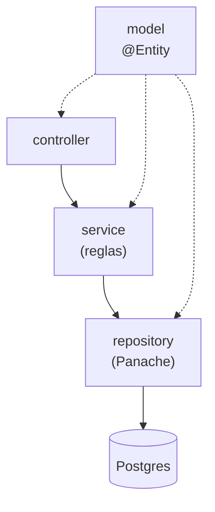
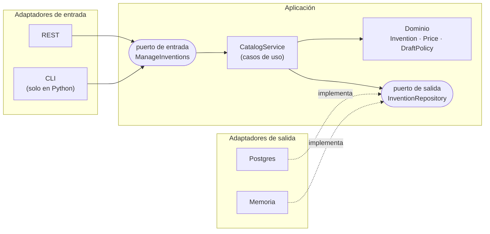
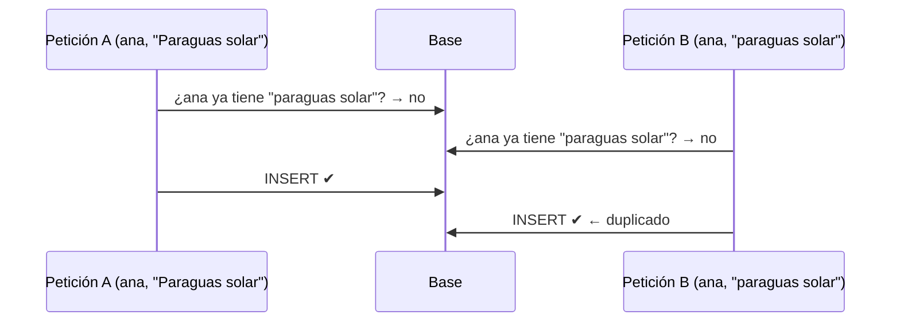

# 02 · Capas vs. Hexagonal vs. Clean

> Dónde ponen las reglas de negocio las distintas arquitecturas, y qué ganas o pierdes con cada opción. Aquí el **mismo servicio** está implementado tres veces y las tres versiones corren lado a lado.

**Patrones:** Layered Architecture · Hexagonal (Ports & Adapters) · Clean Architecture / Onion
**Stack:** Quarkus (capas y hexagonal) · FastAPI (hexagonal) · **Infra:** PostgreSQL · **Tiempo estimado:** 1,5 a 2 h · **Requiere:** lab 01

---

## El problema

El catálogo permite **publicar un invento**, con cuatro reglas:

| Regla | Código de error | HTTP |
|---|---|---|
| El precio es mayor que 0 | `PRICE_MUST_BE_POSITIVE` | 422 |
| El nombre es único por inventor (sin distinguir mayúsculas ni espacios) | `NAME_ALREADY_USED` | 409 |
| Un inventor tiene como máximo 3 borradores | `TOO_MANY_DRAFTS` | 409 |
| No se publica sin imagen | `IMAGE_REQUIRED` | 422 |

Escribir estas reglas es fácil. Lo difícil viene después:

- **Probarlas.** Si para comprobar "precio mayor que 0" hay que arrancar el framework y una base de datos, los tests son lentos y la gente escribe menos.
- **Cambiar la tecnología.** Pasar de Postgres a otra base, o agregar una entrada nueva (un CLI, un consumidor de Kafka), obliga a tocar el código que tiene las reglas.
- **Leerlas.** Si las reglas están mezcladas con anotaciones de JPA, códigos HTTP y transacciones, cuesta encontrar dónde vive el negocio.

## Las tres versiones

Las tres cumplen **el mismo contrato HTTP**: el mismo JSON, los mismos códigos de error y los mismos estados. El test de la API es idéntico en las tres, y [`smoke.sh`](smoke.sh) lo ejecuta contra todas.

| Servicio | Arquitectura | Stack | Puerto |
|---|---|---|---|
| [`catalog-layered`](services/catalog-layered) | Capas | Quarkus + Panache | 8101 |
| [`catalog-hexagonal`](services/catalog-hexagonal) | Hexagonal | Quarkus + JPA | 8111 |
| [`catalog-hexagonal-py`](services/catalog-hexagonal-py) | Hexagonal | FastAPI + SQLAlchemy | 8112 |

⚠️ 8111 y 8112 son puertos propios de este lab: la convención general reserva 8101 para `catalog` y aquí hay tres.

Las tres usan la base `catalog` de Postgres, cada una en su propio esquema (`layered`, `hexagonal` y `hexagonal_py`). Son tres versiones del mismo servicio, así que no hace falta una base para cada una.

### 1. Capas (la versión "de siempre")

```
controller/  InventionController   ← HTTP: recibe, llama al servicio, devuelve la ENTIDAD como JSON
service/     InventionService      ← TODAS las reglas, con @Transactional
repository/  InventionRepository   ← Panache (clase concreta)
model/       Invention             ← entidad JPA = objeto de negocio = JSON de respuesta
```



Las dependencias van **de arriba hacia abajo**, hasta la base de datos. Funciona y es fácil de entender. Para un CRUD, es la opción correcta.

El problema está en lo que **no se puede hacer sin tocar** [`InventionService`](services/catalog-layered/src/main/java/com/mercadoinventos/catalog/service/InventionService.java):

- **Probar una regla sin Quarkus ni Postgres.** El servicio usa Panache y `@Transactional`. Mira [`InventionServiceTest`](services/catalog-layered/src/test/java/com/mercadoinventos/catalog/InventionServiceTest.java): para probar el precio arranca todo.
- **Cambiar Postgres por otra cosa.** El servicio depende de la clase concreta `InventionRepository`.
- **Reutilizar las reglas desde otra entrada.** El servicio lanza `NotFoundException` de JAX-RS y decide los códigos HTTP (`BusinessException(..., 409, ...)`). Un CLI o un consumidor de Kafka heredarían conceptos de HTTP.

### 2. Hexagonal (Ports & Adapters)

La idea de Alistair Cockburn: la aplicación está en el centro y el mundo exterior se conecta por **puertos**, que son interfaces definidas por la aplicación. Los **adaptadores** implementan esos puertos para una tecnología concreta.

```
domain/                         ← Java puro: Invention, Price, DraftPolicy, Rule
application/
  port/in/ManageInventions      ← puerto de ENTRADA: lo que la aplicación ofrece
  port/out/InventionRepository  ← puerto de SALIDA: lo que la aplicación necesita
  CatalogService                ← casos de uso (sin anotaciones de Quarkus)
adapter/
  in/rest/                      ← REST: traduce HTTP ⇄ casos de uso y errores ⇄ códigos HTTP
  out/postgres/                 ← JPA: traduce dominio ⇄ tabla
  out/memory/                   ← un Map en memoria
config/ApplicationConfig        ← raíz de composición: decide qué adaptador se enchufa
```



Lo importante es la **dirección de las dependencias**. El adaptador de Postgres depende del puerto, no al revés. Por eso el dominio y la aplicación no importan nada de JPA, Quarkus ni HTTP. Compruébalo:

```bash
grep -rn "import jakarta\|import io.quarkus" services/catalog-hexagonal/src/main/java/com/mercadoinventos/catalog/{domain,application}
# (nada)
```

Las piezas clave:

- [`Price`](services/catalog-hexagonal/src/main/java/com/mercadoinventos/catalog/domain/Price.java) es un **value object**: un precio inválido no puede existir. La regla no depende de que alguien se acuerde de poner `@Positive`.
- [`DraftPolicy`](services/catalog-hexagonal/src/main/java/com/mercadoinventos/catalog/domain/DraftPolicy.java) tiene las reglas que necesitan ver **otros** inventos (nombre único, máximo 3 borradores). Recibe la lista como parámetro y no sabe de dónde salió.
- [`ApplicationConfig`](services/catalog-hexagonal/src/main/java/com/mercadoinventos/catalog/config/ApplicationConfig.java) es el **único** archivo que conoce a la vez puertos y adaptadores. Lee `CATALOG_PERSISTENCE` y enchufa Postgres o memoria.
- [`ErrorMappers`](services/catalog-hexagonal/src/main/java/com/mercadoinventos/catalog/adapter/in/rest/ErrorMappers.java): el dominio lanza `BusinessRuleViolation(Rule.TOO_MANY_DRAFTS)` y es el **adaptador REST** el que decide que eso es un `409`.

### 3. Hexagonal en Python

[`catalog-hexagonal-py`](services/catalog-hexagonal-py) es la misma arquitectura en FastAPI, para comprobar que el patrón no depende del lenguaje:

```
app/domain/        invention.py (Invention, Price, Rule), draft_policy.py      ← Python puro
app/application/   ports.py (Protocol), catalog_service.py                      ← casos de uso
app/adapters/      rest.py · sqlalchemy_repository.py · memory_repository.py · cli.py
app/main.py        raíz de composición
```

Dos diferencias con Java:

- El puerto de salida es un [`Protocol`](services/catalog-hexagonal-py/app/application/ports.py) (*duck typing* con tipos): un adaptador lo cumple si tiene los métodos, sin heredar de nada.
- Tiene un **segundo adaptador de entrada**, [`cli.py`](services/catalog-hexagonal-py/app/adapters/cli.py). Para agregarlo se escribió **un archivo**, sin tocar ni el dominio ni la aplicación.

## Clean, Hexagonal, Onion: ¿son lo mismo?

Casi. Las tres comparten **la regla de dependencia**: el código de negocio está en el centro y **todas las dependencias apuntan hacia adentro**. Lo de afuera (frameworks, base de datos, HTTP) es un detalle que se puede cambiar.

| | Hexagonal (Cockburn, 2005) | Onion (Palermo, 2008) | Clean (Martin, 2012) |
|---|---|---|---|
| Metáfora | Un hexágono con puertos en los bordes | Capas concéntricas, como una cebolla | Círculos concéntricos |
| Centro | La aplicación | *Domain model* | *Entities* |
| Capa de casos de uso | No la nombra | *Application services* | *Use cases* (*interactors*) |
| Bordes | Puertos y adaptadores, con lado de entrada (*driving*) y de salida (*driven*) | *Infrastructure*, UI y tests en la capa externa | *Interface adapters* y luego *Frameworks & drivers* |
| Énfasis | Simetría: la UI, los tests y la BD se conectan igual | El dominio no depende de la infraestructura | Reglas estrictas por capa y *boundaries* explícitos |

En este lab, la versión "hexagonal" usa vocabulario de las tres:

| Concepto | Hexagonal | Clean | Onion | En el código |
|---|---|---|---|---|
| Reglas del negocio | Aplicación | Entities | Domain model | `domain/` |
| Casos de uso | Aplicación | Use cases | Application services | `application/CatalogService` |
| Lo que la aplicación ofrece | Puerto de entrada | Input boundary | — | `port/in/ManageInventions` |
| Lo que la aplicación necesita | Puerto de salida | Output boundary / Gateway | Repository interface | `port/out/InventionRepository` |
| Traductores HTTP y BD | Adaptadores | Interface adapters | Infrastructure | `adapter/` |
| Quarkus, JPA, FastAPI | Fuera del hexágono | Frameworks & drivers | Infrastructure | `pom.xml`, anotaciones |

**Lo que importa** no es el nombre ni la cantidad de carpetas, sino la regla de dependencia. Un proyecto con carpetas `domain/` y `infrastructure/` en el que el dominio importa `jakarta.persistence` **no** es hexagonal.

## Levántalo

```bash
cd labs/02-capas-hexagonal-clean
docker compose up --build -d
./smoke.sh
```

[`requests.http`](requests.http) tiene las peticiones del flujo completo. Cambia `@base` para apuntar a cada versión. Swagger UI: http://localhost:8101/q/swagger-ui, http://localhost:8111/q/swagger-ui y http://localhost:8112/docs.

Para limpiar: `docker compose down -v`.

## Rómpelo

1. **El mismo contrato, tres arquitecturas.** Ejecuta [`requests.http`](requests.http) contra 8101, 8111 y 8112. Las respuestas son iguales, incluidos los errores. Desde afuera, la arquitectura no se ve.

2. **Cambia de base de datos sin tocar el dominio.**
   ```bash
   CATALOG_PERSISTENCE=memory docker compose up -d catalog-hexagonal catalog-hexagonal-py
   curl -s localhost:8111/api/info     # {"persistence":"memory", ...}
   ```
   Crea un invento, reinicia el contenedor y verás que desapareció: estaba en memoria. Vuelve a Postgres con `docker compose up -d`. En la versión en capas esto **no se puede** hacer sin modificar el servicio.

   ⚠️ En memoria, la versión Quarkus no lee ni escribe en Postgres, pero igual se conecta al arrancar: Flyway y Hibernate son extensiones del framework y se inicializan siempre. La versión Python no toca la base. Ver el ejercicio.

3. **Un adaptador de entrada nuevo.** El CLI usa los mismos casos de uso que REST:
   ```bash
   docker compose exec catalog-hexagonal-py python -m app.adapters.cli create --inventor ana --name "Lámpara" --price 10
   docker compose exec catalog-hexagonal-py python -m app.adapters.cli list --inventor ana
   curl -s 'localhost:8112/api/inventions?inventorId=ana'
   ```
   Lo que se crea por el CLI se ve por REST y al revés. Prueba también `create` con `--price 0`: el CLI muestra `PRICE_MUST_BE_POSITIVE`, porque la regla está en el dominio y no en el adaptador.

4. **Compara la velocidad de los tests.**
   ```bash
   cd services/catalog-hexagonal && ./mvnw test        # mira el "Time elapsed" de cada clase
   cd ../catalog-layered && ./mvnw test
   cd ../catalog-hexagonal-py && uv run pytest --durations=0
   ```
   Tiempos medidos al escribir el lab:

   | Test | Qué arranca | Tiempo |
   |---|---|---|
   | `InventionTest`, `DraftPolicyTest` (hexagonal) | Nada: JUnit puro | ~0,01 s |
   | `CatalogServiceTest` (hexagonal) | Nada: adaptador en memoria | ~0,08 s |
   | `InventionApiTest` (cualquiera) | Quarkus + Postgres (Dev Services) | ~7,5 s |
   | `InventionServiceTest` (capas) | Quarkus + Postgres, **para probar un `if`** | arranca todo |

   Con 20 reglas, la diferencia entre milisegundos y segundos decide si el equipo escribe tests o no.

5. **Busca las fugas.** En la versión en capas, busca dónde aparece HTTP fuera del controller (`grep -rn "409\|NotFoundException" services/catalog-layered/src/main`). En la hexagonal, haz la misma búsqueda en `domain/` y `application/`.

## ¿Qué cambia en dev y prod?

Este lab no trae overlays de ambiente. La lección de ambientes es otra: **el adaptador es configuración** (factor III de Twelve-Factor, lab 01).

- **Local:** el adaptador en memoria permite desarrollar y probar la UI sin levantar Postgres.
- **Dev y prod:** siempre `CATALOG_PERSISTENCE=postgres`. En prod, un valor desconocido hace **fallar el arranque** (`ApplicationConfig` lanza una excepción). Es mejor que arrancar con el adaptador equivocado.
- **Tests:** el adaptador en memoria **no reemplaza** a los tests contra Postgres. Una consulta mal escrita solo falla contra la base real. Por eso cada versión tiene los dos tipos de test.

## Costo y cuándo NO usarlo

- **Más archivos y más indirección.** Para una regla, la versión hexagonal tiene interfaz de puerto, implementación, entidad JPA, mapeo y raíz de composición. En capas, una clase.
- **Mapeo duplicado.** `Invention` (dominio) e `InventionEntity` (JPA) son casi iguales. Ese mapeo es el precio de que el dominio no dependa de la base.
- **⚠️ Una simplificación de este lab:** la regla "nombre único" se comprueba leyendo y luego escribiendo, en las tres versiones. Con dos peticiones simultáneas, las dos pueden pasar. La arquitectura no elimina los problemas de concurrencia. Ver "Cómo se arregla el nombre único", abajo.

### Cómo se arregla el nombre único

El ⚠️ marca algo que funciona en la demo pero **no** debe copiarse así a producción. El problema:



Leer antes de escribir deja una ventana entre las dos operaciones. La solución es que la **base** garantice la regla, porque es la única que ve las dos escrituras:

1. **Un índice único** en una migración nueva (por inventor, y sin mayúsculas ni espacios de más, igual que la comprobación de hoy):
   ```sql
   CREATE UNIQUE INDEX inventions_name_per_inventor ON inventions (inventor_id, lower(trim(name)));
   ```
2. **Traducir el error en el adaptador de persistencia.** Postgres responde `23505` (*unique_violation*). El adaptador lo convierte en el mismo error de negocio que ya existe (`409 NAME_ALREADY_USED`). El dominio no sabe de SQLState: esa traducción es justo el trabajo del adaptador.
3. **La lectura previa puede quedarse**, como cortesía: da un error claro en el caso normal sin pasar por la excepción. Pero ya no es la que garantiza la regla.
4. **Un test que lo pruebe:** dos inserciones simultáneas del mismo nombre, y exactamente una tiene que fallar con `409`.

En la versión hexagonal, el cambio queda dentro del adaptador y de la migración: el puerto, el caso de uso y los tests de dominio no se tocan. Es otra forma de ver para qué sirve la arquitectura.
- **Cuándo no:** en un CRUD sin reglas (un formulario que guarda y lista), las capas bastan y la hexagonal es burocracia. Hexagonal empieza a pagar cuando hay **reglas que valen la pena probar solas** o **más de una forma de entrar o salir**.

## Ejercicio

Haz que la versión hexagonal en Quarkus arranque **sin Postgres** cuando `CATALOG_PERSISTENCE=memory`.

Pista: Quarkus permite desactivar extensiones al arrancar (`quarkus.datasource.active`, `quarkus.hibernate-orm.active`, `quarkus.flyway.active`). Pero si las desactivas sin más, el arranque falla: `PostgresInventionRepository` inyecta un `EntityManager` que ya no está activo. ¿Cómo lo cambias para que lo pida solo si se usa (`Instance<EntityManager>`)? ¿Qué te dice esto sobre lo "invisible" que es realmente el framework?

## Para profundizar

- Alistair Cockburn, [*Hexagonal Architecture*](https://alistair.cockburn.us/hexagonal-architecture/) (2005).
- Jeffrey Palermo, [*The Onion Architecture*](https://jeffreypalermo.com/2008/07/the-onion-architecture-part-1/) (2008).
- Robert C. Martin, [*The Clean Architecture*](https://blog.cleancoder.com/uncle-bob/2012/08/13/the-clean-architecture.html) (2012).
- Tom Hombergs, *Get Your Hands Dirty on Clean Architecture* (2.ª ed., 2023): hexagonal en Java, con los atajos que vale la pena tomar.
- Siguiente: el [lab 03](../03-ddd/) se mete **dentro** del dominio con agregados, value objects y eventos de dominio.
