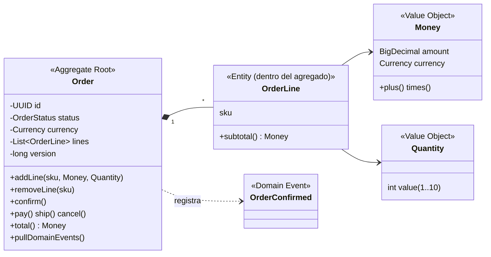
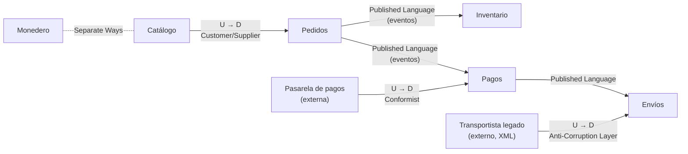

# 03 · Domain-Driven Design: táctico y estratégico

> Un modelo en el que las reglas del negocio **no se pueden romper**, porque el único camino para cambiar los datos pasa por ellas. Y un mapa para decidir dónde termina un modelo y empieza otro.

**Patrones:** Aggregate · Entity · Value Object · Domain Event · Repository · Bounded Context · Context Map
**Stack:** Quarkus · **Infra:** PostgreSQL · **Tiempo estimado:** 1,5 a 2 h · **Requiere:** lab 02

---

## El problema

Un pedido tiene reglas que **siempre** deben cumplirse (*invariantes*):

1. El total es la suma de las líneas.
2. Las líneas solo se editan mientras el pedido es un borrador.
3. Máximo 10 unidades por invento.
4. Todas las líneas en la moneda del pedido.
5. El estado sigue su ciclo de vida: `DRAFT → CONFIRMED → PAID → SHIPPED`, y se puede cancelar antes de pagar.

En un **modelo anémico** (una clase con getters y setters), estas reglas no tienen dueño. Viven repartidas en servicios y controladores: un endpoint recalcula el total y otro se olvida, uno valida la cantidad y otro no. Cada nuevo endpoint es una nueva oportunidad de romper una regla.

## La versión ingenua

[`AnemicOrder`](services/orders/src/main/java/com/mercadoinventos/orders/anemic/AnemicOrder.java) y [`AnemicOrderResource`](services/orders/src/main/java/com/mercadoinventos/orders/anemic/AnemicOrderResource.java), en `/api/anemic/orders`:

- `total` es un campo `double` con `setTotal()`. El endpoint de creación lo calcula y el de agregar línea se olvida.
- `status` es un `String` con `setStatus()`: acepta `"banana"`.
- `quantity` es un `int` sin límite.
- El dinero es `double`: `0.1 + 0.2 = 0.30000000000000004`.

Nada de esto es un bug "difícil". Es lo que pasa cuando cualquier código puede modificar cualquier campo.

## El patrón: DDD táctico

El paquete [`ddd/domain`](services/orders/src/main/java/com/mercadoinventos/orders/ddd/domain) tiene las piezas del modelo:



| Pieza | Qué es | En este lab |
|---|---|---|
| **Value Object** | Un valor sin identidad, inmutable, comparado por su contenido. Se valida al crearse, así que **un valor inválido no puede existir**. | [`Money`](services/orders/src/main/java/com/mercadoinventos/orders/ddd/domain/Money.java) (monto + moneda, `BigDecimal`, no se mezclan monedas) y [`Quantity`](services/orders/src/main/java/com/mercadoinventos/orders/ddd/domain/Quantity.java) (1 a 10) |
| **Entity** | Tiene identidad propia: dos líneas con el mismo precio y cantidad siguen siendo líneas distintas. | [`OrderLine`](services/orders/src/main/java/com/mercadoinventos/orders/ddd/domain/OrderLine.java), identificada por su SKU dentro del pedido |
| **Aggregate** | Un grupo de objetos que cambia junto y protege sus invariantes. Se accede **solo por la raíz**. | [`Order`](services/orders/src/main/java/com/mercadoinventos/orders/ddd/domain/Order.java): no hay forma de tocar una línea sin pasar por él |
| **Domain Event** | Algo que pasó, en pasado, que a otros les puede interesar. | [`OrderConfirmed`](services/orders/src/main/java/com/mercadoinventos/orders/ddd/domain/OrderConfirmed.java) |
| **Repository** | Guarda y carga **agregados completos**. Uno por agregado, no uno por tabla. | [`OrderRepository`](services/orders/src/main/java/com/mercadoinventos/orders/ddd/application/OrderRepository.java): no existe un `OrderLineRepository` |

Cómo protege cada invariante el agregado:

| Invariante | Cómo se garantiza |
|---|---|
| Total = suma de líneas | `total()` **se calcula**; no existe un campo ni un setter. La tabla `orders` ni siquiera tiene la columna. |
| Solo se edita en borrador | `addLine()` y `removeLine()` empiezan con `ensureEditable()`. |
| Máximo 10 por invento | `Quantity` no se puede construir con más de 10. Si sumas 8 + 3 del mismo invento, `Quantity.plus()` falla **antes** de modificar nada. |
| Una sola moneda | `Money.plus()` y `addLine()` comparan monedas. |
| Ciclo de vida | Métodos con nombre de negocio (`confirm`, `pay`, `ship`, `cancel`), cada uno con su transición permitida. No hay `setStatus()`. |

El **servicio de aplicación** ([`OrderService`](services/orders/src/main/java/com/mercadoinventos/orders/ddd/application/OrderService.java)) queda delgado: carga el agregado, le pide que haga algo, lo guarda y publica sus eventos. No tiene reglas.

### Eventos de dominio

`confirm()` **registra** el evento `OrderConfirmed` dentro del agregado. El dominio no sabe quién escucha ni cómo se publica. El servicio de aplicación lo saca con `pullDomainEvents()` y lo dispara como evento CDI. [`OrderConfirmedListener`](services/orders/src/main/java/com/mercadoinventos/orders/ddd/application/OrderConfirmedListener.java) reacciona con `@Observes(during = AFTER_SUCCESS)`: **solo si la transacción hizo commit**. Si falla el guardado, el correo no sale.

Estos eventos viven **dentro del proceso**. Para avisar a otros servicios hace falta un broker (lab 06) y, para no perder eventos, un outbox (lab 15).

### Un agregado = una transacción = una unidad de concurrencia

`Order` tiene un campo `@Version`. Si dos peticiones modifican el mismo pedido a la vez, la segunda en guardar recibe `409 CONCURRENT_MODIFICATION` en lugar de pisar a la primera. Como el agregado es la frontera de consistencia, también es la frontera del bloqueo: dos pedidos distintos nunca se bloquean entre sí.

## El patrón: DDD estratégico

El diseño táctico responde **cómo** modelar. El estratégico responde **cuántos modelos** hay y dónde están sus fronteras.

### "Invento" significa cosas distintas

| Contexto | Qué es un invento para este contexto | Lo que **no** le importa |
|---|---|---|
| **Catálogo** | Nombre, descripción, precio de lista, imágenes, inventor, estado de publicación | Stock, peso |
| **Inventario** | SKU, unidades disponibles, reservas, ubicación en el almacén | Descripción, precio |
| **Pedidos** | SKU, precio **al momento de la compra**, cantidad | Imágenes, stock |
| **Envíos** | Peso, dimensiones, si es frágil | Precio, descripción |

Forzar un único `Invention` con todos esos campos para todos crea una clase enorme que cambia por motivos de cuatro equipos distintos. Cada **Bounded Context** tiene **su propio modelo**, con su propio lenguaje (*Ubiquitous Language*) y su propia base de datos (lab 05).

Fíjate en `OrderLine`: guarda el **precio unitario del momento de la compra**. Si mañana el catálogo cambia el precio, los pedidos anteriores no cambian. Es otro concepto, aunque se llame igual.

### El mapa de contextos de Mercado de Inventos



| Relación | Qué significa | Dónde aparece |
|---|---|---|
| **Customer/Supplier** | El de arriba (*upstream*, U) provee y el de abajo (*downstream*, D) consume. El downstream puede pedir cambios y negociar. | Catálogo → Pedidos (precios) |
| **Published Language** | Un contrato público y versionado (eventos, esquemas) que todos entienden, independiente del modelo interno de cada uno. | Los eventos de Kafka (labs 06, 16 y 17) |
| **Conformist** | El downstream acepta el modelo del upstream tal cual, porque no puede influir en él. | Pagos frente a la pasarela externa (lab 11) |
| **Anti-Corruption Layer** | El downstream traduce el modelo ajeno al suyo en una capa aislada, para que no lo contamine. | Envíos frente al transportista legado (lab 19) |
| **Separate Ways** | Dos contextos que no se integran: más barato que integrarlos. | Monedero y Catálogo |
| **Shared Kernel** | Dos contextos comparten una parte del modelo y la cambian de común acuerdo. | No se usa aquí. Es caro de coordinar, así que úsalo con cuidado. |
| **Open Host Service** | Un contexto ofrece una API pensada para muchos consumidores. | El API Gateway (lab 07) |

## Arquitectura del lab

Un solo servicio Quarkus (`orders`, puerto 8102) con los dos modelos lado a lado y una base `orders`:

| Ruta | Modelo | Tablas |
|---|---|---|
| `/api/anemic/orders` | ❌ Anémico | `anemic_orders`, `anemic_order_lines` |
| `/api/orders` | ✅ Agregado | `orders`, `order_lines` |
| `/api/events` | Los últimos eventos de dominio publicados | (en memoria) |

## Levántalo

```bash
cd labs/03-ddd
docker compose up --build -d
./smoke.sh
```

[`requests.http`](requests.http) tiene las peticiones de los dos modelos. Swagger UI: http://localhost:8102/q/swagger-ui. Para limpiar: `docker compose down -v`.

## Rómpelo

1. **Viola cada invariante en los dos modelos.** Con [`requests.http`](requests.http): el anémico acepta un total equivocado, 50 unidades y el estado `"banana"`. El agregado responde con `422` o `409` y un código que dice qué regla rompiste.

2. **Manda el total desde el cliente.** Agrega `"total": 1` al cuerpo de `POST /api/orders/{id}/lines`. Se ignora: el agregado no tiene dónde ponerlo.

3. **Escrituras simultáneas.** Lanza 6 líneas a la vez sobre el mismo pedido, primero contra el anémico:
   ```bash
   A=$(curl -s -X POST localhost:8102/api/anemic/orders -H 'Content-Type: application/json' \
         -d '{"customerId":"x","lines":[]}' | grep -o '"id":"[^"]*"' | cut -d'"' -f4)
   for i in 1 2 3 4 5 6; do
     curl -s -o /dev/null -w "%{http_code} " -X POST localhost:8102/api/anemic/orders/$A/lines \
       -H 'Content-Type: application/json' -d "{\"sku\":\"S$i\",\"unitPrice\":1,\"quantity\":1}" &
   done; wait; echo
   curl -s localhost:8102/api/anemic/orders/$A | grep -o '"sku"' | wc -l
   ```
   Las 6 respuestas son `200`, pero el pedido termina con un número **cualquiera** de líneas. Al escribir el lab salieron 11, 5 y 9 en tres intentos: líneas duplicadas o perdidas, sin ningún error. Hibernate reescribe la colección completa en cada transacción y las transacciones se pisan.

   Repite contra `/api/orders`. Algunas peticiones reciben `409 CONCURRENT_MODIFICATION`, y el pedido tiene **exactamente** tantas líneas como respuestas `200`. Nada se pierde en silencio: el cliente sabe qué reintentar.

4. **Mira el evento.** Confirma un pedido y revisa `GET /api/events` y los logs (`docker compose logs orders | grep 📧`). Después intenta confirmar uno vacío: no se publica nada, porque el agregado lo rechaza antes.

5. **Busca los setters.** `grep -n "public void set" services/orders/src/main/java/com/mercadoinventos/orders/ddd/domain/*.java` no encuentra nada. En el anémico, todos los campos tienen uno.

## ¿Qué cambia en dev y prod?

Este lab no trae overlays de ambiente: **el dominio no cambia entre ambientes**, y es justo lo que se busca. Lo que sí cambia es lo que rodea al dominio:

- Los eventos en memoria (`/api/events`) son solo para el lab. En prod, los eventos que importan a otros servicios se guardan en un outbox (lab 15).
- `@Version` es imprescindible en prod, donde hay varias instancias y usuarios simultáneos. En local casi nunca ves el conflicto, salvo que lo provoques como en el experimento 3.

## Costo y cuándo NO usarlo

- **Más código.** `Money`, `Quantity` y los métodos de negocio son más líneas que un `double` y un setter.
- **Mapeo.** Los value objects y los agregados no siempre encajan fácil con un ORM. ⚠️ Aquí el agregado lleva anotaciones de JPA como atajo; en el lab 02 viste cómo separarlas. Funciona porque Hibernate soporta records como `@Embeddable`.
- **Agregados mal dimensionados.** Si metes demasiado en un agregado (por ejemplo, "Cliente con todos sus pedidos"), cada cambio bloquea todo y las cargas son enormes. Regla práctica: agregados **pequeños**, y referencias a otros agregados **por id**.
- **Cuándo no:** en dominios sin reglas (un CRUD de configuración, un formulario de contacto). DDD táctico paga cuando las reglas son muchas, cambian seguido o un error cuesta dinero. DDD estratégico (contextos y mapa) casi siempre paga desde que hay más de un equipo.

## Ejercicio

Agrega un **descuento por volumen**: si el pedido tiene 5 o más unidades en total, se aplica un 10 % al total.

- ¿Dónde va la regla: en `Order`, en `Money` o en un servicio de dominio nuevo?
- ¿El descuento se guarda o se calcula?
- Escribe primero el test en `OrderTest`.

Pista: si la regla depende de algo externo al pedido (por ejemplo, el tipo de cliente), un servicio de dominio que reciba los datos como parámetro, como `DraftPolicy` en el lab 02, mantiene el agregado independiente.

## Para profundizar

- Eric Evans, *Domain-Driven Design* (2003): el libro original. La parte IV trata el diseño estratégico.
- Vaughn Vernon, *Implementing Domain-Driven Design* (2013) y [*Effective Aggregate Design*](https://www.dddcommunity.org/library/vernon_2011/) (2011): las reglas para dimensionar agregados.
- Vlad Khononov, *Learning Domain-Driven Design* (2021): introducción moderna y práctica.
- [DDD Crew: Context Mapping](https://github.com/ddd-crew/context-mapping): plantillas de los patrones de relación entre contextos.
- Siguiente: el [lab 04](../04-monolito-modular/) usa los bounded contexts como módulos de un monolito.
