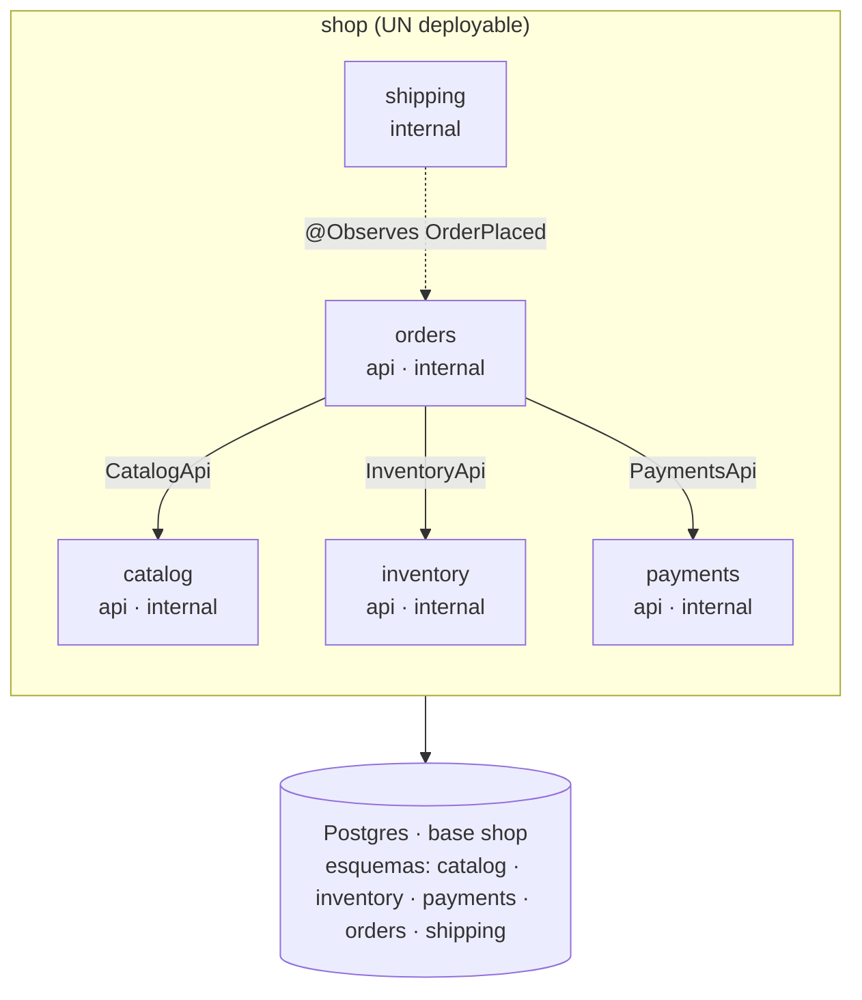
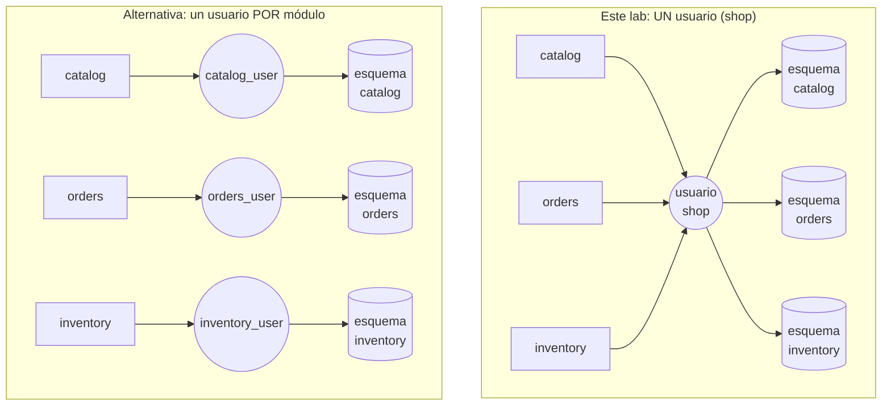

# 04 · Monolito modular

> Antes de distribuir un sistema, sepáralo **por dentro**. Un monolito con módulos de límites claros tiene casi todas las ventajas de diseño de los microservicios y ninguno de sus problemas de red, consistencia y operación.

**Patrones:** Modular Monolith · Bounded Context como módulo · Eventos dentro del proceso
**Stack:** Quarkus (Maven multi-módulo) · ArchUnit · **Infra:** PostgreSQL · **Tiempo estimado:** 1,5 h · **Requiere:** lab 03

---

## El problema

Dos formas de equivocarse:

- **Microservicios desde el día uno.** Red, consistencia eventual, sagas, despliegues coordinados y observabilidad distribuida, cuando todavía no sabes dónde están los límites del dominio. Si te equivocas de límite, mover código entre servicios es carísimo.
- **Un monolito sin límites** (*big ball of mud*). Cualquier clase usa cualquier otra y pedidos hace `JOIN` directo a las tablas de inventario. Después de unos años, nadie puede cambiar nada sin romper algo en otra parte.

El monolito modular está en el medio: **un solo deployable**, con módulos que **solo se hablan por su API pública**. Y esos límites los verifica el build, no la buena voluntad.

## El patrón



Cada **bounded context** (lab 03) es un **módulo Maven** con dos paquetes:

| Paquete | Qué contiene | Quién lo puede usar |
|---|---|---|
| `<módulo>.api` | Interfaces, records y excepciones públicas (`CatalogApi`, `Product`, `OutOfStockException`, `OrderPlaced`) | Cualquier módulo que dependa de este |
| `<módulo>.internal` | Entidades JPA, implementaciones, recursos REST | **Solo el propio módulo** |

Tres mecanismos protegen los límites, de menor a mayor:

1. **Visibilidad de Java.** Las implementaciones (`CatalogService`, `InventoryService`...) son `package-private`. Otro paquete ni siquiera puede nombrarlas.
2. **Dependencias de Maven.** `orders` depende de `catalog`, `inventory` y `payments`. `shipping` depende de `orders`. Maven **prohíbe los ciclos**: catálogo no puede depender de pedidos si pedidos ya depende de catálogo.
3. **ArchUnit**, en [`ModuleBoundariesTest`](shop/app/src/test/java/com/mercadoinventos/shop/ModuleBoundariesTest.java). Falla el build si:
   - una clase usa algo del paquete `internal` de **otro** módulo (las entidades JPA son públicas porque JPA y Jackson las necesitan, así que Java no alcanza);
   - hay un ciclo entre módulos;
   - una API pública expone una clase interna.

### Un esquema por módulo

Una sola base (`shop`) con un **esquema por módulo**. Cada módulo trae sus migraciones en `db/migration/<módulo>/`, y Flyway las junta al arrancar. Entre módulos no hay claves foráneas: `orders.order_lines` guarda el SKU, pero no tiene una FK a `inventory.stock`.

Así, si mañana inventario se convierte en un servicio aparte (lab 05), su esquema se lleva tal cual.

### Una compra = una transacción local

[`PlaceOrderService`](shop/orders/src/main/java/com/mercadoinventos/shop/orders/internal/PlaceOrderService.java) hace una compra que toca **cuatro módulos**, con un solo `@Transactional`:

```java
inventory.reserve(order.id, quantitiesBySku);   // OutOfStockException → rollback de todo
payments.charge(order.id, customerId, total);   // PaymentDeclinedException → rollback de todo, ¡stock incluido!
```

`InventoryApi.reserve()` y `PaymentsApi.charge()` usan `@Transactional(MANDATORY)`: **exigen** la transacción de quien llama. Si el pago se rechaza, la reserva de stock se deshace sola.

Esto es lo que **pierdes** al separar en microservicios (lab 05, donde un pago rechazado deja el stock reservado para siempre) y lo que recuperas, con mucho más trabajo, con una Saga (labs 16 y 17).

### Eventos dentro del proceso

Envíos necesita enterarse de los pedidos, pero pedidos **no depende** de envíos. Pedidos publica `OrderPlaced` (en su paquete `api`), y [`ShipmentScheduler`](shop/shipping/src/main/java/com/mercadoinventos/shop/shipping/internal/ShipmentScheduler.java) lo escucha:

```java
@Transactional(REQUIRES_NEW)
void onOrderPlaced(@Observes(during = TransactionPhase.AFTER_SUCCESS) OrderPlaced event)
```

- `AFTER_SUCCESS`: solo si el pedido hizo commit.
- `REQUIRES_NEW`: en su propia transacción. Si envíos falla, **el pedido ya está confirmado**.

Es decir: aun dentro de un monolito, comunicar módulos por eventos trae **consistencia eventual**. Si el proceso muere entre el commit y el observador, el envío se pierde. La solución es la misma que entre servicios: un outbox (lab 15).

## La versión ingenua

No hay un servicio ingenuo aparte. La versión ingenua es lo que pasa **cuando se rompen los límites**, y el experimento 1 lo provoca: pedidos lee directamente la entidad interna del catálogo "porque es más rápido".

## Arquitectura del lab

| Servicio | Qué es | Puerto |
|---|---|---|
| `shop` | El monolito: los cinco módulos en un solo proceso Quarkus | 8100 |
| `postgres` | Base `shop`, un esquema por módulo | 5432 |

⚠️ 8100 es un puerto propio de este lab: el monolito no aparece en la convención general.

| Endpoint | Módulo |
|---|---|
| `GET /api/catalog/products` | catalog |
| `GET /api/inventory/stock` | inventory |
| `POST /api/orders`, `GET /api/orders` | orders |
| `GET /api/payments` | payments |
| `GET /api/shipments` | shipping |

Estructura del proyecto:

```
shop/
├── pom.xml              ← padre: lista los módulos
├── catalog/             ← módulo (jar)
├── inventory/
├── payments/
├── orders/              ← depende de catalog, inventory y payments
├── shipping/            ← depende de orders
└── app/                 ← el ÚNICO deployable: junta todo, configura Flyway y tiene los tests de ArchUnit
```

## Levántalo

```bash
cd labs/04-monolito-modular
docker compose up --build -d
./smoke.sh
```

Usa [`requests.http`](requests.http) para hacer compras. Swagger UI: http://localhost:8100/q/swagger-ui. Para limpiar: `docker compose down -v`.

Tests (con Java 25): `cd shop && ./mvnw test`.

## Rómpelo

1. **Rompe un límite y mira cómo falla el build.**
   ```bash
   ./experiments/romper-limites.sh          # usa Docker; con LOCAL=1 usa tu Java
   ```
   El script copia [`AtajoAlCatalogo.java`](experiments/AtajoAlCatalogo.java) al módulo de pedidos. Esa clase lee `catalog.internal.ProductEntity` en lugar de usar `CatalogApi`. **Compila** sin problemas, pero ArchUnit responde con:
   ```
   Rule 'Nadie fuera de 'catalog' usa sus clases internas (solo catalog.api)' was violated (2 times):
   Method <...orders.internal.AtajoAlCatalogo.price(String)> gets field <...catalog.internal.ProductEntity.price> in (AtajoAlCatalogo.java:15)
   ```
   Al terminar, el script quita el archivo.

2. **Un pago rechazado no deja basura.** Compra 5 unidades de INV-003 (600 > límite de 500). Respuesta `402`, y `GET /api/inventory/stock` muestra el stock **sin cambios**. Compáralo con el experimento 4 del lab 05, donde el mismo caso deja stock reservado para siempre.

3. **Envíos falla después del commit.**
   ```bash
   SHIPPING_CHAOS_FAIL=true docker compose up -d
   ```
   Haz una compra: `201`, el pedido está confirmado y el pago cobrado, pero `GET /api/shipments` no lo tiene. En los logs: `💥 CAOS: envíos falló para el pedido …`. Vuelve a la normalidad con `docker compose up -d`.

4. **Intenta un ciclo.** Haz que `catalog` dependa de `orders` en su `pom.xml` (por ejemplo, para contar ventas). Maven responde `The projects in the reactor contain a cyclic reference`. ¿Cómo cuentas las ventas sin el ciclo? Pista: igual que envíos, escuchando `OrderPlaced` desde un módulo que dependa de pedidos.

5. **Lo que ArchUnit no ve.** Desde pedidos, haz una consulta nativa `SELECT ... FROM inventory.stock`. Compila y ArchUnit no se entera: no hay ninguna clase de inventario involucrada, solo un string de SQL. ¿Cómo lo evitarías? Ver "Costo".

## ¿Qué cambia en dev y prod?

Este lab no trae overlays de ambiente. Lo que importa entre ambientes:

- **Un solo artefacto para todos los módulos.** Un cambio en catálogo obliga a redesplegar todo. Es el costo principal frente a los microservicios, y la razón para extraer un módulo **cuando su ritmo de cambio o de escala sea distinto** del resto, no antes.
- **Escalar es escalar todo.** Si solo los pedidos necesitan más instancias, igual replicas el monolito completo.
- **Migraciones.** En prod conviene revisar que ninguna migración de un módulo toque el esquema de otro (en code review, o con un test sobre los archivos SQL).

## Costo y cuándo NO usarlo

- **La disciplina cuesta.** Separar `api`/`internal`, evitar FKs cruzadas y pasar por interfaces es más trabajo que llamar al repositorio de otro módulo.
- **⚠️ Un solo usuario de base de datos** para todos los esquemas. ArchUnit protege el código Java, no el SQL (experimento 5). Ver "Un usuario o un usuario por módulo", abajo.

### Un usuario o un usuario por módulo

El ⚠️ de arriba marca una decisión con un costo aceptado a propósito. Las dos opciones, lado a lado:



| | Un usuario (este lab) | Un usuario por módulo |
|---|---|---|
| Quién protege los límites | ArchUnit (el código Java) y la disciplina del equipo | La **base**: `orders_user` no tiene permiso sobre `inventory`, y un `SELECT` cruzado falla |
| SQL nativo que cruza esquemas | Pasa sin que nadie se entere (experimento 5) | Error de permisos en el primer intento |
| Una compra = una transacción | **Sí**: un datasource, una conexión, un `COMMIT` | No: un datasource por módulo, y una compra toca tres. Habría que coordinar (XA) o pasar a consistencia eventual, como entre microservicios |
| Configuración | Un datasource | Un datasource por módulo, cada uno con su pool de conexiones |
| Cuándo conviene | Mientras los módulos vivan juntos | Como **paso previo** a separar un módulo en un servicio: si ya funciona con su usuario propio, sacarlo es mover un datasource |

En los dos casos, todos los usuarios pertenecen a la misma base y al mismo servidor: el aislamiento por usuarios es de **permisos**, no de recursos.
- **Cuándo no:** si los módulos necesitan escalar o desplegarse de forma independiente **hoy**, o si los equipos son tantos que un solo artefacto los frena. Ahí toca el lab 05.
- **Cuándo sí:** casi siempre para empezar. Es el punto de partida que recomiendan Sam Newman y Martin Fowler (*MonolithFirst*): cuando los límites están probados, extraer un módulo es mucho más barato.

## Ejercicio

Extrae **pagos** como si fuera a convertirse en servicio:

1. Haz que `PaymentsApi` sea la única forma de llegar a pagos (ya lo es).
2. Cambia `PlaceOrderService` para que el cobro ocurra **después** del commit, escuchando `OrderPlaced` desde pagos, en lugar de llamarlo dentro de la transacción.
3. ¿Qué pasa ahora con un pago rechazado? ¿Quién libera el stock?

Acabas de reinventar el problema que resuelve la Saga (labs 16 y 17).

## Para profundizar

- Martin Fowler, [*MonolithFirst*](https://martinfowler.com/bliki/MonolithFirst.html) (2015).
- Sam Newman, *Monolith to Microservices* (2019), capítulos 1 y 2.
- Kamil Grzybek, [*Modular Monolith: A Primer*](https://www.kamilgrzybek.com/blog/posts/modular-monolith-primer) y su serie de artículos.
- [ArchUnit User Guide](https://www.archunit.org/userguide/html/000_Index.html).
- En Spring, la herramienta equivalente es **Spring Modulith**, que además documenta los módulos y prueba cada uno aislado. Aquí ArchUnit alcanza, así que no fue necesario cambiar de framework (ver la regla de stack en el README principal).
- Siguiente: el [lab 05](../05-microservicios/) separa este mismo sistema en servicios con su propia base.
