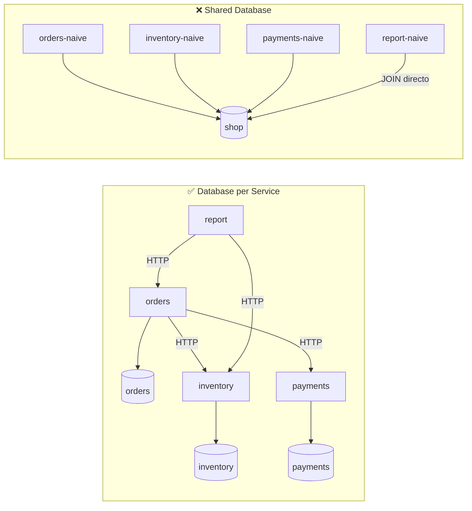

# 05 · Microservicios y Database per Service

> Cada servicio es dueño de sus datos: nadie más lee ni escribe su base. El único contrato es su API.

**Patrones:** Microservice Architecture · Database per Service · Shared Database (antipatrón) · API Composition (adelanto del lab 09)
**Stack:** Quarkus (orders, payments) · FastAPI (inventory, report) · **Infra:** PostgreSQL · **Tiempo estimado:** 1,5 h · **Requiere:** lab 01

---

## El problema

Mercado de Inventos creció y ahora tiene tres equipos: **Pedidos**, **Inventario** y **Pagos**. Cada uno quiere desplegar cuando esté listo, sin coordinarse con los demás para cada cambio. Además, un cuarto equipo (Business Intelligence) necesita un **reporte** que cruza pedidos con el stock actual.

Separar el código en servicios es la parte fácil. La pregunta difícil es **qué hacer con los datos**.

## La versión ingenua: una base compartida

Tres servicios, una sola base `shop`. Es lo más natural: "total, ya tenemos Postgres". Y el reporte sale con un `JOIN`:

```sql
-- services/report/app/sources.py — conoce tablas y columnas de DOS equipos
SELECT o.id, o.status, l.sku, l.quantity, s.available
FROM orders o
JOIN order_lines l ON l.order_id = o.id
LEFT JOIN stock s ON s.sku = l.sku
```

Funciona... hasta que el equipo de Inventario cambia algo **interno**. Esta versión la levantas con `--profile naive` (puertos 91xx) y en "Rómpelo" la vas a ver fallar.

Otros síntomas que vas a encontrar en el código:

- **Hasta las migraciones chocan.** Flyway, al ver tablas de otros equipos en "su" base, se niega a migrar. Hubo que agregar `baseline-on-migrate` y una tabla de historial por servicio ([`application.properties`](services/orders/src/main/resources/application.properties)).
- **Cualquiera puede leer todo.** El usuario `shop` ve los pagos, aunque el reporte solo necesitaba pedidos y stock.

## El patrón

**Database per Service:** cada servicio tiene su propia base de datos (o al menos su propio esquema y usuario) y **nadie más puede acceder**. Si otro servicio necesita esos datos, los pide por la API.



### Las piezas clave

| Qué | Dónde |
|---|---|
| Una base **y un usuario** por servicio, sin permiso para conectarse a las demás | [`infra/postgres/init/01-databases.sh`](../../infra/postgres/init/01-databases.sh) (`REVOKE CONNECT … FROM PUBLIC`) |
| Pedidos llama a inventario y pagos **solo por HTTP** | [`InventoryClient.java`](services/orders/src/main/java/com/mercadoinventos/orders/clients/InventoryClient.java), [`PaymentsClient.java`](services/orders/src/main/java/com/mercadoinventos/orders/clients/PaymentsClient.java) |
| El flujo de un pedido, que toca tres bases | [`OrderService.java`](services/orders/src/main/java/com/mercadoinventos/orders/OrderService.java) |
| La columna interna de inventario se puede renombrar sin cambiar la API | [`db.py`](services/inventory/app/db.py) (`key="available"`) |
| El mismo reporte, por API y por JOIN | [`sources.py`](services/report/app/sources.py) |

## Arquitectura del lab

| Servicio | Stack | Correcta | Ingenua | Base |
|---|---|---|---|---|
| orders | Quarkus | :8102 | :9102 | `orders` / `shop` |
| inventory | FastAPI | :8103 | :9103 | `inventory` / `shop` |
| payments | Quarkus | :8104 | :9104 | `payments` / `shop` |
| report | FastAPI | :8109 (`REPORT_SOURCE=api`) | :9109 (`REPORT_SOURCE=database`) | — / `shop` |

Las dos versiones usan **las mismas imágenes**. Lo único que cambia es la configuración (lab 01).

**Reglas de negocio** (para que los experimentos sean predecibles):
- Stock inicial: INV-001 → 12, INV-002 → 0, INV-003 → 5, INV-004 → 30.
- Pagos aprueba montos de hasta 500,00 y rechaza los mayores (simula el límite de la tarjeta).
- ⚠️ El pedido trae los precios en la petición. En un sistema real los pondría el catálogo; aquí no hay catálogo para mantener el foco.

## Levántalo

```bash
cd labs/05-microservicios
docker compose --profile naive up --build -d     # las dos versiones lado a lado
./smoke.sh            # versión correcta
./smoke.sh naive      # versión ingenua
```

Prueba las peticiones de [`requests.http`](requests.http), o usa Swagger en http://localhost:8102/q/swagger-ui y http://localhost:8103/docs.

Para limpiar: `docker compose --profile naive down -v`.

## Rómpelo

1. **Nadie entra a la base de otro.** Intenta conectarte a la base de inventario con el usuario de pedidos:
   ```bash
   docker compose exec postgres psql -U orders -d inventory
   ```
   Resultado: `User does not have CONNECT privilege`. En la base compartida, en cambio, `shop` lo ve todo:
   ```bash
   docker compose exec postgres psql -U shop -d shop -c 'select * from payments'
   ```

2. **El equipo de Inventario despliega su versión 2.** La v2 renombra una columna **interna**: `stock.available` pasa a ser `stock.units_available`. Ese es exactamente el tipo de cambio que un equipo debería poder hacer sin pedir permiso a nadie.
   ```bash
   INVENTORY_V2=true docker compose --profile naive up -d
   curl localhost:8109/api/report     # ✅ sigue funcionando: la API de inventario no cambió
   curl localhost:9109/api/report     # ❌ "column s.available does not exist"
   ```
   El reporte ingenuo se rompió **sin que nadie tocara su código**, y en producción eso lo descubre un usuario. Con Database per Service, el renombre es un detalle privado de inventario.

3. **El JOIN que ya no se puede hacer.** En la versión correcta, el reporte necesita **dos** llamadas HTTP y une los datos en memoria ([`compose_report`](services/report/app/sources.py)). Es más trabajo y más lento que un `JOIN`. Es el precio de la independencia. Los labs 09 (API Composition) y 14 (CQRS) muestran cómo pagarlo mejor.

4. **El problema que este lab NO resuelve.** Haz un pedido de 10 × INV-004 (725,00, supera el límite) y mira el stock:
   ```bash
   curl localhost:8103/api/stock/INV-004    # bajó 10... para un pedido RECHAZADO
   ```
   Pedidos reservó el stock en la base de inventario y **después** pagos lo rechazó. No hay una transacción que abarque las dos bases, así que nadie devuelve ese stock. Prueba también a apagar pagos (`docker compose stop payments`) y hacer un pedido: pasa lo mismo.

   Esto **no es un bug del lab**: es el problema central de los datos distribuidos. Los labs 15 (Outbox), 16 y 17 (Saga) lo resuelven.

5. **Desplegar un servicio sin tocar los otros.** Recrea solo inventario:
   ```bash
   INVENTORY_V2=true docker compose up -d --force-recreate inventory
   ```
   Pedidos y pagos siguen corriendo; nadie más se reinició.

6. **Volver atrás no siempre es posible.** Después de la v2, intenta "hacer rollback" a la v1 (`INVENTORY_V2=false docker compose up -d inventory`). Inventario no arranca: el código v1 busca una columna que la migración v2 ya renombró. Los cambios de esquema destructivos impiden el rollback. Por eso en la vida real se hacen en dos pasos (*expand/contract*): primero se agrega la columna nueva, y solo cuando nadie usa la vieja, se borra.

### 📎 Lo que nos pasó construyendo este lab

Durante el experimento 2 recreamos `inventory` e `inventory-naive` a la vez, e inmediatamente hicimos un pedido en `orders`. **La reserva terminó en la base `shop`.** Docker le había dado al nuevo `inventory-naive` la IP que tenía el viejo `inventory`, y `orders` todavía tenía esa IP en su caché DNS (la JVM la guarda unos segundos).

En producción pasa algo parecido: tras un redespliegue, un cliente con DNS o conexiones viejas habla con el destino equivocado. Por eso las plataformas usan service discovery (lab 08), *health checks* y *connection draining*. Si quieres reproducirlo, espera unos 30 segundos entre recrear servicios y hacer pedidos, o recrea uno a la vez.

## ¿Qué cambia en dev y prod?

En local ahorramos RAM con **un** contenedor Postgres y una base por servicio. En prod, cada servicio tiene su **propia instancia** de base de datos, con sus propios backups, recursos e incluso versión:

```bash
PROD_DB_PASSWORD=una-clave-larga docker compose -f compose.yaml -f compose.prod.yaml up -d
./smoke.sh prod
```

[`compose.prod.yaml`](compose.prod.yaml) apaga el Postgres compartido, crea `db-orders`, `db-inventory` y `db-payments`, y solo expone `orders` y `report`. Con instancias separadas, el `JOIN` de la versión ingenua **ni siquiera es posible**.

⚠️ Las tres instancias comparten `PROD_DB_PASSWORD` por simplicidad. En la vida real, cada una tendría su credencial en un gestor de secretos (lab 01).

Este lab no trae `compose.dev.yaml`: dev sería igual a local (sin puertos de BD). El lab 01 ya muestra esa diferencia.

## Costo y cuándo NO usarlo

- **Consultas entre servicios:** sin `JOIN`, cada consulta que cruza servicios se arma con varias llamadas (lab 09) o con una vista materializada (lab 14).
- **Consistencia entre servicios:** sin transacciones entre bases, un fallo a mitad de camino deja datos inconsistentes (experimento 4). Hacen falta Outbox y Saga (labs 15 a 17).
- **Operación:** más bases que respaldar, monitorear y migrar.

**Cuándo NO:** con un solo equipo, o cuando todavía no entiendes bien los límites del dominio. En ese caso es mejor un **monolito modular** (lab 04): módulos con límites claros dentro de un solo despliegue, que puedes separar después.

## Ejercicio

El equipo de BI ahora quiere el **monto pagado** de cada pedido en el reporte.

1. Agrégalo a la versión correcta usando solo la API de pagos (`GET /api/payments?orderId=…`).
2. ¿Cuántas llamadas HTTP hace ahora el reporte para 100 pedidos? ¿Cómo lo reducirías?

<details><summary>Pista</summary>

El problema de "una llamada por pedido" se llama **N+1**. Opciones: un endpoint de pagos que acepte varios `orderId`, o mantener una copia local de los pagos que se actualice con eventos (lab 14, CQRS).
</details>

## Para profundizar

- Chris Richardson, [Database per Service](https://microservices.io/patterns/data/database-per-service.html) y [Shared Database](https://microservices.io/patterns/data/shared-database.html).
- Sam Newman, *Monolith to Microservices*, cap. 4: descomponer la base de datos.
- [Expand/contract (parallel change)](https://martinfowler.com/bliki/ParallelChange.html), Martin Fowler.
