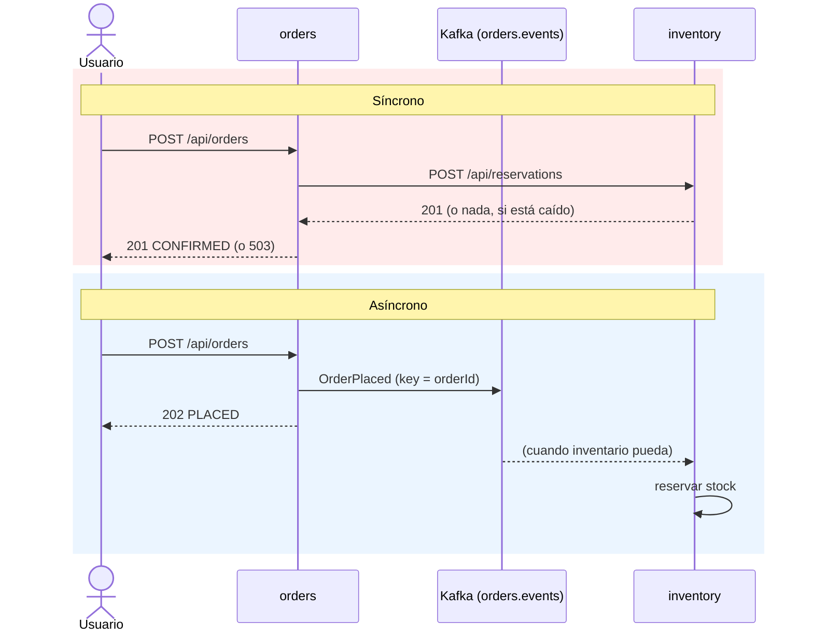

# 06 · Comunicación síncrona vs. asíncrona

> Si un servicio necesita que otro esté vivo **en este momento** para hacer su trabajo, sus caídas se suman. La mensajería rompe esa dependencia temporal.

**Patrones:** Remote Procedure Invocation · Messaging · Publish/Subscribe · Competing Consumers · Dead Letter Channel · Event Notification vs. Event-Carried State Transfer
**Stack:** Quarkus + SmallRye Reactive Messaging (orders) · FastAPI + aiokafka (inventory) · **Infra:** PostgreSQL, Kafka, Kafka UI · **Tiempo estimado:** 1,5 a 2 h · **Requiere:** lab 05

---

## El problema

Cuando alguien compra, inventario tiene que reservar el stock. En el lab 05, pedidos llamaba a inventario por HTTP **y esperaba la respuesta**. Esa forma de comunicarse tiene una consecuencia que no se ve hasta que algo falla:

> Si inventario está caído, **nadie puede comprar**, aunque pedidos funcione perfectamente.

Esto se llama **acoplamiento temporal**: los dos servicios tienen que estar disponibles al mismo tiempo. Con tres servicios encadenados, cada uno con un 99 % de disponibilidad, el flujo completo queda en 0,99³ ≈ 97 %.

## La versión ingenua: todo síncrono

```java
// OrderService.placeSync — pedidos ESPERA a inventario
inventory.reserve(...);           // si inventario no responde → 503 al usuario
order.status = CONFIRMED;
```

Levanta el lab en modo sync (`ORDERS_MODE=sync`) y apaga inventario: el usuario recibe un `503`.

## El patrón: mensajería asíncrona

Pedidos guarda el pedido, **publica un evento** `OrderPlaced` en Kafka y responde de inmediato con `202 Accepted`. Inventario lee el evento cuando puede. Si está caído, el evento lo espera en Kafka.



### Los patrones de mensajería que aparecen

| Patrón | Qué resuelve | En el lab |
|---|---|---|
| **Publish/Subscribe** | El que publica no sabe quién escucha. Mañana se puede sumar envíos o analítica sin tocar pedidos | `orders.events` |
| **Competing Consumers** | Varias réplicas del mismo consumidor se **reparten** el trabajo. Kafka asigna cada partición a una réplica del *consumer group* | group `inventory`, 3 particiones |
| **Dead Letter Channel** | Un mensaje que nunca se va a poder procesar (veneno) se aparta para no bloquear a los demás | `orders.events.dlq` |
| **Event-Carried State Transfer** | El evento trae todos los datos que el consumidor necesita | `EVENT_STYLE=state` (por defecto) |
| **Event Notification** | El evento solo avisa "pasó algo"; el consumidor pregunta el resto | `EVENT_STYLE=notification` |

### Las piezas clave

| Qué | Dónde |
|---|---|
| Los dos modos de pedidos | [`OrderService.java`](services/orders/src/main/java/com/mercadoinventos/orders/OrderService.java) |
| Publicar con key = id del pedido (orden garantizado por pedido) | [`OrderEvents.java`](services/orders/src/main/java/com/mercadoinventos/orders/OrderEvents.java) |
| Procesar, reintentar o mandar a la DLQ | [`consumer.py`](services/inventory/app/consumer.py) (`process_message`) |
| Distinguir errores "nunca va a funcionar" de "todavía no" | [`events.py`](services/inventory/app/events.py) (`InvalidEvent` vs. `TransientError`) |
| Confirmar el offset **después** de procesar | `enable_auto_commit=False` y `consumer.commit()` en [`consumer.py`](services/inventory/app/consumer.py) |
| Crear los topics con 3 particiones | `kafka-init` en [`compose.yaml`](compose.yaml) |
| El mismo consumidor escrito con Quarkus, para comparar | [`services/inventory-quarkus`](services/inventory-quarkus) y [`docs/consumidor-aiokafka-vs-quarkus.md`](docs/consumidor-aiokafka-vs-quarkus.md) |

## Levántalo

```bash
cd labs/06-sync-vs-async
docker compose up --build -d
./smoke.sh
```

- Kafka UI: http://localhost:8090 (topics, mensajes, consumer groups).
- Pedidos: http://localhost:8102/q/swagger-ui · Inventario: http://localhost:8103/docs.
- Peticiones listas en [`requests.http`](requests.http).

Para limpiar: `docker compose --profile scale --profile quarkus down -v`.

### Opcional: el mismo consumidor en Quarkus

El inventario también está escrito con **Quarkus Messaging**, para comparar línea a línea con aiokafka: commit, DLQ y reintentos. Corre en otro grupo de consumidores, así que recibe **todos** los eventos (Publish/Subscribe), con su propio esquema y su propia DLQ.

```bash
docker compose --profile quarkus up --build -d
./smoke-quarkus.sh
```

La comparación completa, con lo que se aprendió al construirlo (por ejemplo, que `@Retry` deja de reintentar a los 3 minutos si no pones `maxDuration = 0`), está en [`docs/consumidor-aiokafka-vs-quarkus.md`](docs/consumidor-aiokafka-vs-quarkus.md).

### Opcional: prod con Kafka de 3 nodos

[`compose.prod.yaml`](compose.prod.yaml) arma un clúster KRaft de **3 nodos**, con topics de replicación 3 y `min.insync.replicas=2`, como en producción.

**Requisitos de RAM.** Medido en reposo: el lab en local usa unos **1,1 GB**; prod con 3 nodos, unos **1,8 GB** (cada nodo de Kafka, 300 a 470 MB, con el heap limitado a 384 MB). Bajo carga, Kafka usa más.

- Docker necesita **al menos 4 GB** asignados. En Docker Desktop, revísalo en *Settings → Resources*: algunos equipos traen 2 GB por defecto, y con eso los nodos de Kafka se reinician sin un error claro.
- El equipo, **8 GB como mínimo**, y 16 GB si además tienes abiertos el IDE y el navegador.
- Si no te alcanza, sáltate esta parte: la tabla de "¿Qué cambia en dev y prod?" explica lo mismo sin levantarlo.

```bash
docker compose up --build -d && docker compose down        # construye las imágenes (prod no compila)
docker compose -f compose.yaml -f compose.prod.yaml up -d
./smoke-prod.sh
docker compose -f compose.yaml -f compose.prod.yaml down -v
```

Pedidos queda en http://localhost:8202, inventario en http://localhost:8203 y Kafka UI en http://localhost:8290. Los experimentos están en "Rómpelo en prod", más abajo.

## Rómpelo

1. **Síncrono: si inventario cae, nadie compra.**
   ```bash
   ORDERS_MODE=sync docker compose up -d orders
   docker compose stop inventory
   curl -i -X POST localhost:8102/api/orders -H 'Content-Type: application/json' \
     -d '{"customerId":"ana","items":[{"sku":"INV-001","quantity":1}]}'
   ```
   Respuesta: `503 … El servicio de inventario no responde`.

2. **Asíncrono: se sigue vendiendo con inventario caído.** Vuelve a async (`docker compose up -d orders`), deja inventario apagado y haz varios pedidos: todos responden `202`. En Kafka UI, el consumer group `inventory` muestra **lag** (mensajes pendientes). Levanta inventario (`docker compose start inventory`): procesa los pendientes y el lag vuelve a 0.

3. **Competing Consumers.** Levanta dos réplicas más:
   ```bash
   docker compose --profile scale up -d --scale inventory-worker=2
   ```
   Haz 15 pedidos y mira `GET localhost:8103/api/reservations`: el campo `processedBy` muestra **tres** hostnames distintos. En Kafka UI, cada réplica tiene una partición asignada.

   Escala a 5 réplicas: dos quedan **ociosas**. Con 3 particiones, como mucho trabajan 3 consumidores. Las particiones fijan el paralelismo máximo.

4. **Mensaje veneno → DLQ.** Publica algo que no es JSON:
   ```bash
   echo "esto no es json" | docker compose exec -T kafka /opt/kafka/bin/kafka-console-producer.sh \
     --bootstrap-server localhost:9092 --topic orders.events
   ```
   Inventario lo manda a `orders.events.dlq` (con el motivo en el header `dlq-reason`) y **sigue** procesando lo demás. Sin DLQ, ese mensaje se reintentaría para siempre y bloquearía su partición.

5. **Event Notification te devuelve el acoplamiento.** Cambia el estilo de los eventos:
   ```bash
   EVENT_STYLE=notification docker compose up -d orders
   ```
   Ahora el evento no trae los ítems e inventario tiene que pedírselos a pedidos (`GET /api/orders/{id}`). Apaga inventario, haz un pedido, apaga **pedidos** y vuelve a levantar inventario. Inventario recibe el evento, pero no puede procesarlo: verás `Falla transitoria (intento N)…` en sus logs, y la partición queda **bloqueada** hasta que pedidos vuelva.

   Con Event-Carried State Transfer (`state`), el consumidor es autónomo. El costo: eventos más grandes y datos duplicados.

6. **El orden está garantizado... por pedido.** Todos los eventos de un pedido usan su `orderId` como key, así que caen en la misma partición y se procesan en orden. Entre pedidos **distintos** no hay orden garantizado. Míralo en Kafka UI: cada mensaje muestra su partición.

### ⚠️ Lo que este lab deja abierto (a propósito)

- **¿Cómo se entera pedidos de que no había stock?** En async, el pedido queda `PLACED` aunque inventario lo rechace. Hace falta que inventario publique un evento de vuelta: eso es una **Saga** (labs 16 y 17).
- **Dual write:** pedidos guarda en Postgres y **después** publica en Kafka. Si el proceso muere entre las dos operaciones, queda un pedido sin evento. Lo resuelve el lab 15 (Transactional Outbox).
- **Duplicados:** Kafka entrega *al menos una vez*. Si inventario procesa un mensaje y se cae antes de confirmar el offset, lo vuelve a procesar y reserva **dos veces**. Lo resuelve el lab 12 (Idempotent Consumer).

### Rómpelo en prod (Kafka con 3 nodos)

Con `compose.prod.yaml` levantado:

7. **Cae un nodo: nada se nota.**
   ```bash
   docker compose -f compose.yaml -f compose.prod.yaml stop kafka-3
   ```
   Haz pedidos: se aceptan y se procesan. Quedan 2 copias (≥ `min.insync.replicas`) y 2 de 3 votos del quórum de controllers. Mira en Kafka UI (http://localhost:8290) cómo el ISR baja de `1,2,3` a dos nodos.

8. **Caen dos nodos: Kafka prefiere no aceptar a perder datos.**
   ```bash
   docker compose -f compose.yaml -f compose.prod.yaml stop kafka-2
   ```
   - Un pedido tarda 10 s y responde **500**. En los logs de pedidos: `Error: NOT_ENOUGH_REPLICAS`. Con `acks=all`, Kafka exige 2 copias y solo queda 1.
   - Los comandos de administración (`kafka-topics.sh --describe`) **no responden**: con 1 de 3 votos se perdió el quórum de controllers.

9. **El 500 que mintió.** Vuelve a levantar los nodos (`start kafka-2 kafka-3`) y mira el pedido que respondió 500: **existe** y **se reservó**. Pedidos dejó de esperar a los 10 s, pero el productor de Kafka siguió reintentando por su cuenta (hasta `delivery.timeout.ms`, 2 minutos), y cuando volvieron los nodos, entregó el evento. Un timeout no dice si la operación ocurrió. Si el cliente reintenta, crea un pedido **duplicado**. Por eso existen la Idempotency Key (lab 12) y el Outbox (lab 15).

10. **`acks=1`: aceptado pero invisible.** El conector Kafka de SmallRye usa `acks=1` por defecto (el cliente de Kafka usa `all`). Pedidos lo fija en `all`, pero puedes ver la diferencia:
    ```bash
    ORDERS_ACKS=1 docker compose -f compose.yaml -f compose.prod.yaml up -d orders
    docker compose -f compose.yaml -f compose.prod.yaml stop kafka-2 kafka-3
    ```
    Los pedidos responden **202 al instante**, pero inventario **no los procesa**: el evento quedó en una sola copia y los consumidores solo leen lo que está replicado. Si ese último nodo se cae ahora, esos eventos se **pierden**. Al volver los nodos, se replican y se procesan.

## ¿Qué cambia en dev y prod?

El overlay de prod **opcional** (`compose.prod.yaml`) simula el clúster. Los cambios de prod para Kafka:

| Aspecto | Local (este lab) | Prod |
|---|---|---|
| Brokers | 1 | ≥ 3, en zonas distintas (el overlay opcional levanta 3) |
| Replicación de topics | 1 | 3, con `min.insync.replicas=2` |
| Confirmación del productor | depende del cliente: el cliente Java de Kafka usa `acks=all` desde 3.0, pero el conector de **SmallRye (Quarkus) usa `acks=1`**, igual que aiokafka. Este lab fija `acks=all` en pedidos | `acks=all` **explícito** + `enable.idempotence=true` en todos los clientes. No confíes en el default |
| Particiones | 3 | Según el paralelismo que necesites. Aumentarlas después **cambia** a qué partición va cada key |
| Creación de topics | `kafka-init` + `auto.create.topics.enable=true` | Solo desde infraestructura como código. Autocreación **apagada** |
| DLQ | se mira a mano | Alerta cuando llega cualquier mensaje + proceso para reinyectarlos |
| Observabilidad | Kafka UI | Métrica de **consumer lag** con alertas (lab 10) |

## Costo y cuándo NO usarlo

- **Consistencia eventual:** el `202` dice "lo recibí", no "está listo". La UI y el negocio tienen que aceptar que el resultado llega después.
- **Más piezas:** un broker que operar, topics que diseñar, DLQs que vigilar.
- **Depurar es más difícil:** el flujo ya no es una pila de llamadas. Sin trazas distribuidas (lab 10) cuesta seguirlo.
- **Nuevos problemas:** duplicados, orden y dual write (labs 12 y 15).

**Cuándo NO:** cuando el usuario necesita la respuesta **ya** para continuar (validar una tarjeta, consultar un saldo) o cuando el flujo es una simple consulta. Leer datos suele ser síncrono; las **órdenes** de cambio son las que más ganan con la asincronía.

## Ejercicio

Haz que el usuario se entere del resultado: inventario publica `StockReserved` o `StockReservationFailed` en un topic `inventory.events`, y pedidos lo consume para pasar el pedido a `CONFIRMED` o `REJECTED`.

<details><summary>Pista</summary>

En pedidos, agrega un canal `@Incoming("inventory-events")` en `application.properties` (`mp.messaging.incoming.inventory-events...`). En inventario, publica con el `AIOKafkaProducer` que ya existe para la DLQ. Acabas de construir la primera mitad de una saga por coreografía (lab 16).
</details>

## Para profundizar

- Gregor Hohpe y Bobby Woolf, *Enterprise Integration Patterns*: [Publish-Subscribe Channel](https://www.enterpriseintegrationpatterns.com/patterns/messaging/PublishSubscribeChannel.html), [Competing Consumers](https://www.enterpriseintegrationpatterns.com/patterns/messaging/CompetingConsumers.html), [Dead Letter Channel](https://www.enterpriseintegrationpatterns.com/patterns/messaging/DeadLetterChannel.html).
- Martin Fowler, [What do you mean by "Event-Driven"?](https://martinfowler.com/articles/201701-event-driven.html): notification vs. state transfer.
- [Quarkus: Apache Kafka reference](https://quarkus.io/guides/kafka).
