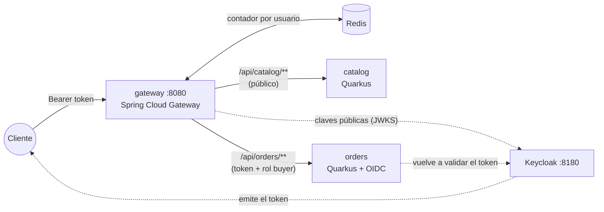

# 07 · API Gateway

> Un solo punto de entrada para todos los servicios. El gateway enruta, valida la identidad, limita el abuso y resuelve CORS una sola vez, para que cada servicio no tenga que repetirlo.

**Patrones:** API Gateway · Access Token (JWT) · Rate Limiting · Gateway Offloading
**Stack:** Spring Cloud Gateway (Spring Boot 4) · Quarkus · **Infra:** Keycloak, Redis · **Tiempo estimado:** 1,5 a 2 h · **Requiere:** lab 05

---

## El problema

Con varios servicios, el cliente (la web, una app móvil) tiene que:

- conocer la URL de **cada** servicio, y cambiarla cada vez que uno se mueve;
- mandar el token a cada uno, mientras **cada servicio** repite la validación, la configuración de CORS y los límites de uso, cada uno a su manera;
- quedar expuesto a que un usuario (o un script) sature un servicio con miles de peticiones.

## La versión ingenua

Cada servicio publicado en internet con su propio puerto, su propio CORS y su propia validación. En este lab puedes verlo llamando directo a `orders` en `:8102`, sin pasar por el gateway. Funciona, pero el cliente tiene que saber que existe `:8102`, y nada impide una ráfaga de peticiones.

## El patrón



El gateway hace cuatro cosas antes de que una petición llegue a un servicio:

| Qué | Cómo | Dónde |
|---|---|---|
| **Enrutar** | `Path=/api/catalog/**` → `catalog`, `Path=/api/orders/**` → `orders` | [`application.yaml`](gateway/src/main/resources/application.yaml) |
| **Autenticar** | Verifica el JWT: firma (con las claves de Keycloak), vencimiento y emisor (`iss`) | `spring.security.oauth2.resourceserver.jwt` en `application.yaml` |
| **Autorizar** | Catálogo público; ver pedidos requiere token; **comprar** requiere el rol `buyer`; todo lo demás, denegado | [`SecurityConfig.java`](gateway/src/main/java/com/mercadoinventos/gateway/SecurityConfig.java) |
| **Limitar** | Token bucket en Redis, **por usuario**: 2 peticiones por segundo, ráfagas de hasta 5 | Filtro `RequestRateLimiter` en `application.yaml` |

Y una de *Gateway Offloading*: **CORS** se configura una sola vez en el gateway (`CORS_ORIGINS`), no en cada servicio. Es la misma idea del lab 01, pero centralizada.

### El token viaja hasta el servicio

El gateway **no consume** el token: lo reenvía tal cual. `orders` lo valida **otra vez** con `quarkus-oidc` ([`application.properties`](services/orders/src/main/resources/application.properties)) y aplica `@RolesAllowed("buyer")` ([`OrderResource.java`](services/orders/src/main/java/com/mercadoinventos/orders/OrderResource.java)). Esto es **defensa en profundidad**: si alguien llega a `orders` sin pasar por el gateway (un error de red, otro servicio comprometido), igual lo frena.

Y la identidad sale **del token**, nunca del cuerpo de la petición: si ana manda `"customerId": "beto"`, el pedido queda a nombre de ana.

### Un detalle que confunde a todos: dos URLs para el mismo Keycloak

| | Valor | Para qué |
|---|---|---|
| URL interna | `http://keycloak:8080/realms/mercado` | Para que el gateway y `orders` descarguen las claves públicas (red de Compose) |
| Emisor (`iss`) | `http://localhost:8180/realms/mercado` | Lo que viene **dentro** del token. El gateway y `orders` exigen que coincida |

Keycloak se configura con `KC_HOSTNAME=http://localhost:8180` para que **todos** los tokens salgan con ese emisor, sin importar por qué URL se pidieron. Si el emisor no coincide, la respuesta es `401`, y el test `aTokenFromAnotherIssuerIsRejected` lo comprueba.

## ⚠️ Por qué Spring en un lab de Quarkus

La regla de la guía es Quarkus primero y Spring solo ante una limitación real. Quarkus **no tiene un gateway** equivalente: rutas declarativas con predicados y filtros, rate limiting con Redis, reescritura de rutas y balanceo por pesos (lab 20). Por eso este es el lab de Spring Cloud Gateway.

**Versiones:** Spring Boot **4.0.9** con Spring Cloud **2025.1.4**, la última combinación estable y compatible. Spring Boot 4.1 ya salió, pero su Spring Cloud (2026.0) todavía no tiene versión estable; ver [`docs/actualizaciones-futuras.md`](../../docs/actualizaciones-futuras.md).

### ¿Y Traefik, Kong, Envoy o nginx?

| | Spring Cloud Gateway | Traefik | Kong | Envoy | nginx |
|---|---|---|---|---|---|
| Qué es | Una **aplicación** Java que tú programas | Proxy configurado por etiquetas o archivos | Gateway con plugins (sobre nginx) | Proxy de alto rendimiento | Servidor web y proxy |
| Configuración | YAML + código Java | Etiquetas de Docker/Kubernetes | API de administración o YAML declarativo | YAML (o un control plane como Istio) | Archivos `.conf` |
| Lógica propia | Fácil: es código | Plugins en Go (limitado) | Plugins en Lua/Go | Filtros en C++/Wasm | Lua (OpenResty) |
| JWT y rate limiting | Con Spring Security y Redis | Middlewares | Plugins listos | Filtros (más configuración) | Módulos de terceros o de pago |
| Cuándo | El equipo es Java y necesita lógica a medida | Kubernetes o Docker, poca lógica | Muchos equipos o APIs públicas con plugins listos | Service mesh y mucho tráfico | Ya lo usas y la lógica es mínima |

Lo que se aprende aquí (rutas, autenticación en el borde, límites por usuario y defensa en profundidad) es igual en todos.

## Arquitectura del lab

| Servicio | Qué es | Puerto |
|---|---|---|
| `gateway` | Spring Cloud Gateway: el único punto de entrada | 8080 |
| `keycloak` | Servidor de identidad: emite y firma los tokens. Admin: `admin` / `admin`. Viene de [`infra/keycloak.yaml`](../../infra/keycloak.yaml) | 8180 |
| `catalog` | Quarkus, público, solo lectura | 8101 (expuesto solo para experimentar) |
| `orders` | Quarkus, valida el token otra vez | 8102 (expuesto solo para experimentar) |
| `redis` | Contadores del rate limiting | 6379 |

Usuarios del realm `mercado` ([`infra/keycloak/mercado-realm.json`](../../infra/keycloak/mercado-realm.json); contraseña = nombre de usuario):

| Usuario | Rol `buyer` | Para qué |
|---|---|---|
| `ana` | Sí | Comprar |
| `carla` | Sí | Probar el rate limiting sin afectar a ana |
| `beto` | No | Ver el `403` |

## Levántalo

```bash
cd labs/07-api-gateway
docker compose up --build -d     # Keycloak tarda unos 30 s en estar listo
./smoke.sh
```

Para tus pruebas, pide un token y úsalo:

```bash
TOKEN=$(./token.sh ana)
curl -s localhost:8080/api/orders -H "Authorization: Bearer $TOKEN"
```

⚠️ `token.sh` usa el flujo *password* de OAuth (la contraseña viaja al pedir el token) porque es cómodo desde la terminal. Una web real usa **Authorization Code + PKCE**, donde la contraseña se escribe solo en la página de Keycloak y nunca pasa por la aplicación.

Más peticiones en [`requests.http`](requests.http). Las rutas activas: http://localhost:8080/actuator/gateway/routes. La consola de Keycloak: http://localhost:8180 (`admin` / `admin`). Para limpiar: `docker compose down -v`.

## Rómpelo

1. **Sin token, con token, con el rol equivocado.**
   ```bash
   curl -i localhost:8080/api/orders                                          # 401
   curl -i -X POST localhost:8080/api/orders -H "Authorization: Bearer $(./token.sh beto)" \
     -H 'Content-Type: application/json' -d '{"items":[{"sku":"INV-001","quantity":1}]}'   # 403
   ```
   En los dos casos el gateway responde **sin molestar** a `orders`: la petición nunca llega.

2. **Mira dentro del token.** Pega el resultado de `./token.sh ana` en https://jwt.io (es un token de laboratorio). Verás `iss`, `preferred_username`, `exp` y `realm_access.roles` con `buyer`. Nada de eso está cifrado: un JWT está **firmado**, no oculto. Nunca pongas secretos dentro de uno.

3. **Ráfaga: 429.**
   ```bash
   TOKEN=$(./token.sh carla)
   for i in $(seq 1 12); do curl -s -o /dev/null -w "%{http_code} " localhost:8080/api/orders -H "Authorization: Bearer $TOKEN"; done; echo
   ```
   Las primeras 5 pasan (la ráfaga) y después llegan `429 Too Many Requests`. Mira los headers con `curl -i`: `X-RateLimit-Remaining`, `X-RateLimit-Burst-Capacity`, `X-RateLimit-Replenish-Rate`. Mientras tanto, ana sigue comprando: cada usuario tiene **su propio balde** en Redis. Para verlos, corre `docker compose exec redis redis-cli keys '*'` justo después de la ráfaga: aparecen `request_rate_limiter.{carla}.tokens` y `.timestamp`, que expiran a los pocos segundos.

4. **Cambia los límites sin recompilar.**
   ```bash
   RATE_LIMIT_REPLENISH=1 RATE_LIMIT_BURST=2 docker compose up -d gateway
   ```

5. **Sáltate el gateway.** Llama a `orders` directo en `:8102`, sin token (`401`) y con el de beto (`403`). Aunque alguien encuentre el puerto, el servicio se defiende solo. En prod, además, `:8102` no estaría expuesto.

6. **Falsifica la identidad.** Compra como ana poniendo `"customerId": "beto"` en el cuerpo: el pedido queda a nombre de ana. La identidad sale del token, que Keycloak firmó, no de lo que dice el cliente.

7. **Tumba un servicio.**
   ```bash
   docker compose stop catalog
   curl -i localhost:8080/api/catalog/inventions      # 500
   curl -s localhost:8080/api/orders -H "Authorization: Bearer $(./token.sh ana)"   # sigue funcionando
   docker compose start catalog
   ```
   El gateway responde `500` para el catálogo, sin explicar mucho, y el resto de las rutas sigue funcionando. Responder un `503` claro o un *fallback* (por ejemplo, un catálogo en caché) es trabajo del **circuit breaker**. Se ve en profundidad en el [lab 11](../11-resiliencia/): timeout, retry, circuit breaker, bulkhead y fallback, con una pasarela de pagos que falla a propósito y una prueba de carga. En este gateway sería el filtro `CircuitBreaker` de Spring Cloud Gateway (con Resilience4j) y una ruta `fallbackUri`.

## ¿Qué cambia en dev y prod?

Este lab no trae overlays de ambiente. Lo que cambia:

| Aspecto | Local (este lab) | Prod |
|---|---|---|
| Puertos expuestos | Gateway, Keycloak **y** los servicios (para experimentar) | Solo el gateway (y Keycloak, o su dominio público) |
| Keycloak | `start-dev`, base en memoria, realm importado | `start` con HTTPS, base de datos propia y realm gestionado como código |
| Flujo de login | *Password* desde la terminal | Authorization Code + PKCE desde la web |
| Vida del token | 10 minutos | Corta (5 a 15 minutos) con *refresh tokens* |
| CORS | `http://localhost:3000` | El dominio real de la web; nunca `*` |
| Rate limiting | 2/s, ráfaga 5 | Según el plan del cliente y la capacidad de cada servicio; varias réplicas del gateway comparten Redis |
| `/actuator/gateway` | Abierto (para ver las rutas) | Cerrado o detrás de autenticación |

## Costo y cuándo NO usarlo

- **Un salto más** en cada petición (latencia) y una pieza más que operar.
- **Punto único de falla**: si el gateway cae, cae todo. En prod se corren varias réplicas.
- **El riesgo de un "monolito de borde".** Si el gateway empieza a tener lógica de negocio (componer respuestas, transformar datos por pantalla), se vuelve un cuello de botella que todos los equipos tienen que tocar. Para componer datos por pantalla está el BFF (lab 09).
- **Cuándo no:** con un solo servicio, o con pocos servicios internos que no se exponen a internet. Un reverse proxy simple (como el nginx del lab 01) alcanza.

## Ejercicio

Agrega un límite **por IP** para el catálogo público (que no tiene usuario). Pista: un `KeyResolver` propio que use `exchange.getRequest().getRemoteAddress()`, y un segundo `RequestRateLimiter` en la ruta `catalog` que lo use con `key-resolver: "#{@ipKeyResolver}"`. ¿Qué pasa si todos tus usuarios salen a internet por la misma IP (una oficina, una VPN)?

## Para profundizar

- Chris Richardson, [*Pattern: API Gateway*](https://microservices.io/patterns/apigateway.html) y [*Access Token*](https://microservices.io/patterns/security/access-token.html).
- [Spring Cloud Gateway (Server WebFlux)](https://docs.spring.io/spring-cloud-gateway/reference/spring-cloud-gateway-server-webflux.html): rutas, filtros y `RequestRateLimiter`.
- [Quarkus OIDC Bearer token authentication](https://quarkus.io/guides/security-oidc-bearer-token-authentication).
- Siguiente: el [lab 08](../08-service-discovery/) resuelve cómo el gateway y los servicios **encuentran** las instancias cuando escalan.
