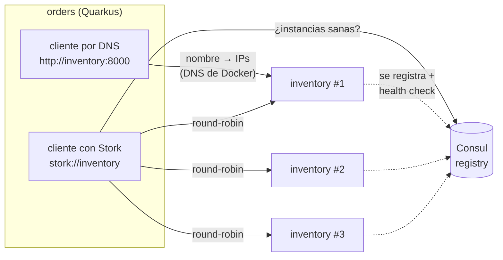

# 08 · Service Registry y Discovery

> Cuando un servicio corre en varias instancias que aparecen, desaparecen y cambian de IP, ¿cómo sabe el que lo llama a quién hablarle? Y sobre todo: ¿cómo evita hablarle a una instancia caída o enferma?

**Patrones:** Service Registry · Self Registration · Client-side Discovery · Server-side Discovery (DNS)
**Stack:** Quarkus + SmallRye Stork · FastAPI · **Infra:** Consul · **Tiempo estimado:** 1 a 1,5 h · **Requiere:** lab 06

---

## El problema

Inventario corre en **3 réplicas** (y mañana en 5). Cada una tiene una IP que cambia en cada reinicio. Pedidos necesita:

1. **Encontrarlas**, sin una lista de IPs escrita a mano.
2. **Repartir** las llamadas entre todas, no cargar a una sola.
3. **Evitar** las que están caídas o enfermas (vivas, pero respondiendo mal).

## Dos formas de resolverlo, lado a lado

Pedidos consulta el stock de inventario por **dos caminos**, y los puedes comparar con las mismas réplicas:



### 1. Por DNS (el modelo de Docker y de Kubernetes)

Pedidos llama a `http://inventory:8000`. Docker resuelve el nombre `inventory` a las IPs de las réplicas. El "registry" es el propio Docker. Es lo más simple, y no requiere código ni infraestructura extra.

Pero el DNS **no sabe de salud**. Si una réplica está viva pero enferma, su IP sigue en la respuesta. Y como el cliente **reutiliza la conexión** (keep-alive), casi todas las llamadas van a la misma réplica.

### 2. Client-side discovery con Consul + Stork

- **Service Registry:** [Consul](https://developer.hashicorp.com/consul) guarda qué instancias hay de cada servicio y le hace a cada una un **health check** cada 2 s.
- **Self Registration:** cada réplica de inventario se registra sola al arrancar (con su IP y su health check) y se borra al apagarse ([`consul.py`](services/inventory/app/consul.py)). Si muere sin despedirse (`kill -9`), el health check falla, Consul la marca *critical* y, si sigue así un minuto, la borra.
- **Client-side discovery:** pedidos usa la URL `stork://inventory`. [SmallRye Stork](https://smallrye.io/smallrye-stork/) le pregunta a Consul qué instancias **sanas** hay (con un refresco cada 2 s) y elige una con **round-robin** en cada llamada ([`application.properties`](services/orders/src/main/resources/application.properties)).

```properties
quarkus.rest-client.inventory-consul.url=stork://inventory
quarkus.stork.inventory.service-discovery.type=consul
quarkus.stork.inventory.service-discovery.refresh-period=2S     # el default es 5 minutos
quarkus.stork.inventory.load-balancer.type=round-robin
```

## Lo que se midió en este lab

| Situación | Por DNS | Con Consul + Stork |
|---|---|---|
| 3 réplicas sanas, 9 llamadas | **9 a la misma réplica** (la conexión se reutiliza) | 3 / 3 / 3 |
| Una réplica **enferma** (viva, health check en rojo) | Le siguen llegando **todas** las llamadas | Sale de la rotación en ~2 a 4 s |
| Una réplica muere con `kill -9` | Si era la que usaba, se pasa a otra IP | Unas pocas llamadas fallan hasta el siguiente health check y refresco; después, cero errores |
| Una réplica se apaga bien (`docker stop`) | Docker la saca del DNS | Se borra sola de Consul en el momento |
| Escalar a 4 | Sigue usando la misma | La nueva se registra y entra en la rotación: 2 / 2 / 2 / 2 |

## Arquitectura del lab

| Servicio | Qué es | Puerto |
|---|---|---|
| `orders` | Quarkus, con los dos clientes | 8102 |
| `inventory` | FastAPI, **3 réplicas** sin puertos publicados. Cada respuesta dice qué réplica respondió (el ID del contenedor) | — |
| `consul` | Registry, en modo desarrollo. UI: http://localhost:8500 | 8500 |

| Endpoint de pedidos | Qué hace |
|---|---|
| `GET /api/discovery/{dns\|consul}/stock/{sku}` | Una consulta de stock, y qué réplica respondió |
| `GET /api/discovery/{dns\|consul}/spread?calls=9` | N consultas seguidas y cuántas respondió cada réplica |

## Levántalo

```bash
cd labs/08-service-discovery
docker compose up --build -d
./smoke.sh
```

Mira las instancias en la UI de Consul: http://localhost:8500/ui/dc1/services/inventory/instances. Más peticiones en [`requests.http`](requests.http). Para limpiar: `docker compose down -v`.

## Rómpelo

1. **¿Quién responde?**
   ```bash
   curl -s 'localhost:8102/api/discovery/consul/spread?calls=9'
   curl -s 'localhost:8102/api/discovery/dns/spread?calls=9'
   ```
   Con Stork, 3 / 3 / 3. Por DNS, casi siempre las 9 a la misma réplica.

2. **Enferma una réplica sin matarla.** Toma el ID de la que responde por DNS y apágale el health check:
   ```bash
   ID=$(curl -s localhost:8102/api/discovery/dns/stock/INV-001 | python3 -c "import json,sys; print(json.load(sys.stdin)['instance'])")
   docker exec $ID python -c "import urllib.request; urllib.request.urlopen(urllib.request.Request('http://localhost:8000/admin/health', data=b'{\"healthy\": false}', headers={'Content-Type': 'application/json'}))"
   ```
   En la UI de Consul se pone en rojo. Repite el experimento 1: Stork ya no la usa, pero por DNS **le siguen llegando todas**. En la vida real, una réplica "enferma" puede ser una sin conexión a su base, o una con la memoria llena. Vuelve a ponerla sana con `{"healthy": true}`.

3. **Mátala sin aviso.**
   ```bash
   docker kill $(docker compose ps -q inventory | head -1)
   for i in 1 2 3; do curl -s 'localhost:8102/api/discovery/consul/spread?calls=6'; echo; sleep 2; done
   ```
   Las primeras llamadas pueden fallar (`"errors"` > 0): hay una ventana entre la muerte y el siguiente health check y refresco. Después, cero errores. Achicar esa ventana tiene un costo: más health checks y más consultas a Consul. Los reintentos del lab 11 cubren lo que queda.

4. **Apágala bien.** `docker stop <id>` manda SIGTERM: la réplica alcanza a borrarse de Consul (mira sus logs: `Borrada de Consul`). Con `kill -9`, en cambio, queda registrada hasta que el health check la delata.

5. **Escala.**
   ```bash
   docker compose up -d --scale inventory=5
   ```
   Las nuevas se registran solas. Ni pedidos ni Consul cambiaron su configuración.

6. **Apaga el registry.** `docker compose stop consul` y repite el experimento 1. Las llamadas **siguen funcionando**: Stork se queda con la última lista que obtuvo (en los logs de pedidos verás errores al refrescar). Pero ya no se entera de cambios: una réplica que muera ahora seguirá en la lista. Por eso en prod Consul corre en 3 o 5 servidores.

## ¿Qué cambia en dev y prod?

Este lab no trae overlays de ambiente. Lo que cambia:

| Aspecto | Local (este lab) | Prod |
|---|---|---|
| Consul | 1 nodo `-dev`, en memoria | 3 o 5 servidores (quórum Raft) + un agente en cada máquina, con ACL y TLS |
| Registro | La app llama a la API de Consul | Lo mismo, o lo hace la plataforma (Nomad, el agente con archivos de servicio, Registrator) |
| Refresco de Stork | 2 s | Unos segundos a un minuto: equilibrio entre reaccionar rápido y cargar a Consul |
| En Kubernetes | — | Normalmente **no** hace falta un registry: el `Service` tiene una IP virtual estable y solo enruta a pods con el *readiness probe* en verde. Es server-side discovery con salud incluida |

## Costo y cuándo NO usarlo

- **Una pieza crítica más.** Si Consul cae, los clientes se quedan con su última lista (Stork la guarda; experimento 6) pero no ven cambios. En prod necesita alta disponibilidad.
- **Cada lenguaje necesita su cliente.** Stork en Quarkus, Spring Cloud LoadBalancer en Spring, y en Python, a mano. Con server-side discovery (Kubernetes, un load balancer) el cliente no sabe nada.
- **Self Registration acopla la app al registry.** La alternativa, *3rd party registration*, es que la plataforma registre las instancias.
- **Cuándo no:** en Kubernetes, casi nunca: usa `Service` + *readiness probes*. Tampoco con instancias fijas detrás de un load balancer. Un registry propio paga cuando hay máquinas virtuales o varios clústeres y lenguajes que deben encontrarse entre sí.

### ¿Y Eureka?

Eureka (Spring Cloud Netflix) es el registry clásico del mundo Spring, con la misma idea: las instancias se registran y mandan *heartbeats*, y los clientes (Spring Cloud LoadBalancer) eligen una. Diferencias con Consul:

| | Consul | Eureka |
|---|---|---|
| Cómo sabe que una instancia vive | **Él** le hace health checks (HTTP, TCP, script) | La **instancia** le manda *heartbeats* cada 30 s |
| Consistencia | CP (Raft): todos ven lo mismo | AP: prefiere responder, aunque sea una lista vieja |
| Además ofrece | DNS, almacén clave-valor, service mesh | Solo registry |
| Ecosistema | Cualquier lenguaje | Principalmente Java/Spring |

Stork también soporta Eureka (`service-discovery.type=eureka`), así que el código de pedidos no cambiaría.

## Ejercicio

Agrega un tercer camino: **server-side discovery** con un balanceador. Levanta Traefik con el *provider* de Docker; descubre los contenedores por etiquetas, sin registry propio. Pedidos llama a Traefik, que reparte entre las réplicas sanas. Pista: `traefik.http.services.inventory.loadbalancer.healthcheck.path=/health`. ¿Cuál de los tres caminos elegirías y por qué?

## Para profundizar

- Chris Richardson, [*Service Registry*](https://microservices.io/patterns/service-registry.html), [*Client-side discovery*](https://microservices.io/patterns/client-side-discovery.html) y [*Server-side discovery*](https://microservices.io/patterns/server-side-discovery.html).
- [Quarkus: Getting started with SmallRye Stork](https://quarkus.io/guides/stork) y su [referencia de Consul](https://smallrye.io/smallrye-stork/latest/service-discovery/consul/).
- Siguiente: el [lab 09](../09-bff/) arma la pantalla "Mis pedidos" componiendo datos de varios servicios.
