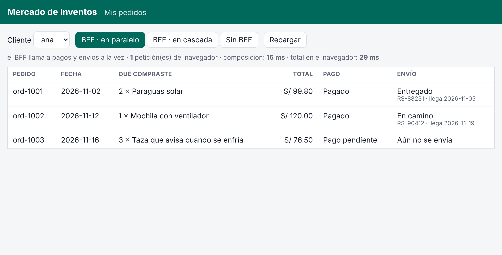
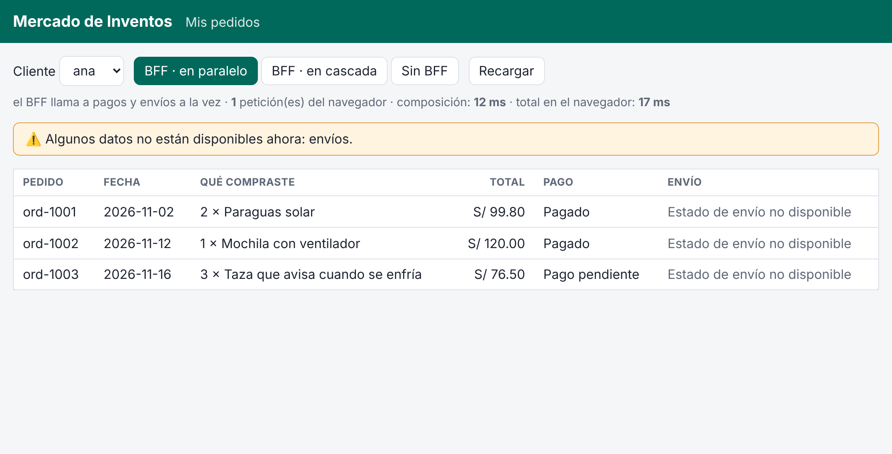
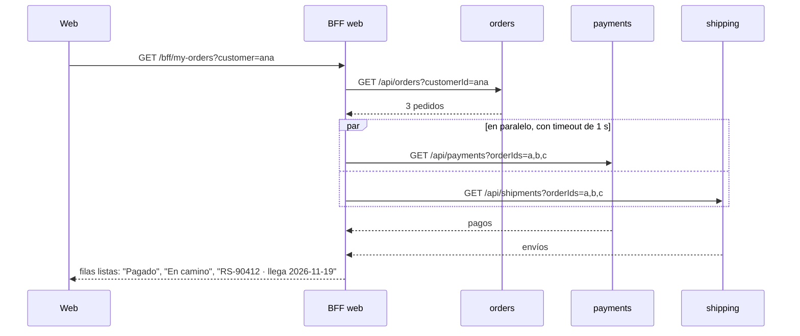

# 09 · Backend for Frontend y API Composition

> Una pantalla necesita datos de varios servicios. En lugar de que el navegador los pida uno por uno y los arme, un backend hecho **para esa interfaz** los pide en paralelo, los combina y le entrega a la pantalla exactamente lo que va a mostrar.

**Patrones:** Backend for Frontend (BFF) · API Composition
**Stack:** FastAPI (BFF y envíos) · Quarkus (pedidos y pagos) · React · **Infra:** — · **Tiempo estimado:** 1 a 1,5 h · **Requiere:** lab 05

---

| La pantalla, compuesta por el BFF | Con envíos caído: respuesta parcial, no un error |
|---|---|
|  |  |

## El problema

La pantalla **"Mis pedidos"** muestra, por cada pedido, qué se compró, el estado del **pago** y el estado del **envío**. Esos datos viven en tres servicios con su propia base (lab 05). No hay un `JOIN` posible.

Si el navegador arma la pantalla solo:

- **Hace varias peticiones** (pedidos, luego pagos, luego envíos). En una red móvil, cada una cuesta.
- **Recibe de más:** las API de dominio devuelven todo lo que saben (precios unitarios, SKUs, fechas de pago), y la pantalla usa una parte.
- **Repite lógica:** traducir `IN_TRANSIT` a "En camino", qué hacer si envíos no responde... y la app móvil tendría que repetirla otra vez.
- **Maneja los errores parciales** por su cuenta, o peor: si un servicio falla, toda la pantalla falla.

## La versión ingenua

El botón **"Sin BFF"** de la web. El navegador hace las tres peticiones y compone con [`composeInBrowser`](frontend/src/myOrders.ts). Funciona, pero mira cuánta lógica de negocio terminó en TypeScript: traducciones de estados, manejo de fallas parciales y uniones por `orderId`. Abre DevTools (pestaña *Network*) y verás las tres peticiones.

## El patrón



**API Composition** ([`compose.py`](services/bff/app/compose.py)):

1. **Primero lo imprescindible.** Sin la lista de pedidos no hay pantalla: si pedidos falla, `503`.
2. **El resto en paralelo** (`asyncio.gather`). El tiempo total es el del servicio **más lento**, no la suma.
3. **Con timeout** por llamada (1 s, `CALL_TIMEOUT_S`). Un servicio lento no cuelga la pantalla.
4. **Respuesta parcial:** si pagos o envíos no responden, la respuesta es `200` con `"unavailable": ["shipping"]` y el texto "Estado de envío no disponible". La pantalla avisa, pero muestra lo que sí tiene.
5. **En lote, nunca uno por uno:** `?orderIds=a,b,c` es **una** llamada por servicio. Pedir el pago de cada pedido por separado sería el problema N+1: 20 pedidos, 40 llamadas.

**Backend for Frontend:** el BFF es el backend de **una** interfaz, la web. Su respuesta tiene la forma de la pantalla, con fechas cortas, textos listos para mostrar y solo los campos que se ven. Si mañana hay una app móvil con otra pantalla, tendría **su propio** BFF, mantenido por el equipo de esa app.

| | API de dominio (`orders`, `payments`, `shipping`) | BFF |
|---|---|---|
| Pensada para | El dominio: cualquier cliente | **Una** interfaz y sus pantallas |
| Devuelve | Todo lo que el servicio sabe (`IN_TRANSIT`, `unitPrice`, `paidAt`...) | Lo que la pantalla muestra ("En camino", "2 × Paraguas solar") |
| Cambia cuando | Cambia el negocio | Cambia la pantalla |
| Dueño | El equipo del servicio | El equipo de la interfaz |

## Arquitectura del lab

| Servicio | Qué es | Puerto |
|---|---|---|
| `frontend` | React + nginx. Proxy de `/bff` (y de `/api/*`, solo para el modo "Sin BFF") | 3000 |
| `bff` | FastAPI: compone "Mis pedidos" | 8110 |
| `orders` | Quarkus: pedidos de un cliente | 8102 |
| `payments` | Quarkus: pagos de varios pedidos | 8104 |
| `shipping` | FastAPI: envíos de varios pedidos | 8105 |

Los datos son de ejemplo, en memoria. Clientes: `ana` (3 pedidos, uno entregado, uno en camino y uno sin pagar) y `beto` (1 pedido reembolsado). Cada servicio acepta latencia inyectada con `PUT /admin/delay {"ms": 800}`.

## Levántalo

```bash
cd labs/09-bff
docker compose up --build -d
./smoke.sh
```

Abre http://localhost:3000. Más peticiones en [`requests.http`](requests.http). Para limpiar: `docker compose down -v`.

## Rómpelo

1. **Cuenta las peticiones.** Con DevTools abierto (*Network*), cambia entre "BFF · en paralelo" y "Sin BFF". Con BFF, **1** petición y solo los campos que se muestran. Sin BFF, **3**, con todos los campos de cada servicio.

2. **Cascada contra paralelo.** Ponle 500 ms a pagos y a envíos:
   ```bash
   curl -X PUT localhost:8104/admin/delay -H 'Content-Type: application/json' -d '{"ms":500}'
   curl -X PUT localhost:8105/admin/delay -H 'Content-Type: application/json' -d '{"ms":500}'
   ```
   En la web, compara "composición" entre "en cascada" (~1000 ms, la **suma**) y "en paralelo" (~500 ms, el **más lento**). Con 5 servicios de 300 ms, la diferencia es 1,5 s contra 0,3 s.

3. **Un servicio caído.**
   ```bash
   docker compose stop shipping
   ```
   Recarga: aviso amarillo, "Estado de envío no disponible", pero los pedidos y los pagos están. Prueba lo mismo en "Sin BFF": la web también lo resuelve, porque esa lógica está duplicada en [`myOrders.ts`](frontend/src/myOrders.ts). Esa duplicación es justo lo que el BFF evita. `docker compose start shipping` para volver.

4. **Un servicio lento.** Pon 3000 ms a pagos. La pantalla llega en ~1 s, sin el estado de pago: el timeout corta la espera. Cambia el límite con `CALL_TIMEOUT_S=5 docker compose up -d bff` y la pantalla espera los 3 s completos. ¿Qué prefiere tu usuario?

5. **Sin lo imprescindible.** `docker compose stop orders`: el BFF responde `503`. No todos los datos son iguales: sin pedidos no hay nada que mostrar, pero sin envíos sí.

## ¿Qué cambia en dev y prod?

Este lab no trae overlays de ambiente. Lo que cambia:

| Aspecto | Local (este lab) | Prod |
|---|---|---|
| Quién es el cliente | Parámetro `?customer=ana` (⚠️ cualquiera puede pedir los pedidos de otro) | Sale de la **sesión o del token** (lab 07). El BFF suele ser quien maneja la sesión de la web |
| Servicios directos (`/api/*`) | Expuestos por nginx para el modo "Sin BFF" | **No** expuestos: la web solo habla con su BFF (detrás del gateway) |
| Timeout | 1 s para todo | Uno por servicio, según su latencia normal (p99) |
| Fallas | Respuesta parcial | Lo mismo, más *circuit breaker* (lab 11) para no insistir con un servicio que ya está caído |
| Observabilidad | — | Una traza muestra las llamadas en paralelo del BFF (lab 10) |

## Costo y cuándo NO usarlo

- **Un servicio más por cada interfaz**, con su despliegue y su equipo. Si hay 4 interfaces, hay 4 BFF.
- **Tentación de lógica de negocio.** El BFF traduce y compone; las **reglas** (si se puede cancelar, cuánto cuesta el envío) siguen en los servicios. Un BFF con reglas de negocio es otro monolito.
- **API Composition tiene límites.** Componer en memoria sirve para una pantalla con pocos pedidos. Para "todos los pedidos con envío atrasado, ordenados por fecha de pago", filtrando y paginando entre servicios, no alcanza: ahí entra CQRS (lab 14), con una vista ya combinada.
- **Cuándo no:** con un solo cliente simple, o cuando las API de dominio ya calzan con las pantallas. Un gateway (lab 07) o una sola llamada directa alcanzan.

## Ejercicio

Agrega una segunda pantalla al BFF: **"Detalle del pedido"** (`GET /bff/orders/{id}`), que muestre además el stock actual de cada invento. ¿Qué pasa si el pedido no es del cliente que lo pide? ¿Dónde se valida eso: en el BFF o en pedidos? Pista: la regla "solo ves tus pedidos" es del dominio, así que debería validarla pedidos; el BFF solo le pasa la identidad.

## Para profundizar

- Sam Newman, [*Backends For Frontends*](https://samnewman.io/patterns/architectural/bff/), y *Building Microservices* (2.ª ed.), capítulo 14.
- Chris Richardson, [*API Composition*](https://microservices.io/patterns/data/api-composition.html).
- Phil Calçado, [*The Back-end for Front-end Pattern*](https://philcalcado.com/2015/09/18/the_back_end_for_front_end_pattern_bff.html): cómo nació en SoundCloud.
- Siguiente: el [lab 10](../10-observabilidad/) muestra cómo seguir una petición que cruza varios servicios.
