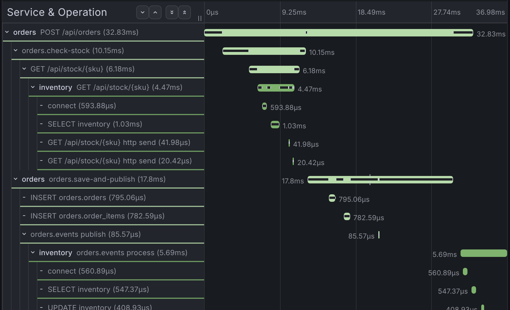
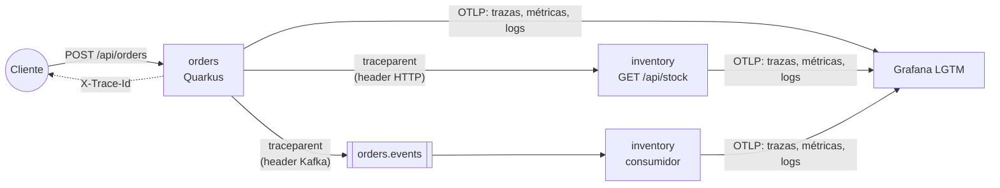

# 10 · Observabilidad distribuida

> Cuando una petición cruza varios servicios, dos lenguajes y un broker, lo primero que pierdes es la capacidad de ver qué pasó. Este lab la recupera.

**Patrones:** Distributed Tracing · Log Aggregation · Application Metrics · Health Check API · Correlation ID
**Stack:** Quarkus + `quarkus-opentelemetry` · FastAPI + OpenTelemetry SDK · **Infra:** PostgreSQL, Kafka, Grafana LGTM (Grafana + Tempo + Loki + Prometheus + colector OTel) · **Tiempo estimado:** 1,5 h · **Requiere:** lab 06



*Una sola petición `POST /api/orders` vista en Grafana Tempo: 15 spans y 2 servicios en 2 lenguajes, unidos por HTTP y por Kafka.*

---

## El problema

Un cliente escribe: *"Hice un pedido a las 10:42 y tardó muchísimo"*. Para responder necesitas saber:

- **Qué servicios** tocó esa petición y en qué orden.
- **Cuánto tardó cada paso**: ¿la llamada a inventario, la base de datos, Kafka?
- **Qué logs** escribió cada servicio **para esa petición**, entre miles de otras.
- Si es un caso aislado o algo general (**métricas**).

Con un monolito bastaba un stack trace y un archivo de log. Con microservicios, cada servicio tiene su propio log y nadie ve el recorrido completo.

## La versión ingenua

`docker compose logs` en cada servicio y `grep` por el id del pedido... que no siempre aparece en todos los logs. Si el problema está en un mensaje de Kafka, el rastro se corta. Y para saber "cuánto tardó", te quedan los timestamps a mano.

## El patrón: los tres pilares, unidos por el traceId

| Pilar | Responde | Dónde lo ves |
|---|---|---|
| **Trazas** | ¿Por dónde pasó esta petición y cuánto tardó cada paso? | Grafana → Explore → Tempo |
| **Logs** | ¿Qué dijo cada servicio en ese momento? | Grafana → Explore → Loki |
| **Métricas** | ¿Cuántas, qué tan rápido, qué tan seguido falla? | Grafana → Explore → Prometheus |

Lo que los une es el **traceId**:

1. El primer servicio que recibe la petición lo genera.
2. Viaja en el header HTTP `traceparent` (estándar W3C) **y en los headers de los mensajes de Kafka**.
3. Cada servicio lo agrega a sus spans **y a cada línea de log**.
4. Pedidos lo devuelve al cliente en `X-Trace-Id` (el *Correlation ID*). Con ese valor el soporte encuentra todo.



### Health Check API: dos preguntas distintas

| Endpoint | Pregunta | Si dice DOWN… | ¿Revisa dependencias? |
|---|---|---|---|
| **liveness** `/q/health/live` · `/health/live` | ¿El proceso está vivo? | La plataforma lo **reinicia** | **No** |
| **readiness** `/q/health/ready` · `/health/ready` | ¿Puedo atender tráfico ahora? | La plataforma **deja de enviarle** tráfico | **Sí** (BD, Kafka) |

¿Por qué liveness no revisa la base de datos? Si la BD cae y liveness dijera DOWN, la plataforma reiniciaría **todos** los servicios a la vez. Eso no arregla la base y suma un problema nuevo.

### Las piezas clave

| Qué | Dónde |
|---|---|
| Quarkus: trazas, métricas y logs con **configuración**, sin código | [`application.properties`](services/orders/src/main/resources/application.properties) (`quarkus.otel.*`, `jdbc.telemetry`) |
| El traceId en cada línea de log | `quarkus.log.console.format=… traceId=%X{traceId}` |
| Correlation ID para el cliente | [`TraceIdHeader.java`](services/orders/src/main/java/com/mercadoinventos/orders/TraceIdHeader.java) |
| Spans de negocio en Quarkus: `@WithSpan` (`orders.check-stock`) y `Tracer` (`orders.save-and-publish`) | [`StockCheck.java`](services/orders/src/main/java/com/mercadoinventos/orders/StockCheck.java) y [`OrderService.java`](services/orders/src/main/java/com/mercadoinventos/orders/OrderService.java) |
| Métrica de negocio en Quarkus `orders.placed` (con el `Meter`) y el atributo `order.id` | [`OrderService.java`](services/orders/src/main/java/com/mercadoinventos/orders/OrderService.java) |
| Python: proveedores de trazas, métricas y logs | [`telemetry.py`](services/inventory/app/telemetry.py) |
| **Continuar la traza desde un mensaje de Kafka** | [`consumer.py`](services/inventory/app/consumer.py) (`context_from_kafka_headers` + span `CONSUMER`) |
| Métrica de negocio `inventory.reservations` | [`telemetry.py`](services/inventory/app/telemetry.py) y [`events.py`](services/inventory/app/events.py) |

**¿A mano o automático?** La extensión de Quarkus instrumenta todo lo técnico sin código; en Python este lab configura el SDK a mano para que se vea cada pieza. [`docs/instrumentacion-manual-vs-automatica.md`](docs/instrumentacion-manual-vs-automatica.md) compara las dos formas en Python, Quarkus y Spring Boot, con los errores típicos de cada una.
| Liveness vs. readiness | [`health.py`](services/inventory/app/health.py) |

## Levántalo

```bash
cd labs/10-observabilidad
docker compose up --build -d
./smoke.sh
```

`smoke.sh` hace un pedido y comprueba tres cosas: que Tempo tenga una traza con spans de los dos servicios, que Loki tenga los logs de ambos con el mismo traceId y que Prometheus tenga la métrica de negocio. Al final imprime el traceId para que lo busques.

**Grafana:** http://localhost:3001 → **Explore**:
- **Tempo**: pega el traceId en la consulta TraceQL.
- **Loki**: `{service_name=~"orders|inventory"} | trace_id="<traceId>"`.
- **Prometheus**: `inventory_reservations_total` o `http_server_request_duration_seconds_count`.

Para limpiar: `docker compose down -v`.

## Rómpelo

1. **Sigue un pedido.** Haz un pedido con [`requests.http`](requests.http), copia el `X-Trace-Id` y búscalo en Tempo. Recorre el árbol de spans: la consulta de stock (HTTP a inventario y su `SELECT`), los `INSERT` de pedidos, `orders.events publish` y, **como hijo de ese publish**, el `orders.events process` de inventario con su `UPDATE`.

   Dos procesos, dos lenguajes y un broker en medio, todo dentro de **una** traza.

2. **Encuentra la lentitud.** Agrega 1,5 segundos de latencia artificial a inventario:
   ```bash
   STOCK_LOOKUP_DELAY_MS=1500 docker compose up -d inventory
   ```
   Haz un pedido y abre su traza: `POST /api/orders` tarda unos 1500 ms, y el span culpable es `inventory GET /api/stock/{sku}`, que tarda lo mismo. Sin trazas, solo sabrías que "pedidos está lento". Para volver a la normalidad, ejecuta `docker compose up -d inventory`.

3. **De la traza a los logs.** En el detalle de la traza, el botón **Related logs** abre Loki filtrado por ese traceId: los logs de **orders y inventory** juntos, en orden. También puedes ir al revés: busca `RESERVED` en Loki y abre la traza desde el log.

4. **Liveness vs. readiness.** Tumba la base de datos:
   ```bash
   docker compose stop postgres
   curl -i localhost:8102/q/health/live    # 200: el proceso está bien
   curl -i localhost:8102/q/health/ready   # 503: no puede atender pedidos
   curl -i localhost:8103/health/ready     # 503 con el detalle {"database":"DOWN (...)"}
   docker compose start postgres
   ```
   `docker compose ps` muestra los servicios como `unhealthy`, porque su `HEALTHCHECK` usa readiness. Al volver la BD, se recuperan solos y sin reinicio.

5. **Métricas, no solo trazas.** En Prometheus, `inventory_reservations_total` cuenta las reservas por resultado y `sum by (http_response_status_code) (http_server_request_duration_seconds_count{job="orders"})` muestra las respuestas de pedidos por código HTTP. Haz algunos pedidos de INV-002 (stock 0): pedidos los rechaza **antes** de publicar (consulta de stock → `409`). La serie `409` crece y las reservas de inventario no cambian. Una traza explica **una** petición; una métrica dice **cuántas** van así. Las métricas se exportan cada 10 s (en Quarkus el default es 60 s; aquí se bajó con `quarkus.otel.metric.export.interval`).

6. **¿Qué pasa si se pierde el traceparent?** En [`consumer.py`](services/inventory/app/consumer.py), quita `context=parent` del `start_as_current_span`. Reconstruye inventario y haz un pedido: ahora el consumidor de Kafka aparece en una traza **separada**, sin relación con el pedido. Así de frágil es la propagación de contexto: un eslabón que no la pasa corta la historia.

## ¿Qué cambia en dev y prod?

| Aspecto | Local (este lab) | Prod |
|---|---|---|
| Backend de telemetría | `grafana/otel-lgtm`: todo en un contenedor, sin persistencia | Tempo, Loki y Prometheus/Mimir por separado, con almacenamiento (S3/GCS) y retención definida, o un servicio administrado |
| Muestreo de trazas | 100 % | Muestreo (p. ej. 10 % + todas las trazas con error, *tail sampling* en el colector) |
| Colector OTel | dentro de LGTM | Un colector propio (o *sidecar*) que filtra, enriquece y enruta |
| Logs | texto en consola + OTLP | JSON estructurado (lab 01) + OTLP; **nunca** datos personales ni secretos en logs |
| Alertas | ninguna | Sobre métricas (tasa de error, latencia p99, *consumer lag*), no sobre logs sueltos |
| Health checks | `HEALTHCHECK` de Docker | Probes de Kubernetes (`livenessProbe`, `readinessProbe`, `startupProbe`) |

## Costo y cuándo NO usarlo

- **Volumen y costo:** la telemetría puede costar más que los propios servicios si no se muestrea ni se define una retención.
- **Instrumentación que mantener:** en Python hay que fijarse en la compatibilidad. Construyendo este lab, la instrumentación de SQLAlchemy **no soportaba la 2.1** y se negó a funcionar (de ahí el `sqlalchemy==2.0.x` en [`requirements.txt`](services/inventory/requirements.txt)).
- **Alta cardinalidad:** poner ids de pedido como *labels* de métricas revienta Prometheus. Los ids van en **trazas y logs**; las métricas usan dimensiones acotadas (`status`, `route`).

La observabilidad no es opcional en un sistema distribuido. Lo que sí se elige es **cuánta**: en un monolito pequeño, logs estructurados y un par de métricas bastan.

## Ejercicio

Agrega un **span manual** en inventario que envuelva solo la lógica de reserva, con los atributos `order.id` y `reservation.items`. Luego búscalo en Tempo con TraceQL:

```
{ span.order.id = "<id del pedido>" }
```

<details><summary>Pista</summary>

Usa `tracer.start_as_current_span("reserve-stock", attributes={...})` de [`telemetry.py`](services/inventory/app/telemetry.py) dentro de `OrderEventHandler.handle`. Como el handler corre en otro hilo (`asyncio.to_thread`), el contexto llega porque `to_thread` copia los *contextvars*.
</details>

## Para profundizar

- [OpenTelemetry: conceptos](https://opentelemetry.io/docs/concepts/) y [W3C Trace Context](https://www.w3.org/TR/trace-context/).
- [Quarkus: OpenTelemetry](https://quarkus.io/guides/opentelemetry).
- Chris Richardson, [Distributed tracing](https://microservices.io/patterns/observability/distributed-tracing.html) y [Health Check API](https://microservices.io/patterns/observability/health-check-api.html).
- [grafana/docker-otel-lgtm](https://github.com/grafana/docker-otel-lgtm).
