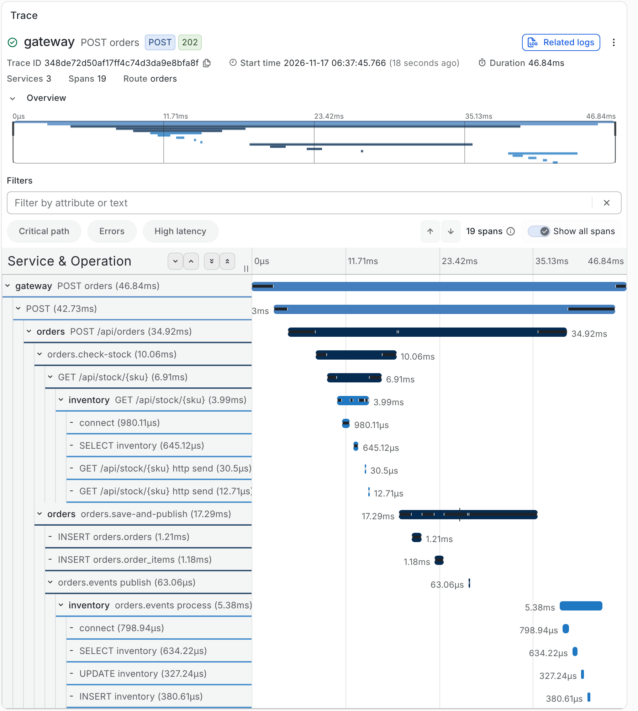

# Instrumentar a mano o automáticamente: Python, Quarkus y Java con agente

OpenTelemetry tiene dos capas:

- **Instrumentación automática:** una librería, agente o extensión crea los spans de lo **técnico** (peticiones HTTP, consultas SQL, mensajes de Kafka) sin que escribas código.
- **Instrumentación manual:** tu código crea spans, atributos y métricas de lo que **solo tú sabes**: qué paso del negocio es, qué pedido, cuántos se aceptaron.

En la práctica se usan **las dos**: la automática te da el esqueleto de la traza y la manual le pone nombres de negocio. Este lab muestra tres formas, una por servicio.

| | Lo técnico (automático) | Lo de negocio (manual) |
|---|---|---|
| **orders** (Quarkus) | La extensión `quarkus-opentelemetry`: HTTP entrante y saliente, JDBC, Kafka, logs | `@WithSpan` en [`StockCheck`](../services/orders/src/main/java/com/mercadoinventos/orders/StockCheck.java), `Tracer` y `Meter` en [`OrderService`](../services/orders/src/main/java/com/mercadoinventos/orders/OrderService.java) |
| **gateway** (Spring Cloud Gateway) | El **agente de Java** (`-javaagent`): servidor y cliente HTTP, logs y métricas de la JVM. Sin código ni dependencias | Nada: un gateway no tiene lógica de negocio |
| **inventory** (Python) | Instrumentaciones de FastAPI y SQLAlchemy, activadas **en el código** | El SDK configurado a mano en [`telemetry.py`](../services/inventory/app/telemetry.py), el span del consumidor de Kafka y la métrica `inventory.reservations` |



## Python: configurado a mano

[`telemetry.py`](../services/inventory/app/telemetry.py) arma cada pieza del SDK de forma explícita: `TracerProvider`, `MeterProvider` y `LoggerProvider`, cada uno con su exportador OTLP. Así se ve lo que en otros stacks queda escondido.

La parte más didáctica es la **propagación por Kafka**. El cliente aiokafka no está instrumentado, así que el consumidor lee el `traceparent` de los headers y abre un span **hijo** de esa traza ([`consumer.py`](../services/inventory/app/consumer.py)):

```python
parent = context_from_kafka_headers(message.headers)          # propagate.extract(...)
with tracer.start_as_current_span(f"{message.topic} process", context=parent, kind=SpanKind.CONSUMER,
                                  attributes={"messaging.system": "kafka", ...}):
    await process_message(message.value, handler, dlq, settings.retry_backoff_seconds)
```

Sin esas tres líneas, la traza se **corta** en Kafka: inventario empezaría una traza nueva y no podrías seguir el pedido de punta a punta.

## Python: automático (la alternativa)

Lo mismo, sin tocar el código de la app:

```bash
uv add opentelemetry-distro opentelemetry-exporter-otlp
uv run opentelemetry-bootstrap -a install       # instala las instrumentaciones de las librerías que detecta
OTEL_SERVICE_NAME=inventory OTEL_EXPORTER_OTLP_ENDPOINT=http://lgtm:4318 \
  uv run opentelemetry-instrument uvicorn app.main:create_app --factory
```

`opentelemetry-instrument` parchea las librerías al arrancar. Es más rápido de poner, pero:

- **Depende de que exista una instrumentación para cada librería y versión.** En este lab, la de SQLAlchemy todavía no soporta la 2.1, y por eso el lab fija SQLAlchemy 2.0.57 (L10-4). Con la automática, ese problema aparece como spans que faltan, sin ningún error.
- **Es menos explícito.** Cuando algo no aparece en la traza, hay que saber qué parcheó el agente y qué no.
- **No agrega negocio.** Los spans de negocio y las métricas como `inventory.reservations` se siguen escribiendo a mano.

## Quarkus: automático

Una dependencia y tres propiedades:

```xml
<artifactId>quarkus-opentelemetry</artifactId>
```

```properties
quarkus.otel.exporter.otlp.endpoint=${OTEL_EXPORTER_OTLP_ENDPOINT}
quarkus.otel.metrics.enabled=true
quarkus.otel.logs.enabled=true
quarkus.datasource.jdbc.telemetry=true         # un span por consulta SQL
```

Con eso, Quarkus instrumenta el servidor HTTP, el REST client, JDBC y **Kafka**. El `traceparent` viaja en los headers del mensaje sin una línea de código: es lo que en Python hace `context_from_kafka_headers`.

## Quarkus: a mano (el ejemplo de este lab)

### 1. `@WithSpan`: un span por anotación

```java
@WithSpan("orders.check-stock")
public void ensureAvailable(@SpanAttribute("order.items") int itemCount, List<Order.Item> items) { ... }
```

- Crea un span hijo alrededor del método. Las llamadas HTTP a inventario quedan **dentro** de él, agrupadas (mira la captura).
- Si el método lanza una excepción, el span queda en `ERROR` con la excepción registrada, sin código extra. El test `aRejectedOrderMarksTheSpanAsError` lo comprueba.
- Es un interceptor de CDI: funciona en un **bean** y en métodos **no privados**. Por eso vive en una clase aparte (`StockCheck`), en lugar de un método privado de `OrderService`.

### 2. `Tracer`: control total

```java
Span span = tracer.spanBuilder("orders.save-and-publish")
    .setAttribute("order.id", order.id.toString())
    .startSpan();
try (Scope ignored = span.makeCurrent()) {   // lo de adentro (JDBC, Kafka) cuelga de este span
    QuarkusTransaction.requiringNew().run(order::persist);
    span.addEvent("order.saved");
    events.orderPlaced(order);
} catch (RuntimeException e) {
    span.recordException(e);
    span.setStatus(StatusCode.ERROR, "No se pudo guardar o publicar el pedido");
    throw e;
} finally {
    span.end();                               // sin end(), el span nunca se exporta
}
```

Es más código que `@WithSpan`, pero permite atributos calculados, eventos dentro del span (`order.saved`) y decidir qué error marca el span. Los dos errores típicos son olvidar `span.end()` (el span nunca llega a Tempo) y olvidar `makeCurrent()` (los spans de adentro quedan como hermanos, no como hijos).

### 3. `Meter`: una métrica de negocio

```java
LongCounter ordersPlaced = meter.counterBuilder("orders.placed").setUnit("1").build();
ordersPlaced.add(1, Attributes.of(RESULT, "accepted"));      // o "out_of_stock"
```

En Prometheus aparece como `orders_placed_total{result="accepted"}`. Es el equivalente de `inventory.reservations` en Python.

⚠️ Quarkus exporta las métricas cada **60 s** por defecto. Este lab lo baja a 10 s con `quarkus.otel.metric.export.interval=10s`, igual que inventario.

### ¿Y si en Java se usa un `KafkaConsumer` directo?

Con SmallRye no hace falta, pero si usas el cliente de Kafka sin framework, la propagación es igual que en Python:

```java
Context parent = GlobalOpenTelemetry.getPropagators().getTextMapPropagator()
    .extract(Context.current(), record.headers(), new TextMapGetter<Headers>() {
        public Iterable<String> keys(Headers headers) { ... }
        public String get(Headers headers, String key) {
            Header header = headers.lastHeader(key);
            return header == null ? null : new String(header.value(), StandardCharsets.UTF_8);
        }
    });
Span span = tracer.spanBuilder(record.topic() + " process").setParent(parent).setSpanKind(SpanKind.CONSUMER).startSpan();
```

## Java con el agente: el gateway

El gateway no tiene **ninguna** dependencia de OpenTelemetry en su [`pom.xml`](../gateway/pom.xml) ni una línea de código de observabilidad. El agente se baja junto al jar y se engancha a la JVM al arrancar ([`Dockerfile`](../gateway/Dockerfile)):

```dockerfile
CMD ["java", "-javaagent:/app/opentelemetry-javaagent.jar", "-jar", "gateway.jar"]
```

Y se configura **solo** con variables de entorno ([`compose.yaml`](../compose.yaml)):

```yaml
OTEL_SERVICE_NAME: gateway
OTEL_EXPORTER_OTLP_ENDPOINT: http://lgtm:4318
OTEL_METRIC_EXPORT_INTERVAL: "10000"
```

| | El agente |
|---|---|
| Qué instrumenta | Lo que reconoce en el classpath: aquí Netty y Reactor Netty (el span `SERVER` de la petición y el `CLIENT` hacia orders). También JDBC, Kafka, gRPC, la mayoría de los clientes HTTP… |
| Propagación | Automática: lee el `traceparent` que llega y lo agrega a lo que sale |
| Logs | Pone `trace_id` y `span_id` en el MDC (Logback, Log4j) y exporta los logs por OTLP. Por eso los logs del gateway están en Loki |
| Apagarlo | `OTEL_JAVAAGENT_ENABLED=false` (experimento 7 del README) |
| Costo | Unos segundos más de arranque y algo de memoria: instrumenta clases mientras se cargan |
| Riesgo típico | Una versión de librería que el agente no soporta todavía: esos spans **faltan en silencio**. Hay que mirar la traza, no asumir |

Sirve para cualquier aplicación Java, aunque no sea tuya: un servicio de terceros, un sistema viejo que no se puede recompilar o un gateway como este.

## Spring Boot (referencia)

Para los servicios **tuyos** en Spring, además del agente existe la integración propia. Comparada con Quarkus:

| Necesidad | Quarkus | Spring Boot |
|---|---|---|
| Activar trazas | `quarkus-opentelemetry` | Micrometer Tracing con el puente OTel (`micrometer-tracing-bridge-otel` + `opentelemetry-exporter-otlp`), o el agente Java de OpenTelemetry |
| HTTP, JDBC | Automático | Automático (Observation API); JDBC con `datasource-micrometer` o el agente |
| Kafka | Automático con SmallRye | `spring.kafka.template.observation-enabled=true` y `spring.kafka.listener.observation-enabled=true` |
| Span por anotación | `@WithSpan` | `@Observed` (Micrometer) o `@WithSpan` con el agente o el starter de OTel |
| Span a mano | `Tracer` de OpenTelemetry | `Tracer` de Micrometer, o `Observation.createNotStarted(...).observe(...)` |
| Métrica de negocio | `Meter` de OpenTelemetry | `MeterRegistry` de Micrometer (`Counter.builder(...)`) |
| traceId en los logs | `%X{traceId}` en el formato | `%X{traceId}` (Micrometer lo pone en el MDC) |

La diferencia de fondo: Spring usa **Micrometer** como fachada propia (Observation API) y OpenTelemetry como uno de sus *backends*. Quarkus usa **OpenTelemetry directamente**. Las dos terminan enviando OTLP, así que Grafana, Tempo y Loki no notan la diferencia.

## Resumen

| | Python a mano | Python automático | Quarkus | Java con agente |
|---|---|---|---|---|
| Esfuerzo inicial | Alto (≈60 líneas en `telemetry.py`) | Bajo (un comando) | Bajo (una dependencia, 3 propiedades) | Muy bajo (un jar y variables de entorno) |
| Propagación por Kafka | A mano (`propagate.extract`) | Según exista la instrumentación de tu cliente | Automática | Automática |
| Spans de negocio | `tracer.start_as_current_span` | Igual, a mano | `@WithSpan` o `Tracer` | `@WithSpan` (con la dependencia de anotaciones) o la API de OTel |
| Métricas de negocio | `meter.create_counter` | Igual, a mano | `Meter` | La API de OTel o Micrometer |
| Riesgo típico | Olvidar una pieza del SDK | Versiones no soportadas, spans que faltan en silencio | `span.end()`, `makeCurrent()`, métodos privados con `@WithSpan` | Igual que Python automático: librerías no soportadas, spans que faltan en silencio |
| Mejor para | Aprender cómo funciona | Servicios Python en producción | Servicios Quarkus en producción | Aplicaciones Java que no quieres o no puedes tocar (como este gateway) |
