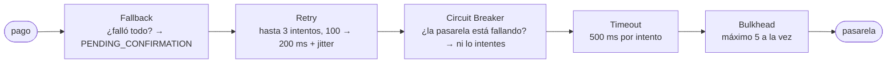
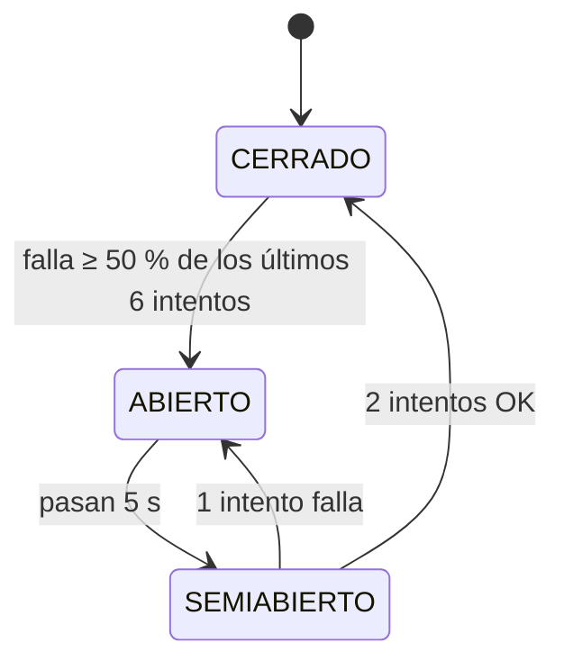

# 11 · Resiliencia: Timeout, Retry, Circuit Breaker, Bulkhead y Fallback

> Una dependencia lenta o caída no debería arrastrar al resto del sistema. Estos cinco patrones deciden **cuánto esperar**, **cuándo reintentar**, **cuándo dejar de intentar**, **cuánto aislar** y **qué responder** cuando algo falla.

**Patrones:** Timeout · Retry con backoff exponencial y jitter · Circuit Breaker · Bulkhead · Fallback
**Stack:** Quarkus + SmallRye Fault Tolerance · FastAPI + tenacity · k6 · **Infra:** Grafana LGTM · **Tiempo estimado:** 2 h · **Requiere:** labs 10 y 12

---

## El problema

Pagos depende de una **pasarela de pagos externa**. No es nuestra: no podemos arreglarla ni saber cuándo va a fallar. A veces está lenta, a veces devuelve errores y a veces se cae.

Sin protección:

- **Lenta:** cada pago espera lo que tarde la pasarela (30 s, el timeout del cliente HTTP). Los hilos de pagos se agotan esperando, y pagos deja de responder **todo**, incluso lo que no usa la pasarela. La falla se propaga en cascada.
- **Caída:** si el código reintenta sin pausa, cada pago genera varias llamadas. Una pasarela que ya estaba en problemas recibe **6 veces** más tráfico justo cuando menos puede atenderlo (*retry storm*).

## La pasarela simulada y sus controles de caos

[`payment-provider`](services/payment-provider/app/main.py) imita una pasarela real:

| Control | Efecto |
|---|---|
| `PUT /admin/chaos {"latencyMs": 3000}` | Cada cobro tarda 3 s |
| `PUT /admin/chaos {"errorRate": 0.5}` | La mitad de los cobros responde `500` |
| `PUT /admin/chaos {"down": true}` | Todo responde `503` |
| `PUT /admin/chaos {}` | Vuelve a la normalidad |
| `GET /admin/stats` | Cuántas peticiones **recibió** y cuántos cobros hizo |

Es **idempotente**: el mismo `idempotencyKey` nunca cobra dos veces (lab 12). Y rechaza los montos mayores a 1000 con `402`: eso es un error de **negocio**, no una falla.

## La versión ingenua

Pagos tiene tres caminos hacia la pasarela, para compararlos:

| Endpoint | Qué hace |
|---|---|
| `POST /api/payments/naive` | ❌ Sin timeout (solo los 30 s del cliente HTTP), sin reintentos, sin fallback |
| `POST /api/payments/naive-retry` | ❌ Reintenta 5 veces **al instante** ante cualquier error |
| `POST /api/payments` | ✅ Con los cinco patrones |

## El patrón

En Quarkus, los cinco patrones son **anotaciones** de SmallRye Fault Tolerance sobre un solo método, [`ResilientProvider.charge`](services/payments/src/main/java/com/mercadoinventos/payments/ResilientProvider.java):

```java
@Fallback(fallbackMethod = "pendingConfirmation", skipOn = PaymentDeclinedException.class)
@Retry(maxRetries = 2, delay = 100, jitter = 50,
       abortOn = {PaymentDeclinedException.class, CircuitBreakerOpenException.class, BulkheadException.class})
@ExponentialBackoff(factor = 2, maxDelay = 1000)
@CircuitBreaker(requestVolumeThreshold = 6, failureRatio = 0.5, delay = 5000, successThreshold = 2,
                skipOn = {PaymentDeclinedException.class, BulkheadException.class})
@Timeout(500)
@Bulkhead(5)
public ChargeResult charge(ChargeRequest request) { ... }
```

Se aplican **en este orden**, de afuera hacia adentro (lo define la especificación de MicroProfile):



| Patrón | Qué resuelve | Configuración en este lab |
|---|---|---|
| **Timeout** | No esperar para siempre. Libera el hilo | 500 ms por intento |
| **Retry** | Las fallas pasajeras (un `503` suelto) | 2 reintentos con espera **exponencial** (100 ms, 200 ms…) y **jitter** (±50 ms al azar) |
| **Circuit Breaker** | No insistir con algo que está caído: le da tiempo a recuperarse y responde al instante | Se abre si en 6 intentos falla la mitad; queda abierto 5 s; vuelve a cerrarse tras 2 éxitos en semiabierto |
| **Bulkhead** | Que una dependencia lenta no se lleve **todos** los hilos | Máximo 5 llamadas simultáneas a la pasarela |
| **Fallback** | Qué responder cuando todo lo anterior falla | El pago queda `PENDING_CONFIRMATION` (`202`) y un **reconciliador** lo confirma después |



### Los detalles que hacen la diferencia

- **No todo error es una falla.** Un `402` (pago rechazado) va a dar `402` siempre: no se reintenta (`abortOn`), no se esconde con un fallback (`skipOn`) y no cuenta para abrir el circuito (`skipOn`). El cliente recibe `402 DECLINED`.
- **Reintentar es seguro solo porque la pasarela es idempotente.** Cada intento lleva la **misma** `idempotencyKey` (`"pay-" + orderId`). Sin eso, un timeout seguido de un reintento podría cobrar dos veces (lab 12).
- **Con el circuito abierto, no se reintenta** (`abortOn = CircuitBreakerOpenException`). Reintentar contra un circuito abierto es reintentar una respuesta que ya sabes.
- **El fallback no inventa el resultado.** `PENDING_CONFIRMATION` significa "no sabemos si se cobró". El [reconciliador](services/payments/src/main/java/com/mercadoinventos/payments/PaymentService.java) (`@Scheduled` cada 5 s) reintenta los pendientes con la misma clave, salvo que el circuito esté abierto. Si la pasarela sí había cobrado, devuelve el mismo cobro.

### 📎 Lo que se aprendió construyendo el lab: el bulkhead abría el circuito

En la primera versión, el circuit breaker solo ignoraba los `402`. Al lanzar la carga con k6 contra un pagos **recién arrancado** (JVM fría), las primeras peticiones tardaron hasta 420 ms. Se juntaron más de 5 a la vez y el bulkhead rechazó algunas. Como el bulkhead está **dentro** del circuit breaker, esos rechazos contaron como fallas de la pasarela, y el circuito se **abrió sin que la pasarela fallara**.

El circuito tiene que medir la salud de **la pasarela**, no nuestra propia saturación. Por eso ahora `BulkheadException` también está en `skipOn`. Revisa siempre qué excepciones cuentan para abrir tu circuito.

### En Python: tenacity

[`checkout`](services/checkout/app/payments.py) (FastAPI) llama a pagos con [tenacity](https://tenacity.readthedocs.io/):

```python
AsyncRetrying(
    stop=stop_after_attempt(3),
    wait=wait_exponential_jitter(multiplier=0.2, max=2.0, jitter=0.2),   # 0,2 s, 0,4 s… + azar
    retry=retry_if_exception(is_transient),                              # conexión, timeout, 5xx; NUNCA 4xx
)
```

tenacity cubre Retry, con backoff y jitter. Timeout lo pone `httpx`. Para Circuit Breaker y Bulkhead, en Python se usan otras librerías (`pybreaker`, `aiobreaker`, un `asyncio.Semaphore`).

**¿Por qué jitter?** Si mil clientes fallan a la vez y todos esperan exactamente 200 ms, vuelven **a la vez** y tumban de nuevo al servicio. Con un poco de azar, los reintentos se reparten.

**⚠️ Los reintentos se multiplican entre capas.** Checkout reintenta 3 veces a pagos, y pagos reintenta 3 veces a la pasarela: en el peor caso son **9** llamadas a la pasarela por un clic. Regla práctica: reintenta en **una** capa, la más cercana a la dependencia, y en las demás, falla rápido.

## Arquitectura del lab

| Servicio | Qué es | Puerto |
|---|---|---|
| `checkout` | FastAPI + tenacity: el paso "Pagar" | 8110 |
| `payments` | Quarkus + SmallRye Fault Tolerance | 8104 |
| `payment-provider` | La pasarela externa simulada, con caos | 8122 |
| `lgtm` | Grafana con métricas (admin / admin) | 3001 |
| `k6` | Generador de carga (perfil `load`) | — |

Métricas que publica pagos (en Prometheus, dentro de Grafana):

| Métrica | Qué muestra |
|---|---|
| `payments_circuit_state` | 0 = cerrado, 1 = semiabierto, 2 = abierto |
| `payments_outcomes_total{outcome}` | Pagos `approved`, `pending_confirmation`, `declined`, `reconciled`, `failed` |
| `payments_provider_calls_total{path}` | Llamadas que **salen** hacia la pasarela, por camino (`resilient`, `naive`, `naive-retry`) |

## Levántalo

```bash
cd labs/11-resiliencia
docker compose up --build -d
./smoke.sh
```

Más peticiones en [`requests.http`](requests.http). Para limpiar: `docker compose down -v`.

## Rómpelo

1. **Pasarela lenta.**
   ```bash
   curl -X PUT localhost:8122/admin/chaos -H 'Content-Type: application/json' -d '{"latencyMs":3000}'
   curl -s -w '\n%{time_total}s\n' -X POST localhost:8104/api/payments/naive -H 'Content-Type: application/json' -d '{"orderId":"a1","amount":25}'
   curl -s -w '\n%{time_total}s\n' -X POST localhost:8104/api/payments       -H 'Content-Type: application/json' -d '{"orderId":"a2","amount":25}'
   ```
   El ingenuo tarda 3 s, con un hilo bloqueado todo ese tiempo. El resiliente responde `202 PENDING_CONFIRMATION` en ~1,8 s: 3 intentos de 500 ms más las esperas. Con más reintentos o más timeout, tarda más. Siempre hay un equilibrio.

2. **Retry storm.** Con la pasarela caída (`{"down":true}`), haz un pago por `/naive-retry` y mira `GET localhost:8122/admin/stats`: **6** peticiones por un pago. Con mil usuarios, 6000.

3. **El circuito se abre.** Con la pasarela caída, haz 3 pagos por `/api/payments`. Los dos primeros tardan (reintentos). El tercero responde en **milisegundos**, porque el circuito está abierto y ni lo intenta (`GET /api/resilience` → `OPEN`, y `admin/stats` no sube). Vuelve a la normalidad con `{}`: a los 5 s pasa a semiabierto, con 2 éxitos se cierra, y el reconciliador confirma los pendientes (`GET /api/payments/<orderId>` → `APPROVED`).

4. **Rechazo de negocio.** Paga 5000: `402 DECLINED` al instante y **1** sola llamada a la pasarela. Ni reintento ni fallback.

5. **Bulkhead.** Con la pasarela a 400 ms, lanza 10 pagos a la vez:
   ```bash
   curl -X PUT localhost:8122/admin/chaos -H 'Content-Type: application/json' -d '{"latencyMs":400}'
   for i in $(seq 1 10); do curl -s -X POST localhost:8104/api/payments -H 'Content-Type: application/json' -d "{\"orderId\":\"b$i\",\"amount\":25}" & done; wait
   ```
   5 se aprueban y 5 van al fallback **al instante**. La pasarela nunca recibe más de 5 a la vez.

6. **tenacity.** `docker compose stop payments` y luego `curl -X POST localhost:8110/api/checkout -H 'Content-Type: application/json' -d '{"orderId":"c1","amount":10}'`. En `docker compose logs checkout` verás los reintentos con esperas que crecen y no son exactas (jitter). Al tercer intento, `503`.

7. **Carga con k6 y el circuito en Grafana.**
   ```bash
   docker compose --profile load run --rm k6     # 20 pagos/s durante 60 s
   ```
   Mientras corre, en otra terminal, tumba la pasarela por unos 25 s:
   ```bash
   curl -X PUT localhost:8122/admin/chaos -H 'Content-Type: application/json' -d '{"down":true}'
   # … espera …
   curl -X PUT localhost:8122/admin/chaos -H 'Content-Type: application/json' -d '{}'
   ```
   En Grafana (http://localhost:3001 → *Explore* → Prometheus), consulta `payments_circuit_state` y `sum by (outcome) (rate(payments_outcomes_total[15s]))`. Verás el circuito pasar a **abierto** (2) y volver a **cerrado** (0), y los pendientes convertirse en `reconciled`. El resumen de k6 muestra lo que vivió el usuario: **todas** las respuestas `201` o `202`, rápidas, aunque la pasarela estuvo caída. Repite con `TARGET=naive` para comparar.

   Así se vio al escribir el lab: 20 pagos por segundo y la pasarela caída de t=15 a t=40 (la franja gris). El gráfico sale de esas mismas métricas de Prometheus:

   

   El usuario nunca vio un error: 1201 pagos, todos `201` o `202`, con un p95 de 3 ms. La pasarela terminó con un cobro por pago, sin duplicados, aunque cada pendiente se reintentó con la misma clave.

   El **semiabierto** no aparece en el gráfico: dura milisegundos (dos pagos exitosos lo cierran) y la métrica se muestrea cada 5 s. Para verlo, mira los logs: `docker compose logs payments | grep Circuito` muestra `OPEN → HALF_OPEN → CLOSED`, o `HALF_OPEN → OPEN` mientras la pasarela sigue caída. Las curvas de abajo van un poco atrasadas respecto de la franja gris porque `rate(...[15s])` promedia los últimos 15 s.

## ¿Qué cambia en dev y prod?

Este lab no trae overlays de ambiente. Los números de este lab (500 ms, 5 s, 6 intentos) están elegidos para **verse** en segundos. En prod se calibran con datos:

| Parámetro | Cómo elegirlo en prod |
|---|---|
| Timeout | Un poco por encima del p99 **normal** de la dependencia (míralo en Grafana, lab 10), y siempre menor que el timeout de quien te llama |
| Reintentos | 1 o 2, solo para errores pasajeros y solo si la operación es idempotente. Con backoff **y** jitter |
| Circuit breaker | Ventana con volumen suficiente para no abrirse por 2 errores sueltos; tiempo abierto acorde a lo que tarda la dependencia en recuperarse |
| Bulkhead | La concurrencia que la dependencia **soporta** (su límite contractual o su capacidad), no la que tú quieras |
| Fallback | Una decisión de **negocio**: ¿pendiente y confirmar después? ¿pagar con otra pasarela? ¿rechazar? |

Todo se puede cambiar **sin recompilar** con propiedades de MicroProfile. Por ejemplo, `CIRCUIT_OPEN_MS=10000 docker compose up -d payments` usa la propiedad `com.mercadoinventos.payments.ResilientProvider/charge/CircuitBreaker/delay` de [`application.properties`](services/payments/src/main/resources/application.properties).

## Costo y cuándo NO usarlo

- **Más estados posibles.** Con fallback, un pago puede quedar "pendiente": la UI, el soporte y la contabilidad tienen que saber qué significa, y alguien tiene que reconciliar.
- **Reintentos que hacen daño:** sin idempotencia, cobran dos veces; sin backoff ni jitter, multiplican la carga; en varias capas, se multiplican entre sí.
- **Un circuit breaker mal calibrado** se abre por ruido (o, como aquí, por la saturación propia) y deja sin servicio a todos.
- **Cuándo no:** dentro de un mismo proceso o una misma transacción (lab 04), o para errores que no son pasajeros. Y si la operación no es idempotente, **no reintentes** hasta hacerla idempotente.

## Ejercicio

Agrega una **segunda pasarela** como fallback: si la principal falla, intentar con la secundaria antes de dejar el pago pendiente. ¿Dónde va el segundo circuit breaker? ¿Qué pasa si las dos pasarelas cobran el mismo pedido? Pista: cada pasarela necesita su propio `@CircuitBreakerName`, y la clave de idempotencia **no** sirve entre pasarelas distintas.

## Para profundizar

- Michael Nygard, *Release It!* (2.ª ed., 2018): el libro que popularizó Circuit Breaker y Bulkhead.
- Marc Brooker (AWS), [*Timeouts, retries, and backoff with jitter*](https://aws.amazon.com/builders-library/timeouts-retries-and-backoff-with-jitter/).
- [SmallRye Fault Tolerance](https://smallrye.io/docs/smallrye-fault-tolerance/) y la [guía de Quarkus](https://quarkus.io/guides/smallrye-fault-tolerance).
- Siguiente: el [lab 12](../12-idempotencia/) explica por qué los reintentos solo son seguros con idempotencia.
