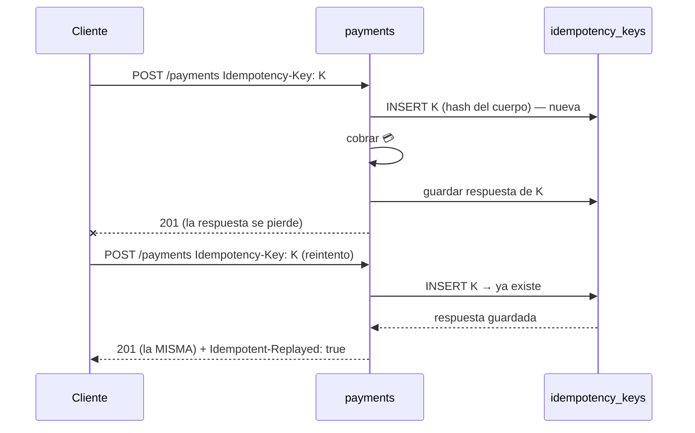

# 12 · Idempotencia

> En un sistema distribuido, **todo se repite**: el usuario hace doble clic, el cliente reintenta tras un timeout, Kafka reentrega un mensaje. Una operación idempotente produce el mismo resultado se ejecute una vez o diez.

**Patrones:** Idempotency Key · Idempotent Consumer (Inbox)
**Stack:** Quarkus (payments) · FastAPI + aiokafka (inventory) · **Infra:** PostgreSQL, Kafka · **Tiempo estimado:** 1 a 1,5 h · **Requiere:** lab 06

---

## El problema

Dos situaciones con el mismo efecto: **cobrar o reservar dos veces**.

**1. En la API.** El usuario pulsa "Pagar". La petición llega a pagos y se cobra, pero la respuesta se pierde por la red (o tarda y el usuario vuelve a pulsar). El cliente **reintenta**. Para el servidor, es una petición nueva: **segundo cobro**.

**2. En la mensajería.** Kafka garantiza entrega *al menos una vez*. El consumidor de inventario procesa un `OrderPlaced`, reserva el stock... y muere justo **antes** de confirmar el offset. Al reiniciar, Kafka le entrega el mismo mensaje otra vez: **segunda reserva**.

No hay forma de evitar los reintentos ni las reentregas: son la base de la fiabilidad (lab 06). Lo que sí se puede es hacer que **repetir no tenga efecto**.

## La versión ingenua

- **API:** `POST /api/payments` **sin** `Idempotency-Key`. Cada llamada cobra.
- **Consumidor:** `IDEMPOTENT_CONSUMER=false`. Cada entrega reserva.

## El patrón

### Idempotency Key (en la API)

El **cliente** genera una clave única por **intención** (este pago de este pedido), no por intento. La manda en el header `Idempotency-Key` y la **reutiliza** en cada reintento. Es lo que hace la API de Stripe.



Los detalles importantes, en [`IdempotentPayments.java`](services/payments/src/main/java/com/mercadoinventos/payments/IdempotentPayments.java):

- **Una sola transacción**: insertar la clave, cobrar y guardar la respuesta. Si el cobro falla, la clave tampoco queda guardada y el reintento puede volver a intentarlo.
- **La `PRIMARY KEY` resuelve la concurrencia.** Si dos peticiones con la misma clave llegan **a la vez**, el `INSERT … ON CONFLICT DO NOTHING` de la segunda **espera** a que la primera termine y después ve que la clave ya existe. Sin locks a mano.
- **Hash del cuerpo**: la misma clave con otro monto es un error del cliente → `422`.
- Los pagos **rechazados** también se guardan. Reintentar un `DECLINED` devuelve `DECLINED` y no vuelve a intentar el cobro.

### Idempotent Consumer (en la mensajería)

El consumidor recuerda qué **eventos** ya procesó, en una tabla `processed_messages` con `event_id` como `PRIMARY KEY`. Lo esencial está en [`reservations.py`](services/inventory/app/reservations.py):

```python
with engine.begin() as conn:                         # UNA transacción
    remembered = conn.execute(insert(processed)...on_conflict_do_nothing().returning(...)).first()
    if remembered is None:
        return Result("DUPLICATE")                   # ya lo procesé: no hago nada
    ... reservar stock ...                           # el efecto, en la MISMA transacción
```

"Recordar el evento" y "aplicar su efecto" se confirman **juntos**. Si el proceso muere antes del commit, no queda ninguna de las dos cosas y la reentrega lo procesa bien. Si muere después, la reentrega se descarta.

La clave es el `eventId` (identifica al **evento**), no el `orderId`: un mismo pedido puede tener varios eventos legítimos.

## Arquitectura del lab

| Servicio | Puerto | Qué demuestra |
|---|---|---|
| payments (Quarkus) | 8104 | Idempotency Key |
| inventory (FastAPI) | 8103 | Idempotent Consumer de `orders.events` |
| Kafka UI | 8090 | Topics, offsets y consumer group |

No hay servicio de pedidos: los eventos se publican con [`publish-event.sh`](publish-event.sh), así controlas exactamente cuándo se repite uno.

## Levántalo

```bash
cd labs/12-idempotencia
docker compose up --build -d
./smoke.sh
```

Para limpiar: `docker compose down -v`.

## Rómpelo

1. **Doble clic sin clave.** Ejecuta dos veces la petición "Sin clave" de [`requests.http`](requests.http) y consulta `GET /api/payments?orderId=pedido-43`: **dos cobros**.

2. **Doble clic con clave.** Ejecuta varias veces la petición con `Idempotency-Key`. Siempre recibes el mismo `id`, a partir de la segunda con `Idempotent-Replayed: true`, y en los logs de pagos aparece `↩️ Reintento … SIN cobrar`. Un solo cobro.

3. **Cinco reintentos simultáneos.** El caso difícil: las cinco peticiones llegan **a la vez**.
   ```bash
   for i in 1 2 3 4 5; do
     curl -s -X POST localhost:8104/api/payments -H 'Content-Type: application/json' \
       -H 'Idempotency-Key: rafaga-1' \
       -d '{"orderId":"pedido-rafaga","customerId":"ana","amount":80,"currency":"PEN"}' &
   done; wait
   curl -s 'localhost:8104/api/payments?orderId=pedido-rafaga'
   ```
   Un solo pago. Es la `PRIMARY KEY` haciendo su trabajo. El test `fiveConcurrentRetriesWithTheSameKeyChargeOnce` comprueba exactamente esto.

4. **Reentrega de Kafka.** Publica el mismo evento dos veces:
   ```bash
   ./publish-event.sh evt-100 pedido-100 INV-003 1
   ./publish-event.sh evt-100 pedido-100 INV-003 1
   ```
   El stock de INV-003 baja **una** vez, y en los logs de inventario aparece `↩️ Evento evt-100 … ya procesado: se ignora`.

5. **Ahora sin idempotencia.**
   ```bash
   IDEMPOTENT_CONSUMER=false docker compose up -d inventory
   ./publish-event.sh evt-200 pedido-200 INV-003 1
   ./publish-event.sh evt-200 pedido-200 INV-003 1
   ```
   El stock baja **dos** veces. Vuelve a la normalidad con `docker compose up -d inventory`.

6. **El caso real: el consumidor muere antes de confirmar.**
   ```bash
   CHAOS_CRASH_BEFORE_COMMIT=true docker compose up -d inventory
   ./publish-event.sh evt-300 pedido-300 INV-004 1
   docker compose logs -f inventory
   ```
   En los logs verás tres cosas en orden:
   - `Evento evt-300 → … RESERVED`.
   - `💥 CAOS: el proceso muere ANTES de confirmar el offset`.
   - Tras el reinicio automático (`restart: on-failure`), `↩️ Evento evt-300 … ya procesado`.

   Kafka reentregó el mensaje porque el offset nunca se confirmó, y el consumidor lo reconoció. Repite el experimento con `IDEMPOTENT_CONSUMER=false CHAOS_CRASH_BEFORE_COMMIT=true` para ver la doble reserva.

## ¿Qué cambia en dev y prod?

Este lab no trae overlays de ambiente. Lo que cambia en prod:

- **Vencimiento de claves.** Las claves de API no se guardan para siempre: Stripe las conserva 24 h. Hace falta un job que borre las viejas (`DELETE … WHERE created_at < now() - interval '24 hours'`).
- **Retención de `processed_messages`.** Basta con guardarlas un poco más que la retención del topic de Kafka (después, ese evento ya no se puede reentregar).
- **La clave la genera el cliente** (frontend o servicio que llama), nunca el servidor. Si la generara el servidor, cada reintento traería una clave distinta.
- **Monitorear los replays:** un aumento de `Idempotent-Replayed` o de duplicados indica problemas de red o de timeouts aguas arriba.

## Costo y cuándo NO usarlo

- **Una escritura extra** por operación (la clave o el evento procesado) y una tabla que crece.
- **No todo necesita la tabla.** Algunas operaciones son idempotentes por naturaleza:
  - `SET estado = 'PAGADO'` repetido no cambia nada.
  - `stock = stock - 1` sí cambia cada vez.
  - `PUT` con el recurso completo es idempotente; `POST` de creación no lo es.

  Si puedes rediseñar la operación para que sea naturalmente idempotente, no necesitas este patrón.
- **El efecto tiene que estar en la misma base que la tabla de idempotencia.** Si el efecto es una llamada a una API externa (la pasarela de pagos real), hace falta que esa API también acepte una clave de idempotencia. Por eso todas las pasarelas serias la soportan.

## Ejercicio

Agrega un endpoint `DELETE /api/admin/idempotency-keys/expired` en pagos que borre las claves de más de 24 horas, y un test que lo compruebe.

¿Qué pasa si un cliente reintenta con una clave **ya borrada**? ¿Es aceptable?

<details><summary>Pista</summary>

Se cobraría de nuevo. Es aceptable si la ventana de vencimiento (24 h) es mucho mayor que el tiempo máximo en que un cliente reintenta. Por eso la ventana se elige pensando en los reintentos, no en el espacio en disco.
</details>

## Para profundizar

- Stripe, [Idempotent requests](https://docs.stripe.com/api/idempotent_requests).
- Chris Richardson, [Idempotent Consumer](https://microservices.io/patterns/communication-style/idempotent-consumer.html).
- IETF, [The Idempotency-Key HTTP Header Field](https://datatracker.ietf.org/doc/draft-ietf-httpapi-idempotency-key-header/) (borrador).
- Gregor Hohpe, *Enterprise Integration Patterns*: [Idempotent Receiver](https://www.enterpriseintegrationpatterns.com/patterns/messaging/IdempotentReceiver.html).
