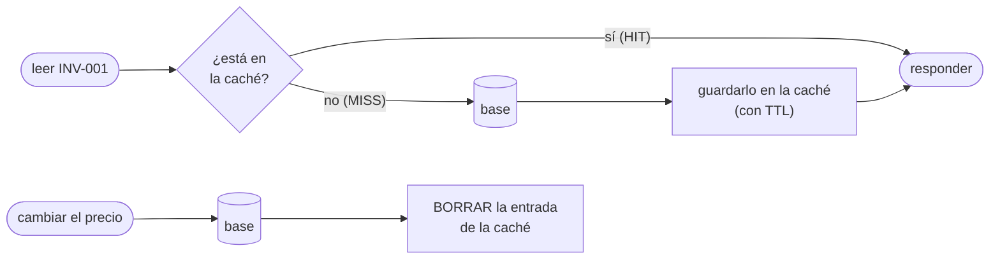

# 13 · Cache-Aside

> El catálogo se lee miles de veces más de lo que se escribe. Guardar lo leído en una caché evita repetir la consulta cara. Lo difícil no es guardar: es **cuándo deja de ser verdad** lo guardado.

**Patrones:** Cache-Aside · TTL e invalidación · Protección contra *cache stampede*
**Stack:** Quarkus · k6 · **Infra:** PostgreSQL, Redis · **Tiempo estimado:** 1 a 1,5 h · **Requiere:** lab 05

---

## El problema

Cada vez que alguien abre un invento, el catálogo hace una consulta a la base. En este lab esa consulta es **cara a propósito** (200 ms, simulados con `pg_sleep`): en la vida real es un `JOIN` de varias tablas, un cálculo de precios o una base que ya está saturada. Con 50 lecturas por segundo, la base hace 50 veces por segundo el mismo trabajo para devolver lo mismo.

## La versión ingenua

`GET /api/inventions/{sku}?cache=none`: cada lectura va a la base.

## El patrón

En **Cache-Aside**, la **aplicación** maneja la caché. La base no sabe que existe ([`InventionReader.java`](services/catalog/src/main/java/com/mercadoinventos/catalog/InventionReader.java)):



- **Al leer:** primero la caché. Si no está (*miss*), se lee la base y se guarda, con un **TTL** (30 s): aunque nadie la invalide, el dato viejo se va solo.
- **Al escribir:** se actualiza la base y se **borra** la entrada de la caché, sin actualizarla. La próxima lectura trae el dato fresco. Borrar es más simple y seguro que actualizar: dos escrituras concurrentes que actualizan la caché pueden dejarla con el valor equivocado.

### Local o distribuida

| | Caché local (`?cache=local`) | Caché distribuida (`?cache=redis`) |
|---|---|---|
| Dónde vive | En la memoria de **cada** instancia ([`LocalCache`](services/catalog/src/main/java/com/mercadoinventos/catalog/LocalCache.java)) | En Redis, compartida ([`RedisCache`](services/catalog/src/main/java/com/mercadoinventos/catalog/RedisCache.java)) |
| Velocidad de un *hit* | La máxima (sin red) | Un viaje de red (~1 ms) |
| Al invalidar | Solo se borra en **la instancia que escribió** | Se borra para todas |
| Con 2 instancias | Cada una puede mostrar un precio distinto hasta que venza su TTL | Todas ven lo mismo |
| Al reiniciar | Se pierde (empieza en frío) | Sobrevive |

Este lab corre **dos instancias** del catálogo (`catalog-1` y `catalog-2`) para que la diferencia se vea.

### Cache stampede

Una clave muy pedida vence. En ese instante llegan 20 lecturas, las 20 encuentran la caché vacía y las 20 van a la base a hacer **la misma** consulta cara. Si la base ya estaba al límite, se cae justo cuando la caché no la protege.

La mitigación de este lab es un **candado en Redis** (`SET lock NX PX 2000`): solo la petición que lo consigue va a la base; las demás esperan unos milisegundos a que la caché se llene (`X-Cache: HIT-AFTER-WAIT`). Como el candado está en Redis, funciona **entre instancias**: 20 lecturas repartidas en `catalog-1` y `catalog-2` hacen **1** consulta.

Otras mitigaciones, sin implementar aquí: renovar la entrada **antes** de que venza (*refresh-ahead*), devolver el valor viejo mientras uno lo recalcula (*stale-while-revalidate*) o variar un poco el TTL de cada clave (*jitter*) para que no venzan todas juntas.

## Arquitectura del lab

| Servicio | Qué es | Puerto |
|---|---|---|
| `catalog-1`, `catalog-2` | Dos instancias del mismo catálogo (Quarkus) | 8101, 8111 |
| `postgres` | La base, con la consulta "cara" | 5432 |
| `redis` | La caché compartida | 6379 |
| `k6` | Carga (perfil `load`) | — |

| Endpoint | Qué hace |
|---|---|
| `GET /api/inventions/{sku}?cache=none\|local\|redis` | Leer. Las cabeceras `X-Cache` (`BYPASS`, `HIT`, `MISS`, `HIT-AFTER-WAIT`) y `X-Instance` dicen qué pasó y quién respondió |
| `PUT /api/inventions/{sku}/price` | Escribir: actualiza la base e invalida las cachés (la local, solo la de esta instancia) |
| `GET /api/stats` | Cuántas consultas recibió la base desde esta instancia |
| `DELETE /admin/cache/{sku}` | Simula que la clave venció |
| `PUT /admin/stampede-protection` | Activa o desactiva el candado (`{"enabled": false}`) |

## Levántalo

```bash
cd labs/13-cache-aside
docker compose up --build -d
./smoke.sh
```

Más peticiones en [`requests.http`](requests.http). Para limpiar: `docker compose down -v`.

## Rómpelo

1. **HIT y MISS.**
   ```bash
   curl -si 'localhost:8101/api/inventions/INV-001?cache=redis' | grep -iE 'x-cache|^HTTP'   # MISS: ~200 ms
   curl -si 'localhost:8101/api/inventions/INV-001?cache=redis' | grep -iE 'x-cache|^HTTP'   # HIT: pocos ms
   docker compose exec redis redis-cli get invention:INV-001                                 # lo que hay en la caché
   docker compose exec redis redis-cli ttl invention:INV-001                                 # segundos que le quedan
   ```

2. **Mide la diferencia con k6** (50 lecturas por segundo durante 30 s):
   ```bash
   CACHE=none  docker compose --profile load run --rm k6
   CACHE=redis docker compose --profile load run --rm k6
   ```
   Medido al escribir el lab:

   | `CACHE=` | p95 | Consultas a la base en 30 s (1500 lecturas) |
   |---|---|---|
   | `none` | 204 ms | 1501 |
   | `redis` | 1,5 ms | 4 (una por invento) |
   | `local` | 0,7 ms | 13 |

   Con caché, la base pasa de 1500 consultas a un puñado. La local es la más rápida (no hay red), pero hizo 13 consultas y no 4: no tiene candado contra el stampede, así que al empezar, varias lecturas del mismo invento fallaron a la vez y fueron todas a la base.

3. **El dato viejo, con la caché local.** Lee INV-002 con `?cache=local` en las **dos** instancias. Cambia el precio por `catalog-1`:
   ```bash
   curl -X PUT localhost:8101/api/inventions/INV-002/price -H 'Content-Type: application/json' -d '{"price": 79}'
   curl -s 'localhost:8101/api/inventions/INV-002?cache=local'     # 79: esta instancia invalidó su caché
   curl -s 'localhost:8111/api/inventions/INV-002?cache=local'     # 89: HIT de un dato VIEJO
   ```
   `catalog-2` muestra el precio viejo hasta que vence su TTL (30 s). Repite con `?cache=redis`: las dos ven 79. Para una caché local con varias instancias hace falta avisarles a todas (por ejemplo, con un evento de Kafka) o aceptar el TTL como límite de lo viejo que puede estar el dato.

4. **Stampede.** Desactiva el candado, simula que la clave venció y lanza 20 lecturas a la vez:
   ```bash
   for c in 8101 8111; do curl -X PUT localhost:$c/admin/stampede-protection -H 'Content-Type: application/json' -d '{"enabled":false}'; done
   curl -X DELETE localhost:8101/admin/cache/INV-001
   for c in 8101 8111; do curl -X PUT localhost:$c/admin/stats/reset; done
   for i in $(seq 1 10); do curl -s -o /dev/null 'localhost:8101/api/inventions/INV-001?cache=redis' & curl -s -o /dev/null 'localhost:8111/api/inventions/INV-001?cache=redis' & done; wait
   curl -s localhost:8101/api/stats; curl -s localhost:8111/api/stats
   ```
   Las dos instancias suman **20** consultas a la base. Vuelve a activar el candado (`{"enabled":true}`) y repite: **1**.

5. **Cambia el TTL sin recompilar.** `CACHE_TTL=5S docker compose up -d` y repite el experimento 3: el precio viejo dura 5 s. Un TTL más corto es más fresco, pero hace más consultas a la base.

## ¿Qué cambia en dev y prod?

Este lab no trae overlays de ambiente. Lo que cambia:

| Aspecto | Local (este lab) | Prod |
|---|---|---|
| Redis | Un contenedor, sin persistencia ni contraseña | Gestionado (o con réplica y *sentinel*), con contraseña y TLS. Si Redis cae, el catálogo debería seguir funcionando contra la base, solo más lento |
| Memoria | Sin límite | `maxmemory` con política de expulsión (`allkeys-lru`): una caché llena borra lo menos usado en lugar de fallar |
| TTL | 30 s para todo | Según cuánto puede estar viejo cada dato: un precio, poco; una descripción, horas |
| Caché local | Para comparar | Útil para datos casi fijos (configuración, catálogos pequeños), con TTL corto |
| En dev | — | A veces se apaga la caché (`?cache=none` o un flag) para depurar sin datos viejos |

## Costo y cuándo NO usarlo

- **Datos viejos.** Toda caché acepta mostrar datos viejos por un tiempo. Si el dato tiene que ser exacto (el stock al confirmar un pedido, un saldo), no se lee de la caché.
- **Dos fuentes de verdad.** Hay que pensar cada escritura: qué entradas invalida. Una invalidación olvidada es un bug que nadie ve hasta que un cliente se queja de un precio.
- **⚠️ Lo que no existe no se cachea** en este lab: pedir 1000 SKUs inexistentes va 1000 veces a la base. En prod se cachea también el "no existe" (*caché negativa*) con un TTL corto.
- **Cuándo no:** si la base responde bien con un índice, o si los datos cambian más de lo que se leen. Mide primero: una caché agrega complejidad que solo se justifica con números.

## Ejercicio

Agrega **caché negativa**: cuando un SKU no existe, guarda un marcador `NOT_FOUND` en Redis con un TTL de 10 s. Escribe primero el test: 5 lecturas de `NOPE` deben hacer **una** consulta a la base. ¿Qué pasa si alguien crea el SKU durante esos 10 s?

## Para profundizar

- [Caching patterns](https://docs.aws.amazon.com/whitepapers/latest/database-caching-strategies-using-redis/caching-patterns.html) (AWS): cache-aside, read-through, write-through.
- Facebook, [*Scaling Memcache at Facebook*](https://www.usenix.org/system/files/conference/nsdi13/nsdi13-final170_update.pdf) (2013): *leases* contra el stampede y los datos viejos.
- [Quarkus Redis client](https://quarkus.io/guides/redis-reference). Quarkus también tiene `@CacheResult` (quarkus-cache), una caché local con anotaciones; aquí se escribió a mano para que se vea cada paso.
- Siguiente: el [lab 14](../14-cqrs/) lleva la idea más lejos: en lugar de cachear consultas, mantener una vista ya armada para leer.
