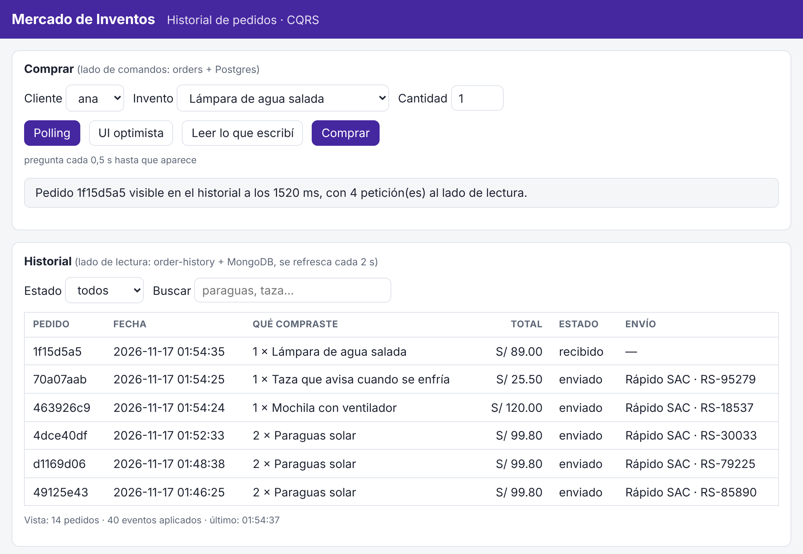
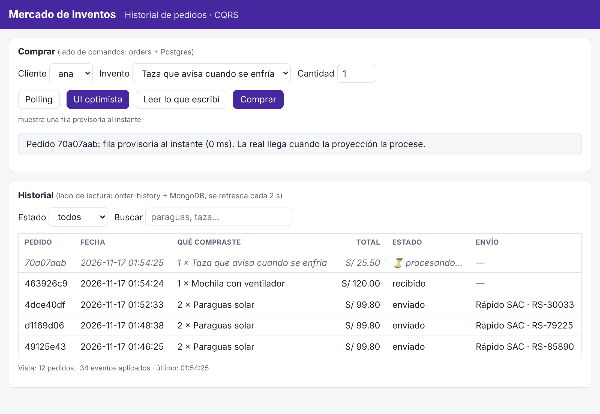
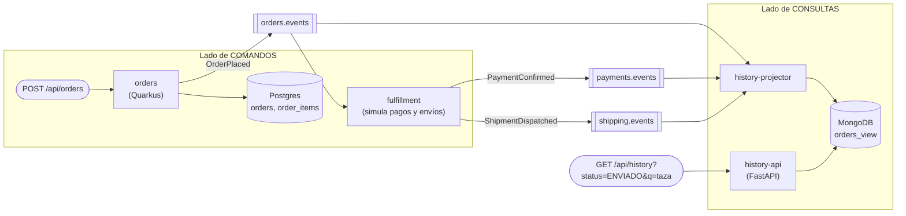

# 14 · CQRS

> El modelo que sirve para **escribir bien** (validar, mantener invariantes, normalizado) casi nunca sirve para **leer bien** (filtrar, buscar, mostrar datos de varios servicios en una fila). CQRS los separa: un modelo para los comandos y otro, armado a la medida de cada pantalla, para las consultas.

**Patrones:** Command Query Responsibility Segregation · Read Model / Proyección · Persistencia políglota
**Stack:** Quarkus (comandos) · FastAPI (consultas) · React · **Infra:** PostgreSQL, Kafka, MongoDB · **Tiempo estimado:** 1,5 a 2 h · **Requiere:** labs 06 y 09

---

| Leer lo que escribí y el historial armado con 3 servicios | UI optimista: la fila provisoria aparece antes que la real |
|---|---|
|  |  |

## El problema

La pantalla **"Mis pedidos"** necesita, por cada pedido, qué se compró, el estado del **pago** y el del **envío**. Y además:

- **Filtrar** ("solo los enviados") y **buscar por texto** ("taza").
- **Ordenar y paginar** por fecha.

Esos datos viven en tres servicios con su propia base (lab 05). En el lab 09, el BFF los compone **en memoria**: pide los pedidos, después los pagos y envíos de esos pedidos, y los une. Sirve para mostrar 3 pedidos. Pero "los pedidos **enviados** de ana que tengan una **taza**, los 20 más recientes" no se puede resolver así: el filtro por envío está en un servicio, el texto en otro, y la paginación tendría que traer **todo** a memoria antes de filtrar.

Tampoco ayuda consultar el modelo de pedidos directamente. Está normalizado (`orders` + `order_items`), no sabe nada de pagos ni envíos y está optimizado para que una escritura sea correcta, no para que una lectura sea rápida.

## El patrón

Separar **comandos** (cambian el estado, no devuelven datos) de **consultas** (devuelven datos, no cambian nada), cada uno con **su propio modelo**:



- **Comandos:** [`orders`](services/orders/src/main/java/com/mercadoinventos/orders/OrderResource.java) solo escribe. No tiene un `GET` de listados ni filtros. Guarda el pedido y publica `OrderPlaced`.
- **Proyección:** [`history-projector`](services/order-history/app/projector.py) consume los eventos de **tres** servicios y mantiene **un documento por pedido**, ya armado para la pantalla: el resumen ("2 × Paraguas solar"), el total, el pago, el envío y un estado derivado.
- **Consultas:** [`history-api`](services/order-history/app/api.py) solo lee esa vista. No escribe ni llama a otro servicio. Filtrar por estado o buscar por texto es una consulta a **una** colección con índices.

Así queda el documento en MongoDB:

```json
{
  "_id": "49125e43-…", "customerId": "ana", "createdAt": "2026-11-17T01:46:25Z",
  "summary": "2 × Paraguas solar", "total": 99.8, "status": "ENVIADO",
  "payment":  { "status": "CONFIRMED", "amount": 99.8 },
  "shipment": { "status": "DISPATCHED", "carrier": "Rápido SAC", "trackingCode": "RS-85890" },
  "orderVersion": 1, "appliedEvents": ["…", "…", "…"]
}
```

### Dos niveles de CQRS

CQRS **no** obliga a tener dos bases, Kafka ni consistencia eventual. Es solo separar los modelos, y se puede hacer en dos niveles:

| | Nivel 1: mismo servicio | Nivel 2: read store separado (este lab) |
|---|---|---|
| Modelo de lectura | Otras tablas (o una vista materializada) en **la misma base** | Otra base, elegida para leer (aquí, MongoDB) |
| Cómo se actualiza | En la **misma transacción** que la escritura, o con eventos dentro del proceso | Una **proyección asíncrona** que consume eventos |
| Consistencia | Inmediata | **Eventual**: la vista va atrasada |
| Datos de otros servicios | No (solo los propios) | Sí: la vista junta eventos de varios servicios |
| Costo | Bajo | Una base más, un proceso más, y lidiar con el atraso |

Empieza por el nivel 1 si los datos son de un solo servicio. El nivel 2 se justifica cuando la vista necesita datos de varios servicios (como aquí) o cuando la carga de lectura es tan distinta que conviene escalarla aparte.

### La proyección: tres propiedades que la hacen confiable

Están en [`projection.py`](services/order-history/app/projection.py), con un test cada una en [`test_projection.py`](services/order-history/tests/test_projection.py):

1. **Idempotente.** Kafka entrega *at-least-once*: un evento puede llegar dos veces. El documento guarda los `eventId` ya aplicados, y la actualización filtra por `appliedEvents: {$ne: eventId}`. Si ya estaba, no cambia nada.
2. **Tolera el desorden.** Los eventos llegan por **tres topics** y Kafka solo ordena **dentro de una partición**. El pago puede proyectarse antes que el pedido. Cada evento escribe **sus** campos (`$set`) y el estado se **deriva** de lo que hay (con envío → `ENVIADO`; con pago y pedido → `PAGADO`; solo pedido → `RECIBIDO`; solo pago → `EN PROCESO`), en lugar de "el estado del último evento que llegó".
3. **Reconstruible.** La vista no es la fuente de verdad: se puede borrar y rearmar releyendo los eventos (ver "Reconstruir la vista").

## Consistencia eventual: el pedido "desaparece"

El `POST` responde `201` en milisegundos. Pero si la pantalla consulta el historial justo después, el pedido **no está**: el proyector todavía no procesó el evento. Este lab le agrega una demora de 1,5 s por evento (`PROJECTION_DELAY_MS`) para que el atraso se vea. En prod suele ser de decenas de milisegundos, pero existe, y bajo carga o con el proyector caído, crece.

La web compara tres técnicas ([`history.ts`](frontend/src/history.ts)):

| Técnica | Cómo funciona | Medido en el lab |
|---|---|---|
| **Polling** | La web pregunta cada 0,5 s hasta que el pedido aparece | Visible a los 1520 ms, con **4 peticiones** |
| **UI optimista** | La web muestra al instante una fila provisoria ("⏳ procesando…") con lo que ya sabe, y la reemplaza cuando llega la real | **0 ms** para el usuario. Pero muestra algo que el servidor todavía no confirmó: si el comando fallara después, hay que deshacerlo en pantalla |
| **Leer lo que escribí** (*read-your-writes*) | El comando devuelve la **versión** que escribió. La web pide `GET /api/history/{id}?minVersion=1&waitMs=8000` y el servidor **espera** (long polling) hasta tener esa versión, o responde `404 NOT_YET_PROJECTED` | Visible a los 1519 ms, con **1 petición** |

`minVersion` es la clave de la tercera técnica. La vista guarda la versión del agregado que proyectó (`orderVersion`, con `$max` para que un evento viejo no la baje). Si mañana hay un comando "cancelar" que deja el pedido en versión 2, la web pide `minVersion=2` y no se conforma con la vista que todavía dice "versión 1, no cancelado".

## Arquitectura del lab

| Servicio | Qué es | Puerto |
|---|---|---|
| `frontend` | React + nginx: `/api/orders` → comandos, `/api/history` → consultas | 3000 |
| `orders` | Quarkus + Postgres: el lado de comandos | 8102 |
| `fulfillment` | Python: simula pagos y envíos. Por cada pedido publica `PaymentConfirmed` (a los 2 s) y `ShipmentDispatched` (a los 5 s) | — |
| `history-projector` | Python: consume los 3 topics y escribe la vista | — |
| `history-api` | FastAPI: solo lee la vista | 8108 |
| `mongodb` | El read store | 27017 |
| `postgres`, `kafka`, `kafka-ui` | Infra compartida | 5432, 9092, 8090 |

`history-projector` e `history-api` son **la misma imagen** con dos comandos distintos. Están separados a propósito: si el proyector se detiene, la API sigue respondiendo.

| Endpoint | Qué hace |
|---|---|
| `POST /api/orders` | Crea un pedido. Responde `{id, version, total}` |
| `GET /api/history?customerId=ana&status=ENVIADO&q=taza` | El historial de un cliente, filtrado |
| `GET /api/history/{id}?minVersion=1&waitMs=8000` | Un pedido, esperando hasta tener esa versión |
| `GET /api/history/status` | Cuántos documentos y eventos tiene la vista, y cuándo se aplicó el último |

## Levántalo

```bash
cd labs/14-cqrs
docker compose up --build -d
./smoke.sh
```

Abre http://localhost:3000. Más peticiones en [`requests.http`](requests.http). Para limpiar: `docker compose down -v`.

El smoke tarda ~2 min: espera a que los pedidos pasen por pago y envío, y reconstruye la vista dos veces.

## Rómpelo

1. **Las tres técnicas.** En la web, compra con "Polling", con "UI optimista" y con "Leer lo que escribí". Mira el mensaje (cuánto tardó y cuántas peticiones hizo) y la pestaña *Network* de DevTools. Después mira cómo el pedido pasa de "recibido" a "pagado" y a "enviado" sin que hagas nada.

2. **La vista va atrasada.**
   ```bash
   ID=$(curl -s -X POST localhost:8102/api/orders -H 'Content-Type: application/json' \
     -d '{"customerId":"ana","items":[{"sku":"INV-001","quantity":1}]}' | python3 -c "import json,sys; print(json.load(sys.stdin)['id'])")
   curl -s localhost:8108/api/history/$ID                               # 404 NOT_YET_PROJECTED
   curl -s "localhost:8108/api/history/$ID?minVersion=1&waitMs=8000"     # espera ~1,5 s y responde
   ```

3. **Apaga el proyector.**
   ```bash
   docker compose stop history-projector
   ```
   Compra en la web: el `POST` funciona, pero el pedido no aparece en el historial ("Leer lo que escribí" se rinde a los 8 s). La API de lectura **sigue respondiendo** con lo que tenía: el lado de lectura cae "suave", con datos viejos, no con errores. `docker compose start history-projector`: retoma desde su último offset y en unos segundos aparece todo, con pagos y envíos incluidos. Mira cómo se pone al día en `docker compose logs -f history-projector`.

4. **Mira el documento** y compáralo con las tablas del lado de comandos:
   ```bash
   docker compose exec mongodb mongosh order_history --quiet --eval 'db.orders_view.find().sort({createdAt:-1}).limit(1)'
   docker compose exec postgres psql -U orders -d orders -c 'select * from order_items limit 3'
   ```
   En Mongo, una fila de la pantalla es **un** documento. En Postgres, un pedido son varias filas en dos tablas, y no hay pagos ni envíos.

5. **Reentrega (idempotencia).** Rebobina el consumer group del proyector al principio. Kafka le entregará **todos** los eventos otra vez:
   ```bash
   docker compose stop history-projector
   docker compose exec kafka /opt/kafka/bin/kafka-consumer-groups.sh --bootstrap-server localhost:9092 \
     --group order-history --reset-offsets --to-earliest --all-topics --execute
   PROJECTION_DELAY_MS=0 docker compose up -d history-projector
   docker compose logs history-projector | grep -c 'ya aplicado'
   ```
   Todos dicen `↩ ya aplicado` y `GET /api/history/status` sigue mostrando los mismos números. Al terminar, `docker compose up -d history-projector` le devuelve la demora normal.

6. **Reconstruye la vista.** Cambiaste cómo se arma el documento (un campo nuevo, otro formato) y hay que recalcularlo para **todos** los pedidos:
   ```bash
   PROJECTION_VERSION=2 PROJECTION_DELAY_MS=0 docker compose up -d history-projector
   ```
   El proyector ve que la versión cambió, **vacía** la colección y vuelve a leer los tres topics desde el offset 0. En segundos, la vista tiene los mismos pedidos. Para volver: `PROJECTION_DELAY_MS=0 docker compose up -d history-projector` (otra reconstrucción, a la v1) y después `docker compose up -d history-projector`.

7. **Desorden.** El caso "el pago se proyecta antes que el pedido" es difícil de provocar a mano. Está fijado en el test `test_events_from_different_topics_can_arrive_out_of_order`: el pago crea el documento con estado `EN PROCESO`, y cuando llega el pedido queda `PAGADO`, igual que en el orden normal.

### Reconstruir la vista: de dónde salen los eventos

La reconstrucción del experimento 6 funciona porque los eventos **siguen en Kafka**. Pero Kafka borra los mensajes viejos: por defecto, a los **7 días** (`log.retention.hours=168`). Pasado ese plazo, releer los topics da una vista **incompleta**. Opciones:

| Opción | Cómo | Límite |
|---|---|---|
| Retención infinita | `retention.ms=-1` en esos topics | El disco crece para siempre |
| *Log compaction* | Kafka guarda solo el **último** mensaje de cada clave | Sirve si cada evento trae el estado completo (lab 06, "state transfer"), no con eventos parciales como los de aquí |
| Un *event store* | Los eventos son la fuente de verdad y se guardan para siempre | Es **Event Sourcing**: el [lab 18](../18-event-sourcing/) |
| Volcar el estado actual | Un proceso lee las bases de los servicios y genera la vista inicial; después siguen los eventos | Hay que coordinar el "desde dónde" para no perder ni duplicar eventos |

Además, la reconstrucción de este lab **vacía** la vista mientras se rearma: durante unos segundos, el historial aparece vacío. En prod se hace *blue/green*: la v2 se arma en **otra** colección mientras la v1 sigue atendiendo, y cuando la v2 se pone al día, la API cambia de colección.

### Lo que encontré al escribir el lab

Para rebobinar el consumer group (experimento 5), Kafka exige que **no tenga miembros activos**. La primera versión del proyector no se iba del grupo al hacer `docker compose stop`: Python corre como **PID 1** en el contenedor, y el PID 1 **ignora `SIGTERM`** si no tiene un handler. Docker lo mataba a los 10 s con `SIGKILL`, el `finally` que cierra el consumidor nunca corría, y Kafka seguía viendo al proyector como miembro hasta que venciera el *session timeout*. El arreglo son 3 líneas en [`projector.py`](services/order-history/app/projector.py) (`add_signal_handler(SIGTERM, …)`): ahora `stop` tarda 0,6 s en lugar de 10, y el log dice `LeaveGroup request succeeded`. Vale para cualquier consumidor que corra como PID 1.

## ¿Qué cambia en dev y prod?

Este lab no trae overlays de ambiente. Lo que cambia:

| Aspecto | Local (este lab) | Prod |
|---|---|---|
| MongoDB | 1 nodo, sin contraseña | *Replica set* de 3 nodos (o gestionado), con usuarios y TLS. Las lecturas pueden ir a los secundarios |
| Demora de la proyección | 1,5 s artificial | Ninguna. Se **mide** el atraso (el *lag* del consumer group) y se alerta si crece |
| Proyector | 1 instancia | Varias, en el mismo consumer group (una por partición como máximo). Como el pedido es la clave de los mensajes, los eventos de un pedido en un topic van siempre a la misma instancia |
| Reconstrucción | Vacía la vista y la rearma | *Blue/green*: otra colección y cambio al terminar |
| Retención de Kafka | La de por defecto (7 días) | Decidida según cómo se va a reconstruir (ver arriba) |
| Quién es el cliente | Parámetro `customerId` (⚠️ cualquiera puede leer el historial de otro) | Sale del token (lab 07) |

## Costo y cuándo NO usarlo

- **Consistencia eventual.** Toda pantalla que lee después de escribir tiene que decidir qué hacer (las tres técnicas). Si el negocio no acepta ni un segundo de atraso en esa pantalla, CQRS de nivel 2 no sirve allí.
- **Más piezas:** una base, un proceso, topics y un atraso que hay que monitorear.
- **Datos duplicados.** El nombre del invento está en pedidos y en la vista. Si cambia, hay que decidir si la vista lo actualiza (otro evento) o muestra el nombre del momento de la compra (aquí, este último, y es lo correcto para un historial).
- **⚠️ Escritura doble en `orders`.** Guarda en Postgres y **después** publica en Kafka. Si el proceso muere entre las dos, el pedido existe pero la vista nunca se entera. Es el problema que resuelve el [lab 15](../15-transactional-outbox/) (Transactional Outbox).
- **Cuándo no:** si un CRUD con un par de índices responde las consultas, o si los datos son de un solo servicio (usa el nivel 1, o una vista materializada de Postgres). CQRS es costo sin beneficio cuando las lecturas y las escrituras se parecen.

## Ejercicio

Agrega **cancelar un pedido**: `POST /api/orders/{id}/cancel` en `orders`, que deja el pedido en versión 2 y publica `OrderCancelled`. En la proyección, el estado derivado debe ser `CANCELADO` y ganarle a `PAGADO`. Escribe primero los tests: uno para el estado y otro que cancele **antes** de que llegue el pago (desorden). En la web, después de cancelar, usa `minVersion=2`. ¿Qué muestra la técnica de polling si solo pregunta "¿existe el pedido?"?

## Para profundizar

- Greg Young, [*CQRS Documents*](https://cqrs.wordpress.com/wp-content/uploads/2010/11/cqrs_documents.pdf) (2010): el origen del término.
- Martin Fowler, [*CQRS*](https://martinfowler.com/bliki/CQRS.html): sobre todo la advertencia de usarlo solo en partes del sistema.
- Udi Dahan, [*Clarified CQRS*](https://udidahan.com/2009/12/09/clarified-cqrs/).
- Chris Richardson, [*CQRS*](https://microservices.io/patterns/data/cqrs.html), y *Microservices Patterns*, capítulo 7.
- Microsoft, [*CQRS pattern*](https://learn.microsoft.com/azure/architecture/patterns/cqrs) y [*Materialized View pattern*](https://learn.microsoft.com/azure/architecture/patterns/materialized-view).
- Siguiente: el [lab 15](../15-transactional-outbox/) resuelve la escritura doble de `orders`.
