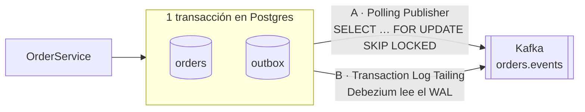

# 15 · Transactional Outbox

> Guardar en la base y publicar en Kafka son **dos** operaciones. Si el proceso muere entre una y otra, el sistema queda inconsistente para siempre. La outbox convierte esas dos operaciones en **una** transacción.

**Patrones:** Transactional Outbox · Polling Publisher · Transaction Log Tailing (CDC)
**Stack:** Quarkus (orders) · Debezium 3 (Kafka Connect) · **Infra:** PostgreSQL (`wal_level=logical`), Kafka · **Tiempo estimado:** 1,5 h · **Requiere:** labs 06 y 12

---

## El problema: dual write

Pedidos tiene que hacer dos cosas cuando alguien compra:

1. Guardar el pedido en **Postgres**.
2. Publicar `OrderPlaced` en **Kafka**, para que inventario, pagos y envíos se enteren.

No existe una transacción que abarque Postgres **y** Kafka. Entonces:

| Orden | Si el proceso muere entre los dos pasos… |
|---|---|
| Guardar → publicar | Hay pedido **sin evento**. Nadie reserva stock ni cobra: el pedido queda "fantasma" |
| Publicar → guardar | Hay evento **sin pedido**. Inventario reserva stock de un pedido que no existe |

No es teórico: es un despliegue, un OOM, un nodo que se reinicia. Con suficiente tráfico, **pasa**.

## La versión ingenua

```java
// OrderService — modo naive
QuarkusTransaction.requiringNew().run(order::persist);   // 1. base ✅
chaos.afterCommit("el pedido");                          // 💥 muere aquí...
kafka.send(event.aggregateId, event.payload);            // 2. ...y esto nunca ocurre
```

`OUTBOX_MODE=naive CHAOS_CRASH_AFTER_COMMIT=true` reproduce exactamente eso: el proceso muere (`Runtime.halt`, como un corte de luz) entre el commit y la publicación.

## El patrón

El evento se guarda en una tabla **`outbox` de la misma base y en la misma transacción** que el pedido. O quedan los dos, o ninguno. Publicar pasa a ser un paso **separado y repetible**:



Hay dos formas de mover la outbox a Kafka:

| | **A · Polling Publisher** (`OUTBOX_MODE=polling`) | **B · Transaction Log Tailing** (`OUTBOX_MODE=cdc`) |
|---|---|---|
| Quién publica | Un job dentro de pedidos, cada 1 s | Debezium, un proceso aparte que lee el WAL de Postgres |
| Latencia | Hasta el intervalo de sondeo | Milisegundos |
| Carga en la BD | Consultas periódicas | Ninguna consulta extra: lee el log de replicación |
| Piezas extra | Ninguna | Kafka Connect + Debezium + `wal_level=logical` |
| Varias réplicas | `FOR UPDATE SKIP LOCKED` reparte las filas | Un solo conector |
| Código en el servicio | El publicador ([`OutboxPublisher.java`](services/orders/src/main/java/com/mercadoinventos/orders/OutboxPublisher.java)) | Solo el `INSERT` en la outbox |

### Las piezas clave

| Qué | Dónde |
|---|---|
| Pedido + evento en una transacción | [`OrderService.java`](services/orders/src/main/java/com/mercadoinventos/orders/OrderService.java) |
| La tabla outbox (columnas que espera Debezium) | [`V2__create_outbox.sql`](services/orders/src/main/resources/db/migration/V2__create_outbox.sql) |
| Polling Publisher con `FOR UPDATE SKIP LOCKED` | [`OutboxPublisher.java`](services/orders/src/main/java/com/mercadoinventos/orders/OutboxPublisher.java) |
| Conector Debezium + Outbox Event Router | [`debezium/orders-outbox.json`](debezium/orders-outbox.json) |
| Caída controlada después del commit | [`Chaos.java`](services/orders/src/main/java/com/mercadoinventos/orders/Chaos.java) |

### La garantía: al menos una vez

La outbox garantiza que **ningún evento se pierde**, pero no que llegue **una sola vez**. Si el publicador envía a Kafka y muere antes de marcar `published_at`, al reiniciar lo envía de nuevo. Debezium tiene el mismo problema con sus offsets. Por eso **outbox e idempotent consumer van siempre juntos**: el `eventId` del envelope es el `id` de la fila de la outbox, y el consumidor del lab 12 descarta los repetidos.

## Levántalo

```bash
cd labs/15-transactional-outbox
docker compose up --build -d
./smoke.sh
```

`smoke.sh` recorre los cuatro escenarios: polling, caída con outbox, caída con dual write y CDC. Toma unos 2 minutos porque reinicia servicios y espera a Debezium.

- Pedidos: http://localhost:8102/q/swagger-ui · Outbox: http://localhost:8102/api/outbox.
- Kafka UI: http://localhost:8090 (topic `orders.events`).

Para limpiar: `docker compose --profile cdc down -v`.

## Rómpelo

1. **Mira la outbox trabajar.** Haz un pedido ([`requests.http`](requests.http)) y consulta enseguida `GET /api/outbox`: el evento aparece con `publishedAt: null` y, en menos de un segundo, con fecha. En los logs: `📤 Outbox: 1 evento(s) publicados`.

2. **Dual write + caída = evento perdido.**
   ```bash
   OUTBOX_MODE=naive CHAOS_CRASH_AFTER_COMMIT=true docker compose up -d --force-recreate orders
   curl -X POST localhost:8102/api/orders -H 'Content-Type: application/json' \
     -d '{"customerId":"fantasma","items":[{"sku":"INV-001","quantity":1}]}'
   ```
   La petición se corta (`Empty reply from server`). Docker reinicia pedidos. El pedido de `fantasma` **existe** en `GET /api/orders`... y en Kafka UI no hay ningún evento para él. Ningún reintento lo arregla: nadie sabe que falta.

3. **Outbox + la misma caída = nada se pierde.**
   ```bash
   CHAOS_CRASH_AFTER_COMMIT=true docker compose up -d --force-recreate orders
   ```
   Repite el pedido. El proceso muere igual, pero al reiniciar el publicador encuentra la fila pendiente y la publica: `📤 Outbox: 1 evento(s) publicados`.

4. **Kafka caído.** Detén Kafka (`docker compose stop kafka`) y haz pedidos en modo polling. **Se siguen aceptando**, porque solo necesitan Postgres. La outbox acumula filas con `publishedAt: null`. Levanta Kafka (`docker compose start kafka`) y observa cómo se vacía.

   Compara con el lab 06, donde un Kafka caído hacía fallar el pedido.

5. **Varias réplicas publicando.** El test [`twoPublishersRunningAtTheSameTimeDoNotDuplicate`](services/orders/src/test/java/com/mercadoinventos/orders/PollingOutboxTest.java) corre dos publicadores a la vez sobre 20 eventos: Kafka recibe exactamente 20. Quita `SKIP LOCKED` de la consulta y vuelve a correrlo (`./mvnw verify`). El test sigue pasando, pero ahora uno de los publicadores **espera** a que el otro suelte los bloqueos: con 5 réplicas, 4 estarían esperando. Postgres reevalúa el `WHERE published_at IS NULL` después de la espera, así que no hay duplicados, pero se pierde todo el paralelismo. Con `SKIP LOCKED`, cada réplica toma las filas libres y sigue.

6. **CDC con Debezium.**
   ```bash
   OUTBOX_MODE=cdc docker compose --profile cdc up -d --force-recreate orders connect connect-init
   curl localhost:8083/connectors/orders-outbox/status     # "state":"RUNNING"
   ```
   Haz un pedido: el evento llega a `orders.events`, con la key igual al id del pedido y un header `eventType: OrderPlaced` que agrega el *Outbox Event Router*. Pedidos **no tocó Kafka**. En `GET /api/outbox`, `publishedAt` queda `null`: Debezium no escribe en la base, solo lee el WAL.

   Apaga Debezium (`docker compose --profile cdc stop connect`), haz pedidos y vuelve a encenderlo. Publica los pendientes, porque recuerda hasta qué posición del WAL había leído.

## ¿Qué cambia en dev y prod?

Este lab no trae overlays de ambiente. En prod:

- **Limpieza de la outbox.** En polling, borrar periódicamente las filas publicadas hace tiempo. En CDC es común insertar y **borrar en la misma transacción**: Debezium captura el `INSERT` del WAL y la tabla queda siempre vacía.
- **Debezium con usuario propio.** Aquí usa el superusuario `admin` por simplicidad (⚠️). En prod se usa un usuario con `REPLICATION` y permisos solo sobre la outbox.
- **Vigilar el slot de replicación.** Si Debezium está caído mucho tiempo, Postgres **retiene el WAL** para él y el disco se llena. Hay que alertar por el tamaño del slot (`pg_replication_slots`).
- **`wal_level=logical`** requiere reiniciar Postgres. En servicios administrados (RDS, Cloud SQL) se activa con un flag.
- **Un conector por servicio dueño de su outbox** (Database per Service, lab 05).

## Costo y cuándo NO usarlo

- **Latencia:** el evento sale después del commit (hasta 1 s con polling).
- **Más piezas:** una tabla y un job, o toda la infraestructura de Debezium.
- **Duplicados:** obliga a tener consumidores idempotentes, aunque en Kafka eso ya hacía falta.

**Cuándo NO:** si el evento no importa tanto como para perderlo de vez en cuando (métricas, notificaciones "nice to have"), basta con publicar *best effort*. También si el estado **es** el evento (Event Sourcing, lab 18): ahí el event store ya es la fuente de verdad y no hay dual write.

## Ejercicio

Agrega al pedido un endpoint `POST /api/orders/{id}/cancel` que cambie el estado a `CANCELLED` y publique `OrderCancelled` **usando la outbox**. Escribe primero el test en `PollingOutboxTest`: tras cancelar y llamar a `publishPending()`, el sink debe tener un evento `OrderCancelled` con key igual al id del pedido.

<details><summary>Pista</summary>

Agrega un método `orderCancelled(Order)` en [`Events.java`](services/orders/src/main/java/com/mercadoinventos/orders/Events.java). En el servicio, haz `order.status = CANCELLED` y `event.persist()` dentro del **mismo** `QuarkusTransaction.requiringNew().run(...)`. Como la key es el id del pedido, `OrderPlaced` y `OrderCancelled` caen en la misma partición y llegan en orden.
</details>

## Para profundizar

- Chris Richardson, [Transactional outbox](https://microservices.io/patterns/data/transactional-outbox.html), [Polling publisher](https://microservices.io/patterns/data/polling-publisher.html) y [Transaction log tailing](https://microservices.io/patterns/data/transaction-log-tailing.html).
- [Debezium: Outbox Event Router](https://debezium.io/documentation/reference/stable/transformations/outbox-event-router.html).
- Gunnar Morling, [Reliable Microservices Data Exchange With the Outbox Pattern](https://debezium.io/blog/2019/02/19/reliable-microservices-data-exchange-with-the-outbox-pattern/).
