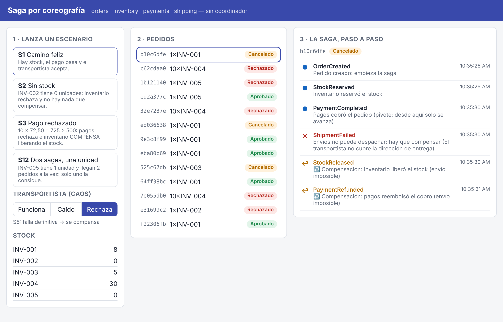
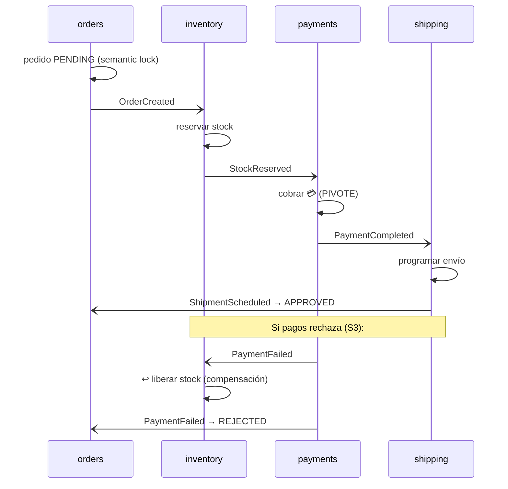

# 16 · Saga por coreografía

> Una transacción de negocio que cruza cuatro bases de datos no puede ser ACID. Una **saga** la parte en pasos locales y, si uno falla, deshace los anteriores con **compensaciones**. En la coreografía no hay coordinador: cada servicio reacciona a los eventos de los demás.

**Patrones:** Saga · Choreography · Compensating Transaction · Semantic Lock · Pivot Transaction — construida sobre Transactional Outbox (lab 15) e Idempotent Consumer (lab 12)
**Stack:** Quarkus (orders, payments) · FastAPI (inventory, shipping) · React · **Infra:** PostgreSQL, Kafka · **Tiempo estimado:** 2 a 3 h · **Requiere:** labs 05, 06, 12 y 15



*Caso S5: el transportista rechaza el envío **después** del cobro, así que inventario y pagos compensan (`StockReleased`, `PaymentRefunded`) y el pedido termina `CANCELLED`.*

---

## El problema

En el lab 05 viste cómo quedaba el stock reservado para un pedido cuyo pago falló. Comprar en Mercado de Inventos toca **cuatro servicios con cuatro bases de datos**:

1. **orders** registra el pedido.
2. **inventory** reserva el stock.
3. **payments** cobra.
4. **shipping** programa el despacho.

No hay una transacción que abarque las cuatro bases. Y **2PC/XA** (two-phase commit) no es una opción práctica: bloquea recursos mientras espera a todos los participantes, si el coordinador cae los deja bloqueados, y ni Kafka ni la mayoría de las bases modernas lo soportan bien entre servicios.

## La idea: una saga

Una **saga** es una secuencia de **transacciones locales**. Cada paso confirma en su propia base y publica un evento que dispara el siguiente. Si un paso falla, se ejecutan **compensaciones**: acciones que deshacen semánticamente lo ya hecho. No se "borra" un cobro: se **reembolsa**.



### Tres tipos de pasos

| Paso | Tipo | Qué significa |
|---|---|---|
| Crear pedido (`PENDING`) | **Compensable** | Se puede deshacer: cancelar |
| Reservar stock | **Compensable** | Se puede deshacer: liberar |
| Cobrar | **Pivote** | El punto de no retorno: si se cobra, la saga intenta **avanzar** |
| Programar envío | **Reintentable** | Después del pivote, ante fallas pasajeras se **reintenta**, no se compensa |

¿Y si el envío falla **definitivamente** después del pivote (S5)? Es una decisión de negocio. Aquí se compensa todo hacia atrás (reembolso + liberar stock): una *compensación posterior al pivote*. En otro negocio podría ser "enviar por otro transportista".

### Coreografía: cada uno decide solo

No hay nadie que coordine. Cada participante **escucha** los eventos que le interesan, hace su transacción local y **publica** el suyo:

| Participante | Escucha | Hace | Publica |
|---|---|---|---|
| **orders** ([`OrderSaga.java`](services/orders/src/main/java/com/mercadoinventos/orders/OrderSaga.java)) | todos | Inicia la saga y sigue su estado | `OrderCreated`, `OrderCancelled` |
| **inventory** ([`saga.py`](services/inventory/app/saga.py)) | `OrderCreated` · `PaymentFailed` · `ShipmentFailed` · `OrderCancelled` | Reserva · **libera** | `StockReserved` · `StockReservationFailed` · `StockReleased` |
| **payments** ([`PaymentsParticipant.java`](services/payments/src/main/java/com/mercadoinventos/payments/PaymentsParticipant.java)) | `StockReserved` · `ShipmentFailed` · `OrderCancelled` | Cobra · **reembolsa** | `PaymentCompleted` · `PaymentFailed` · `PaymentRefunded` |
| **shipping** ([`saga.py`](services/shipping/app/saga.py)) | `PaymentCompleted` · `OrderCancelled` | Programa el envío (reintenta si el transportista cae) | `ShipmentScheduled` · `ShipmentFailed` |

Mira la columna "Escucha": la lógica de compensación de **toda** la saga está repartida entre los cuatro servicios. No hay un archivo donde leer el flujo completo. Esa es la fuerza de la coreografía (nadie es imprescindible) y también su debilidad (nadie tiene la foto completa). El lab 17 muestra la alternativa.

### Los cimientos: outbox + inbox en cada participante

Cada evento se procesa en **una** transacción local con tres partes:

```
BEGIN
  INSERT processed_messages (eventId)  ← inbox: si ya estaba, se ignora (lab 12)
  … cambio de negocio …                ← reservar, cobrar, liberar…
  INSERT outbox (evento siguiente)     ← outbox: se publicará después (lab 15)
COMMIT
```

Sin esto, la saga **no** es confiable: un duplicado cobraría dos veces y una caída entre "guardar" y "publicar" dejaría la saga colgada para siempre. En Python vive en un kit compartido ([`py-saga-kit/saga_kit`](services/py-saga-kit/saga_kit)); en Java, en el paquete `saga` de cada servicio.

### El estado del pedido: una máquina de estados

[`Order.java`](services/orders/src/main/java/com/mercadoinventos/orders/Order.java) declara qué evento mueve el pedido de qué estado a cuál:

```
PENDING ──StockReserved──▶ STOCK_RESERVED ──PaymentCompleted──▶ PAID ──ShipmentScheduled──▶ APPROVED
   │                            │                                  │
   └─StockReservationFailed─▶ REJECTED ◀──PaymentFailed────────────┘   └─ShipmentFailed─▶ CANCELLED
```

- Un evento que **no corresponde** al estado actual se **ignora** y se registra en la línea de tiempo como tal (caso S8).
- `PENDING` funciona como **semantic lock**: el pedido existe, pero nadie debe tratarlo como confirmado.

## Levántalo

```bash
cd labs/16-saga-coreografia
docker compose up --build -d
```

Abre **http://localhost:3000**: lanza escenarios, mira la saga avanzar paso a paso y cambia el modo del transportista.

```bash
./smoke.sh      # reproduce automáticamente 11 de los 13 casos (≈ 3 min; mejor con el lab recién levantado)
```

Puertos: orders 8102 · inventory 8103 · payments 8104 · shipping 8105 · Kafka UI 8090. Peticiones listas en [`requests.http`](requests.http).

Para limpiar: `docker compose down -v`.

## Rómpelo: la matriz de casos

Estos son los casos de la [matriz del README principal](../../README.md#los-casos-de-la-saga). Cada uno se reproduce desde la UI o con un comando.

| # | Caso | Cómo provocarlo | Qué deberías ver |
|---|---|---|---|
| **S1** | Camino feliz | UI → **S1** | `OrderCreated → StockReserved → PaymentCompleted → ShipmentScheduled` → **APPROVED** |
| **S2** | Sin stock | UI → **S2** (INV-002 = 0) | `StockReservationFailed` → **REJECTED**. No hay nada que compensar |
| **S3** | Pago rechazado | UI → **S3** (725 > 500) | `PaymentFailed` → **REJECTED** + `↩ StockReleased`. El stock de INV-004 vuelve a su valor |
| **S4** | Transportista caído | Transportista **Caído** + S1 | El pedido se queda en **PAID**. Los logs de shipping muestran `⏳ Falla transitoria (intento N)`. Vuelve a **Funciona**: termina **APPROVED** sin compensar nada |
| **S5** | Rechazo definitivo | Transportista **Rechaza** + S1 | `ShipmentFailed` → **CANCELLED** + `↩ StockReleased` + `↩ PaymentRefunded` (la captura de arriba) |
| **S6** | Timeout del pago | — | En la coreografía nadie mide el tiempo de la saga: lo resuelve el orquestador del **lab 17** |
| **S7** | Mensaje duplicado | `scripts/replay.sh inventory.events <id> StockReserved` | Pagos lo ignora (`↩️ … ya procesado`): sigue habiendo **un** cobro |
| **S8** | Evento fuera de orden | Con `payments` apagado, crea un pedido y ejecuta `scripts/publish.sh shipping.events ShipmentScheduled <id>` | La línea de tiempo lo muestra **ignorado** (gris): el pedido estaba en `STOCK_RESERVED` |
| **S9** | Falla una compensación | Apaga `payments`, lanza S3, apaga `inventory`, enciende `payments` | El pedido queda **REJECTED**, pero el stock sigue reservado: la compensación espera en Kafka. Enciende `inventory` y aparece `↩ StockReleased` |
| **S10** | Un participante cae a mitad | `docker compose stop payments` + S1 | El pedido se detiene en **STOCK_RESERVED**. `docker compose start payments`: continúa hasta **APPROVED** |
| **S11** | El cliente cancela | Con `payments` apagado, lanza S1 y pulsa **Cancelar** | **CANCELLED** + `↩ StockReleased`. Al volver, pagos **no** cobra: ya conocía la cancelación. Después del pivote, cancelar responde `409` |
| **S12** | Dos sagas, una unidad | UI → **S12** | Dos pedidos por la única unidad de INV-005: uno **APPROVED** y otro **REJECTED**. El `SELECT … FOR UPDATE` de inventario los ordena |
| **S13** | Un participante nunca responde | — | Igual que S6: sin un coordinador con *timeout* global, la saga queda esperando para siempre. Lab 17 |

### Las carreras que la coreografía tiene que resolver

El caso S11 es el más instructivo. La cancelación (`OrderCancelled`, topic `orders.events`) y el `StockReserved` (topic `inventory.events`) viajan por topics **distintos**: Kafka no garantiza en qué orden llegan a pagos. Por eso:

- Pagos **recuerda** las cancelaciones (tabla `cancellations`). Si `StockReserved` llega después, no cobra.
- Si la cancelación llega **después** del cobro, pagos **reembolsa**.
- Envíos hace lo mismo: no despacha un pedido cancelado y anula el envío si la cancelación llega tarde.

Fíjate que **tres servicios** tuvieron que aprender sobre cancelaciones. Esa lógica repartida es el costo real de la coreografía.

### 📎 Lo que nos pasó construyendo este lab

Tras apagar y prender `inventory` varias veces, la UI dejó de mostrar el stock: **502 Bad Gateway**. nginx había resuelto el nombre `inventory` una sola vez al arrancar y seguía enviando el tráfico a la IP vieja del contenedor. Es la misma familia de problemas que el DNS cacheado del lab 05. La solución está en [`frontend/nginx/default.conf`](frontend/nginx/default.conf): `resolver 127.0.0.11 valid=10s` + el destino en una variable, para que nginx vuelva a resolver.

## ¿Qué cambia en dev y prod?

- **Observabilidad obligatoria.** Seguir una saga entre 4 servicios sin trazas (lab 10) es casi imposible. En prod, cada evento lleva el `traceparent` y cada saga se busca por `order.id`.
- **Alertas sobre sagas atascadas:** pedidos en estados intermedios (`STOCK_RESERVED`, `PAID`) por más de X minutos. En la coreografía nadie lo detecta solo.
- **DLQs vigiladas** (`orders.dlq`, `payments.dlq`, `*.events.dlq`): un mensaje ahí es una saga que no avanzará sin intervención.
- **Retención de `processed_messages`, `cancellations` y `outbox`**, como en los labs 12 y 15.

## Costo y cuándo NO usarlo

- **Consistencia eventual:** durante la saga, los datos de los servicios no coinciden (stock reservado, pago pendiente). La UI y el negocio tienen que aceptarlo.
- **Falta de aislamiento:** otra operación puede ver estados intermedios. Las contramedidas (semantic lock, releer, ordenar con locks) hay que diseñarlas a mano.
- **La lógica está repartida:** agregar un paso significa tocar varios servicios y entender quién escucha qué. Con más de 4 o 5 pasos, la coreografía se vuelve difícil de seguir.
- **Depurar cuesta:** "¿por qué este pedido está en `PAID` hace una hora?" exige mirar 4 servicios.

**Cuándo NO:** si puedes mantener los datos en **una** base (monolito modular, lab 04), una transacción local es infinitamente más simple. Y si el flujo tiene muchos pasos, ramas o timeouts, prefiere la orquestación (lab 17).

## Ejercicio

Agrega un quinto participante, **notifications** (en el lenguaje que prefieras), que escuche `ShipmentScheduled` y `PaymentRefunded` y registre un "email" en una tabla.

- ¿Tuviste que tocar algún servicio existente? (Debería ser **no**: esa es la gran ventaja de la coreografía.)
- Ahora haz que el reembolso espere a que notifications confirme el envío del email. ¿Cuántos servicios tocaste esta vez?

<details><summary>Pista</summary>

Para lo primero, copia `shipping` como base, cambia `LISTENS_TO` y los handlers, y usa un `group_id` nuevo.

Lo segundo obliga a cambiar pagos (para que espere un evento nuevo) y quizás pedidos (un estado nuevo). Cuando agregar un paso intermedio exige tocar a varios, es señal de que el flujo pide un orquestador.
</details>

## Para profundizar

- Hector Garcia-Molina y Kenneth Salem, [*Sagas*](https://www.cs.cornell.edu/andru/cs711/2002fa/reading/sagas.pdf) (1987): el artículo original.
- Chris Richardson, [Saga](https://microservices.io/patterns/data/saga.html) y *Microservices Patterns*, cap. 4 (contramedidas por falta de aislamiento).
- Caitie McCaffrey, *Applying the Saga Pattern* (charla en GOTO 2015).
- Bernd Ruecker, *Practical Process Automation*: cuándo coreografía y cuándo orquestación.
