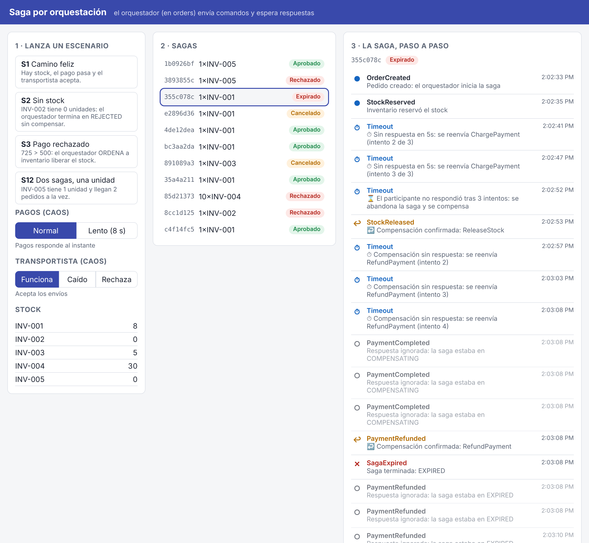
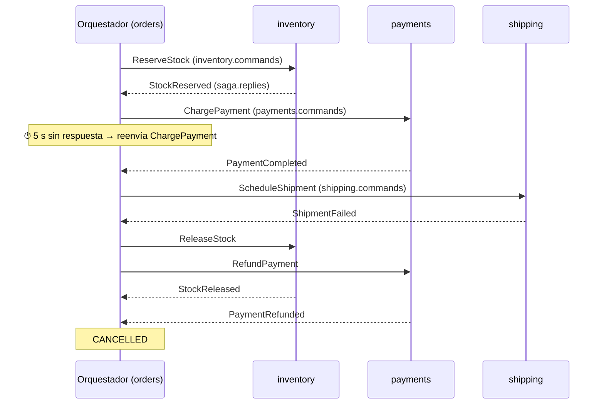

# 17 · Saga por orquestación

> La misma saga del lab 16, pero con un **orquestador**: un componente que conoce el flujo completo, envía **comandos** a cada participante, espera sus **respuestas**, mide el tiempo y decide cuándo compensar.

**Patrones:** Saga · Orchestration · Saga Execution Coordinator · Command/Reply Channels · Compensating Transaction · Pivot Transaction · Timeout / Retry
**Stack:** Quarkus (orders con el orquestador, payments) · FastAPI (inventory, shipping) · React + TypeScript · **Infra:** PostgreSQL, Kafka · **Tiempo estimado:** 2 h · **Requiere:** lab 16



*Caso S13: pagos no respondió. El orquestador reintentó `ChargePayment` 3 veces, abandonó la saga y compensó. Cuando pagos volvió, procesó los cobros encolados (el orquestador ignoró esas respuestas) y después el reembolso. Resultado: el dinero quedó `REFUNDED` y la saga `EXPIRED`. Todo es consistente.*

---

## El problema (que dejó el lab 16)

La coreografía funcionó, pero dejó tres huecos y un costo:

1. **Nadie mide el tiempo de la saga.** Si pagos no responde (S6) o no responde nunca (S13), el pedido queda en `STOCK_RESERVED` para siempre. Ningún servicio es responsable de darse cuenta.
2. **El flujo no está escrito en ningún lugar.** Para entender qué pasa cuando falla el envío, hay que leer cuatro servicios.
3. **Cancelar obligó a tres servicios a aprender sobre cancelaciones** (tablas `cancellations` en pagos, inventario y envíos).
4. Agregar un paso intermedio significa tocar varios servicios.

## El patrón: un orquestador

Un **orquestador** (en el libro de Chris Richardson, *Saga Execution Coordinator*) dirige la saga. Aquí vive dentro de `orders`, que es el servicio dueño del proceso "crear pedido":



Las diferencias con la coreografía, de un vistazo:

| | Coreografía (lab 16) | Orquestación (este lab) |
|---|---|---|
| Mensajes | **Eventos**: "esto pasó" (`StockReserved`) | **Comandos**: "haz esto" (`ReserveStock`) + **respuestas** |
| Topics | Uno por servicio (`inventory.events`…); cada uno escucha a varios | Uno de comandos por participante + `saga.replies` |
| Dónde está el flujo | Repartido en 4 servicios | En **un** archivo: [`OrderSagaOrchestrator.java`](services/orders/src/main/java/com/mercadoinventos/orders/OrderSagaOrchestrator.java) |
| Qué sabe cada participante | Qué eventos de otros le importan | **Nada** de los otros: solo sus comandos |
| Cancelaciones | Inventario, pagos y envíos las recuerdan | Solo el orquestador. Los participantes reciben `ReleaseStock` / `RefundPayment` |
| Timeouts | Nadie | El orquestador: reintenta, abandona y compensa |
| Estado de la saga | Inferido por pedidos a partir de eventos | **Persistido** en `saga_instance` |
| Punto único de falla | No hay | El orquestador (mitigado: su estado está en la base, ver S10) |

### La máquina de estados

```
RESERVING_STOCK ──StockReserved──▶ CHARGING ──PaymentCompleted──▶ SCHEDULING_SHIPMENT ──ShipmentScheduled──▶ APPROVED
     │                                │ (PIVOTE)                        │
     └─StockReservationFailed─▶ REJECTED  └─PaymentFailed─▶ COMPENSATING ─▶ REJECTED
                                                                      └─ShipmentFailed─▶ COMPENSATING ─▶ CANCELLED
```

`COMPENSATING` sabe **qué** compensaciones esperan respuesta (`pendingCompensations`) y a qué estado final ir cuando terminen (`outcome`).

### Las reglas del tiempo

Un *scheduler* revisa cada segundo las sagas cuyo paso no respondió a tiempo (`saga.step-timeout`, por defecto 5 s):

| Dónde está la saga | Qué hace el orquestador al vencer el plazo | Por qué |
|---|---|---|
| Antes del pivote (`RESERVING_STOCK`, `CHARGING`) | Reenvía el comando, hasta `saga.max-attempts` (3). Después **abandona** y compensa → `EXPIRED` | Todavía se puede deshacer todo |
| Después del pivote (`SCHEDULING_SHIPMENT`) | Reenvía **para siempre**. Nunca compensa por timeout | Ya se cobró: la saga debe avanzar |
| `COMPENSATING` | Reenvía las compensaciones pendientes **para siempre** | Una compensación tiene que terminar sí o sí |

Esto solo es seguro porque **reenviar un comando no tiene efectos dobles**:
- Pagos busca si ya cobró ese pedido y **responde lo que pasó** (reconciliación), en lugar de cobrar otra vez ([`PaymentsParticipant.java`](services/payments/src/main/java/com/mercadoinventos/payments/PaymentsParticipant.java)).
- Inventario y envíos hacen lo mismo con la reserva y el envío.
- Cada comando a un participante usa el id del pedido como key, así que llegan **en orden**: un `RefundPayment` nunca se adelanta a su `ChargePayment`.

## Levántalo

```bash
cd labs/17-saga-orquestacion
docker compose up --build -d
```

Abre **http://localhost:3000**: escenarios, controles de caos para pagos (lento) y para el transportista, y la línea de tiempo de cada saga.

```bash
./smoke.sh     # reproduce los casos de la matriz (≈ 4 min; mejor con el lab recién levantado)
```

Puertos: orders 8102 · inventory 8103 · payments 8104 · shipping 8105 · Kafka UI 8090. Peticiones listas en [`requests.http`](requests.http).

Para limpiar: `docker compose down -v`.

## Rómpelo: la matriz de casos, ahora con orquestador

| # | Caso | Cómo provocarlo | Qué deberías ver |
|---|---|---|---|
| **S1** | Camino feliz | UI → **S1** | `ReserveStock → ChargePayment → ScheduleShipment` → **Aprobado** |
| **S2** | Sin stock | UI → **S2** | **Rechazado** sin compensar |
| **S3** | Pago rechazado | UI → **S3** | El orquestador envía `ReleaseStock` y espera `StockReleased` → **Rechazado** |
| **S4** | Transportista caído | Transportista **Caído** + S1 | `⏱ Envíos no responde: después del pivote se REINTENTA, no se compensa`. Vuelve a **Funciona** → **Aprobado** |
| **S5** | Rechazo definitivo | Transportista **Rechaza** + S1 | `ReleaseStock` + `RefundPayment` → **Cancelado**. El pago queda `REFUNDED` |
| **S6** | Pago lento (timeout) | Pagos **Lento (8 s)** + S1 | `⏱ Sin respuesta en 5s: se reenvía ChargePayment (intento 2 de 3)`. Pagos reconcilia: **un** cobro y **Aprobado** |
| **S7** | Respuesta duplicada | `scripts/replay.sh saga.replies <id> StockReserved` | El inbox del orquestador la descarta: un solo `ChargePayment` |
| **S8** | Respuesta fuera de orden | `docker compose stop inventory`, lanza S1 (queda en `RESERVING_STOCK`) y ejecuta `scripts/publish.sh saga.replies PaymentCompleted <id>` | `Respuesta ignorada: la saga estaba en RESERVING_STOCK` |
| **S9** | Falla una compensación | Pagos **Lento** + S1, cancela, y apaga `payments` | El orquestador reenvía `RefundPayment` hasta que pagos vuelva (`⏱ Compensación sin respuesta`) |
| **S10** | Se cae el orquestador | Pagos **Lento** + S1 y `docker compose stop orders`; espera 10 s; `docker compose start orders` | El orquestador lee `saga_instance` y la saga sigue donde estaba → **Aprobado** |
| **S11** | Cancelar durante el cobro | Pagos **Lento** + S1, y **Cancelar** mientras dice *Cobrando* | `ReleaseStock` + `RefundPayment` (por si el cobro ya ocurrió). El `PaymentCompleted` tardío se ignora → **Cancelado** |
| **S12** | Dos sagas, una unidad | UI → **S12** | Una **Aprobada** y otra **Rechazada**. El stock nunca es negativo |
| **S13** | Un participante nunca responde | `docker compose stop payments` + S1 | 3 intentos → `⌛ … se abandona la saga y se compensa`. Al volver pagos: **Expirado** (la captura de arriba) |

Los casos S6, S10 y S13 **no tenían solución** en la coreografía. Son la razón de ser del orquestador.

### Mira la diferencia en el código

- En el lab 16, [`inventory/app/saga.py`](../16-saga-coreografia/services/inventory/app/saga.py) escucha `OrderCreated`, `PaymentFailed`, `ShipmentFailed` y `OrderCancelled`, y recuerda cancelaciones.
- Aquí, [`inventory/app/saga.py`](services/inventory/app/saga.py) solo conoce `ReserveStock` y `ReleaseStock`. **No sabe que existen pagos ni envíos.**
- Toda esa lógica se mudó a **un** lugar: [`OrderSagaOrchestrator.java`](services/orders/src/main/java/com/mercadoinventos/orders/OrderSagaOrchestrator.java).

## ¿Qué cambia en dev y prod?

- **Plazos según el negocio.** 5 s y 3 intentos sirven para ver el patrón. En prod, el plazo del cobro depende de la pasarela real (pueden ser minutos) y conviene un *backoff* creciente entre reintentos.
- **Alertas por sagas viejas:** `COMPENSATING` o `SCHEDULING_SHIPMENT` por más de X minutos. Ahora es una consulta directa a `saga_instance`, mucho más fácil que en la coreografía.
- **Alta disponibilidad del orquestador:** varias réplicas pueden convivir porque el *scheduler* usa `FOR UPDATE SKIP LOCKED` y cada respuesta toma un lock de la fila de su saga.
- **Versionado de sagas:** si cambias el flujo, las sagas en curso tienen que terminar con la versión vieja. Los motores de workflow resuelven esto de serie.

### ¿Y un motor de workflows?

Lo que este lab construye a mano (estado persistido, timeouts, reintentos, compensaciones) es exactamente lo que ofrecen motores como **Temporal**, **Camunda** o **AWS Step Functions**. Con Temporal, el flujo se escribe como código "normal" y el motor lo hace durable:

```java
// Pseudocódigo de Temporal: el motor persiste cada paso y reintenta solo.
inventory.reserveStock(order);
try {
    payments.charge(order);               // timeout y reintentos configurados en la actividad
} catch (PaymentFailed e) {
    inventory.releaseStock(order);        // compensación
    throw e;
}
shipping.schedule(order);
```

Hacerlo a mano primero sirve para **entender** qué hace el motor por ti. En un proyecto real con muchas sagas, el motor suele ganar. Queda como ejercicio avanzado rehacer este lab con Temporal (hay una extensión de Quarkus en Quarkiverse).

## Costo y cuándo NO usarlo

- **Un componente más que puede fallar**, aunque su estado persistido lo mitiga (S10).
- **Riesgo de "orquestador gordo"**: que la lógica de negocio de los participantes termine en el orquestador. El orquestador decide el **orden** y las **compensaciones**. Cómo se reserva o cómo se cobra sigue siendo de cada servicio.
- **Acoplamiento al orquestador**: los participantes no dependen entre sí, pero todos dependen de sus comandos.

**Coreografía o orquestación:**
- Coreografía para flujos cortos (2 o 3 pasos) y estables, donde la autonomía de los equipos importa más que la visibilidad.
- Orquestación para flujos con más pasos, ramas, timeouts, cancelaciones o cambios frecuentes. Muchos sistemas usan las dos: orquestación **dentro** de un dominio y eventos **entre** dominios.

## Ejercicio

Agrega un paso de **verificación antifraude** entre la reserva y el cobro: un comando `CheckFraud` a un participante nuevo, que responde `FraudCheckPassed` o `FraudDetected`.

- ¿Cuántos archivos tocaste? Compáralo con lo que habría costado en la coreografía (ejercicio del lab 16).
- ¿El nuevo paso es compensable? ¿Qué pasa si no responde?

<details><summary>Pista</summary>

En el orquestador:
1. Un estado nuevo `CHECKING_FRAUD` entre `RESERVING_STOCK` y `CHARGING`.
2. Un `case` en `on(...)` y otro en `commandOf(...)`.
3. Un `send` al topic del nuevo participante.

Ningún participante existente cambia. Si el antifraude no responde, aplica la regla "antes del pivote": reintentar y luego abandonar.
</details>

## Para profundizar

- Chris Richardson, *Microservices Patterns*, cap. 4: sagas orquestadas.
- Bernd Ruecker, *Practical Process Automation* (O'Reilly): orquestación vs. coreografía en la práctica.
- [Temporal](https://temporal.io/) y [Camunda](https://camunda.com/): motores de workflow durables.
