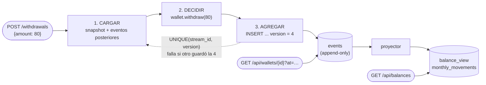
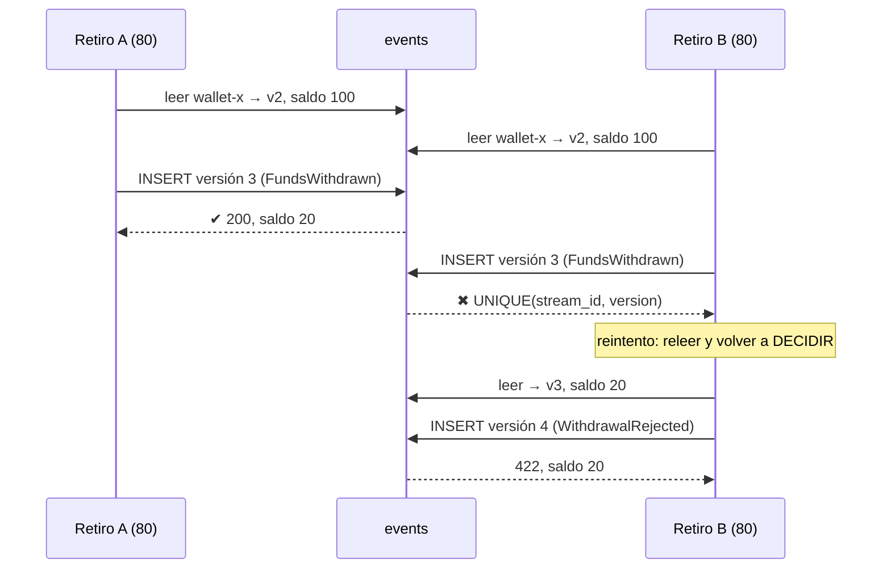

# 18 · Event Sourcing

> Guardar solo el estado actual borra la historia: después de `UPDATE wallets SET balance = 360`, nadie puede responder **por qué** el saldo es 360 ni **cuánto era** el 1 de noviembre. Con Event Sourcing no se guarda el estado: se guardan los **hechos** que lo produjeron, y el estado se calcula.

**Patrones:** Event Sourcing · Event Store · Snapshot · Proyección · Upcasting
**Stack:** Quarkus (JDBC directo, sin ORM) · **Infra:** PostgreSQL · **Tiempo estimado:** 1,5 a 2 h · **Requiere:** labs 03 (agregados) y 14 (proyecciones)

---

## El problema

El **monedero** de cada cliente del Mercado de Inventos: se recarga (Yape, tarjeta) y se paga con él. Con una tabla `wallets(id, balance)`:

- **"¿Por qué mi saldo es 360?"** La tabla solo sabe que es 360. Para explicarlo hace falta una tabla de movimientos aparte, y mantener las dos de acuerdo.
- **"¿Cuánto tenía el 1 de noviembre?"** Imposible, salvo que alguien haya guardado una foto ese día.
- **Dos retiros a la vez se pisan** (*lost update*): los dos leen 100, los dos restan 80 y los dos escriben 20. Se entregaron 160 y el saldo dice 20.

## La versión ingenua

`/api/naive/wallets` ([`NaiveWalletResource`](services/wallet/src/main/java/com/mercadoinventos/wallet/naive/NaiveWalletResource.java)): leer el saldo, comprobar que alcanza, escribir el saldo nuevo. Con dos retiros de 80 a la vez sobre 100, **los dos responden 200** y el saldo queda en 20 (lo mide el smoke y el test `the_naive_version_loses_an_update`).

> Un `UPDATE ... SET balance = balance - 80 WHERE balance >= 80` evitaría este lost update concreto. Pero seguiría sin historia, y en cuanto la regla de negocio no quepa en un `WHERE` (límites diarios, retiros pendientes), se vuelve al leer-decidir-escribir.

## El patrón



### El event store

Una tabla de Postgres ([`V1__event_store.sql`](services/wallet/src/main/resources/db/migration/V1__event_store.sql)). No hay columna de saldo en ningún lado:

| global_position | stream_id | version | type | schema_version | payload | occurred_at |
|---|---|---|---|---|---|---|
| 1 | wallet-ana | 1 | WalletOpened | 1 | `{"owner": "ana"}` | 2026-10-01 |
| 2 | wallet-ana | 2 | FundsDeposited | **1** | `{"amountCents": 50000}` | 2026-10-03 |
| 3 | wallet-ana | 3 | FundsWithdrawn | 1 | `{"amount": 120.00, ...}` | 2026-10-15 |
| … | | | | | | |
| 7 | wallet-ana | 7 | WithdrawalRejected | 1 | `{"amount": 500.00, "balance": 360.00, ...}` | 2026-11-12 |

- **Append-only de verdad.** Un *trigger* rechaza `UPDATE`, `DELETE` y `TRUNCATE`, también para quien entra con `psql`. Un error no se borra: se corrige con **otro** evento (un depósito mal cargado se compensa con un retiro "corrección"), y los dos quedan en la historia.
- **Un stream por agregado** (`wallet-ana`), con versiones 1, 2, 3...
- **`UNIQUE(stream_id, version)`** es todo el control de concurrencia (ver abajo).
- **`metadata`** guarda el contexto: qué comando y en qué intento. Útil para auditar.

### El agregado: decidir y aplicar

[`Wallet.java`](services/wallet/src/main/java/com/mercadoinventos/wallet/domain/Wallet.java) tiene dos tipos de métodos que no se mezclan:

```java
// DECIDIR: valida contra el estado actual y devuelve lo que ocurriría. No cambia nada.
public List<WalletEvent> withdraw(BigDecimal amount, String description) {
    if (balance.compareTo(amount) < 0) {
        return List.of(new WithdrawalRejected(amount, balance, "INSUFFICIENT_FUNDS"));
    }
    return List.of(new FundsWithdrawn(amount, description));
}

// APLICAR: cambia el estado. No valida: el evento ya ocurrió.
public void apply(WalletEvent event) {
    switch (event) {
        case FundsDeposited e -> balance = balance.add(e.amount());
        case FundsWithdrawn e -> balance = balance.subtract(e.amount());
        ...
    }
    version++;
}
```

Cargar un monedero es aplicar su historia en orden. Un retiro rechazado **también es un evento**: el cliente lo intentó, y eso es parte de la historia (y de la proyección mensual).

### Concurrencia optimista

Sin `SELECT ... FOR UPDATE` ni candados. Cada comando guarda "la versión siguiente a la que leí". Si otro llegó antes, la restricción `UNIQUE` lo detecta:



Lo importante del reintento es que **vuelve a decidir** con el estado nuevo, y la segunda decisión es distinta: el saldo ya no alcanza. Reintentar el `INSERT` tal cual sería el mismo lost update. Si se agotan los intentos (`MAX_ATTEMPTS`, 3), la respuesta es `409 CONCURRENT_MODIFICATION` ([`WalletService.handle`](services/wallet/src/main/java/com/mercadoinventos/wallet/app/WalletService.java)).

### Snapshots

Cargar un monedero con 10.000 eventos en cada comando es lento. Cada `SNAPSHOT_EVERY` eventos (5) se guarda una **foto** del estado. Cargar = último snapshot + los eventos posteriores. La respuesta de `GET /api/wallets/{id}` lo muestra en `X-Snapshot-Version` y `X-Events-Replayed`.

El snapshot es una **caché**, no una fuente de verdad: si se borra la tabla `snapshots`, todo sigue funcionando (más lento). Y tiene su propio número de formato: si cambia la forma del estado, los snapshots viejos se ignoran y se rearman.

### Upcasting: cuando el formato de un evento cambia

En octubre, `FundsDeposited` era `{"amountCents": 50000}`. En noviembre el equipo lo cambió a `{"amount": 500.00, "currency": "PEN", "channel": "YAPE"}`. Los eventos viejos **no se reescriben** (el store es append-only, y además son la historia). Se convierten **al leerlos** ([`Upcaster.java`](services/wallet/src/main/java/com/mercadoinventos/wallet/es/Upcaster.java)):

```java
// v1 → v2: céntimos a soles, moneda fija, y lo que v1 no sabía queda "DESCONOCIDO" (no se inventa).
v2.put("amount", BigDecimal.valueOf(event.payload().get("amountCents").asLong(), 2));
v2.put("currency", "PEN");
v2.put("channel", "DESCONOCIDO");
```

El resto del código solo conoce la última versión de cada evento. `GET /api/wallets/wallet-ana/events` muestra `storedSchemaVersion: 1` y `schemaVersion: 2` en los depósitos de octubre.

### Proyecciones

El saldo de **un** monedero se calcula al vuelo. Pero "todos los saldos ordenados" o "depósitos por mes" releerían todos los eventos de todos los monederos. Para eso hay dos **proyecciones**, tablas normales que un proceso mantiene al día ([`Projector.java`](services/wallet/src/main/java/com/mercadoinventos/wallet/projection/Projector.java)): `balance_view` y `monthly_movements`.

A diferencia del lab 14, la vista y el event store están en **la misma base**: el lote de eventos y el checkpoint se guardan en **una** transacción. No hace falta deduplicar por `eventId`.

#### Lo que encontré al escribir el lab: un evento que confirma tarde

La forma obvia de leer "lo nuevo" es `WHERE global_position > checkpoint`. Tiene un bug que no se ve en una demo y sí en producción:

1. La transacción A hace su `INSERT` y recibe la posición **100**, pero todavía no confirma.
2. La transacción B recibe la **101** y confirma enseguida.
3. El proyector lee, ve la 101 (la 100 todavía no es visible) y mueve el checkpoint a 101.
4. A confirma. La 100 queda **antes** del checkpoint: el proyector **nunca** la verá.

La secuencia se asigna al insertar, pero las transacciones confirman en otro orden. La solución de este lab guarda el id de la transacción en cada evento (`transaction_id xid8 DEFAULT pg_current_xact_id()`) y el proyector solo lee transacciones **anteriores a la más vieja que sigue abierta**:

```sql
WHERE (transaction_id, global_position) > (:checkpoint_tx, :checkpoint_pos)
  AND transaction_id < pg_snapshot_xmin(pg_current_snapshot())
ORDER BY transaction_id, global_position
```

El test [`an_event_committed_late_is_not_skipped_by_the_projector`](services/wallet/src/test/java/com/mercadoinventos/wallet/WalletApiTest.java) reproduce los 4 pasos. Con la consulta ingenua falla (lo comprobé cambiándola). El costo: mientras una transacción siga abierta, el proyector **espera**, y también espera lo que confirmaron otras después. Por eso las transacciones que escriben eventos tienen que ser cortas. El mismo problema existe en cualquier outbox con polling (lab 15).

### Event Sourcing y CQRS

Suelen ir juntos (el event store es malo para consultar, así que se le agregan proyecciones), pero **ninguno necesita al otro**. El lab 14 hace CQRS sin Event Sourcing (la fuente de verdad de pedidos es una tabla normal). Y este lab podría no tener proyecciones: el saldo de un monedero se calcula desde sus eventos sin ellas.

## Arquitectura del lab

| Servicio | Qué es | Puerto |
|---|---|---|
| `wallet` | Quarkus: el event store, el agregado, el proyector y la versión ingenua | 8106 |
| `postgres` | La base `wallet` | 5432 |

| Endpoint | Qué hace |
|---|---|
| `POST /api/wallets` · `POST /api/wallets/{id}/deposits` · `POST /api/wallets/{id}/withdrawals` | Comandos. Un retiro sin saldo responde `422` (y queda en la historia); un conflicto sin más intentos, `409` |
| `GET /api/wallets/{id}` · `?at=2026-11-01` | El estado, calculado ahora (o en esa fecha, en hora de Lima) |
| `GET /api/wallets/{id}/events` | La historia, en el formato actual, con el saldo después de cada evento |
| `GET /api/balances` · `GET /api/wallets/{id}/monthly` | Proyecciones |
| `GET /admin/projections` · `POST /admin/projections/rebuild` | Estado del proyector y reconstrucción |
| `PUT /admin/think-time` · `PUT /admin/retries` | Perillas del lab: espera entre leer y guardar, e intentos |
| `/api/naive/wallets/...` | La versión ingenua |

Datos de ejemplo: `wallet-ana` (7 eventos, con depósitos v1 de octubre) y `wallet-beto`.

## Levántalo

```bash
cd labs/18-event-sourcing
docker compose up --build -d
./smoke.sh
```

Más peticiones en [`requests.http`](requests.http). Swagger UI: http://localhost:8106/q/swagger-ui. Para limpiar: `docker compose down -v`.

## Rómpelo

1. **"¿Por qué mi saldo es 360?"**
   ```bash
   curl -s localhost:8106/api/wallets/wallet-ana/events | python3 -m json.tool
   ```
   Cada evento, con el saldo después. Incluye el retiro de 500 que se rechazó el 12 de noviembre.

2. **Viaje en el tiempo.**
   ```bash
   curl -s 'localhost:8106/api/wallets/wallet-ana?at=2026-11-01'    # 580.00
   curl -s 'localhost:8106/api/wallets/wallet-ana?at=2026-10-16'    # 380.00
   ```
   Es la misma función que carga el estado actual, aplicada a los eventos hasta esa fecha.

3. **Dos retiros a la vez.** Abre una ventana de 300 ms entre leer y guardar, y lanza dos retiros de 80 sobre 100:
   ```bash
   curl -X PUT localhost:8106/admin/think-time -H 'Content-Type: application/json' -d '{"ms":300}'
   ID=$(curl -s -X POST localhost:8106/api/wallets -H 'Content-Type: application/json' -d '{"owner":"eva"}' \
     | python3 -c "import json,sys; print(json.load(sys.stdin)['id'])")
   curl -s -X POST localhost:8106/api/wallets/$ID/deposits -H 'Content-Type: application/json' -d '{"amount":100.00}'
   for i in 1 2; do curl -s -X POST localhost:8106/api/wallets/$ID/withdrawals \
     -H 'Content-Type: application/json' -d '{"amount":80.00}' & done; wait
   ```
   Uno responde `200` y el otro `422` con `"attempts": 2`. En `docker compose logs wallet` verás `Conflicto de versión ... Reintento 2: releer y volver a decidir`, y en la historia, el `WithdrawalRejected` con `"attempt": 2` en su metadata. Repite con `/api/naive/wallets/naive-beto/withdrawals`: los dos `200`, y el saldo dice 20.

4. **Sin reintentos.** `PUT /admin/retries {"maxAttempts":1}` y repite: el perdedor recibe `409`. No se pierde nada, pero el cliente tiene que reintentar. Vuelve a `3` y la ventana a `0` al terminar.

5. **Snapshots.** Haz 6 depósitos en un monedero y mira las cabeceras:
   ```bash
   curl -si localhost:8106/api/wallets/$ID | grep -i '^x-'
   ```
   Después bórralos todos: `docker compose exec postgres psql -U wallet -d wallet -c 'delete from snapshots'`. El saldo es el mismo; solo cambió cuántos eventos se releyeron.

6. **Intenta reescribir la historia.**
   ```bash
   docker compose exec postgres psql -U wallet -d wallet -c "update events set payload = '{}' where version = 2"
   ```
   `ERROR: El event store es append-only: UPDATE no está permitido`.

7. **Reconstruye las proyecciones.** `curl -X POST localhost:8106/admin/projections/rebuild` y, al segundo, `GET /api/balances`: las mismas filas, rearmadas desde el primer evento. Si mañana necesitas una vista nueva ("retiros rechazados por cliente"), se crea y se llena con **toda** la historia, también la de antes de que existiera.

## ¿Qué cambia en dev y prod?

Este lab no trae overlays de ambiente. Lo que cambia:

| Aspecto | Local (este lab) | Prod |
|---|---|---|
| Event store | Una tabla en Postgres, escrita a mano | Igual es una opción válida. También hay bases hechas para esto: KurrentDB (antes EventStoreDB), Axon Server, o Marten en .NET |
| Proyector | Dentro del mismo proceso, cada 1 s | Un proceso aparte o una sola instancia activa (si hay 3 réplicas del servicio, las 3 no deben proyectar a la vez). Se alerta si los eventos pendientes crecen |
| Snapshots | Cada 5 eventos | Según cuánto tarda cargar. Muchos sistemas no los necesitan: un monedero con 200 eventos se carga en milisegundos |
| Datos personales | Sin cuidado | Los eventos no se borran, pero la ley puede exigir borrar datos de una persona. Opciones: no guardar datos personales en los eventos (solo referencias) o cifrarlos con una clave por persona y borrar la clave (*crypto-shredding*) |
| Crecimiento | Sin límite | La tabla crece para siempre. Se particiona por fecha, y los streams cerrados se archivan |

## Costo y cuándo NO usarlo

- **Los eventos son para siempre.** Cada cambio de formato necesita un upcaster, y todos los upcasters viven mientras exista un evento viejo. Diseñar eventos exige más cuidado que diseñar una tabla.
- **Consultar es difícil sin proyecciones.** "Todos los monederos con saldo menor a 10" no se puede responder desde el event store: hacen falta proyecciones, con su atraso (lab 14).
- **Curva de aprendizaje.** Decidir y aplicar, versiones, snapshots y proyecciones son conceptos que todo el equipo tiene que entender.
- **Cuándo no:** en la mayoría de los CRUD. Si nadie va a preguntar "¿por qué?" ni "¿cuánto era en tal fecha?", una tabla con su estado (y una de auditoría si hace falta) es más simple. Event Sourcing paga en dominios donde la historia **es** el negocio: dinero, inventario con trazabilidad, expedientes, reservas.

## Ejercicio

En diciembre, `FundsWithdrawn` necesita una **categoría** (`COMPRA`, `TRANSFERENCIA`, `CORRECCION`). Sube su formato a v2 y escribe el upcaster v1 → v2. ¿Qué categoría les pones a los retiros viejos: `COMPRA` (casi todos lo eran) o `DESCONOCIDA`? Escribe primero el test en [`UpcasterTest`](services/wallet/src/test/java/com/mercadoinventos/wallet/UpcasterTest.java). Después agrega a `monthly_movements` el total por categoría y reconstruye la proyección: los meses pasados también se llenan.

## Para profundizar

- Martin Fowler, [*Event Sourcing*](https://martinfowler.com/eaaDev/EventSourcing.html).
- Greg Young, [*Versioning in an Event Sourced System*](https://leanpub.com/esversioning): upcasting y todo lo que pasa cuando los eventos cambian.
- Chris Richardson, [*Event sourcing*](https://microservices.io/patterns/data/event-sourcing.html), y *Microservices Patterns*, capítulo 6.
- Microsoft, [*Event Sourcing pattern*](https://learn.microsoft.com/azure/architecture/patterns/event-sourcing).
- PostgreSQL, [funciones de transacciones y snapshots](https://www.postgresql.org/docs/17/functions-info.html#FUNCTIONS-PG-SNAPSHOT): `pg_current_xact_id` y `pg_snapshot_xmin`.
- Siguiente: el [lab 19](../19-anti-corruption-layer/) protege el dominio de un sistema legado con otro modelo.
