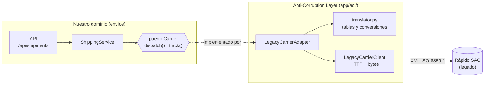

# 19 · Anti-Corruption Layer

> Integrarse con un sistema legado o externo es inevitable. Lo evitable es que **su** modelo (sus códigos, sus unidades, sus errores) se meta en el **tuyo**. Un Anti-Corruption Layer es una capa que traduce en la frontera para que tu dominio nunca se entere de cómo habla el otro.

**Patrones:** Anti-Corruption Layer · Adapter · Translator
**Stack:** FastAPI · **Infra:** — · **Tiempo estimado:** 1 a 1,5 h · **Requiere:** labs 02 (puertos y adaptadores) y 03 (bounded contexts)

---

## El problema

Envíos trabaja con el transportista **Rápido SAC**. Su sistema es de 2003 ([simulado aquí](services/legacy-carrier/app/main.py)) y habla así:

```xml
<?xml version='1.0' encoding='ISO-8859-1'?>
<RESPUESTA>
  <COD_RET>00</COD_RET><NRO_GUIA>RS0000042</NRO_GUIA>
  <EST>3</EST><DES_EST>EN RUTA</DES_EST>
  <FEC_EST>19/11/26</FEC_EST><FEC_ENT/>
  <OBS>RECIBIDO POR: SRA. MUÑOZ</OBS>
</RESPUESTA>
```

| Lo que el legado quiere o devuelve | Lo que nuestro dominio entiende |
|---|---|
| XML en **ISO-8859-1** | JSON y texto en UTF-8 |
| `EST=3`, `EST=4`, `EST=9` | `IN_TRANSIT`, `DELIVERED`, `EXCEPTION` |
| `TPO_SRV=EXP` | `ServiceLevel.EXPRESS` |
| `PESO_LB=4,41` (libras, **coma** decimal) | `weight_kg = Decimal("2.00")` |
| `FEC_EST=19/11/26` (dd/MM/yy) | `date(2026, 11, 19)` |
| `UBIGEO=150122` (código de distrito del INEI) | `district = "Miraflores"` |
| `DIR`: mayúsculas, sin tildes, 40 caracteres | La dirección como la escribió el cliente |
| Errores con **HTTP 200** y `COD_RET=07` | `WeightLimitExceeded` → `422` |

Si esos detalles entran al servicio, se esparcen: el frontend termina con `EST === "3" ? "En camino"`, la regla de negocio "el cliente puede calificar la entrega" se escribe `EST == "4"`, y cada servicio que consulte envíos aprende qué es un UBIGEO. El día que el transportista cambia algo, o que se cambia de transportista, hay que buscar cada uno de esos lugares.

## La versión ingenua

`/api/naive/shipments` ([`naive/api.py`](services/shipping/app/naive/api.py)) deja pasar el modelo del legado en las dos direcciones:

```bash
curl -s -X POST localhost:8105/api/naive/shipments -H 'Content-Type: application/json' \
  -d '{"orderId":"o-1","TPO_SRV":"EXP","PESO_LB":"4,41","UBIGEO":"150122","DIR":"AV LARCO 1150"}'
# {"COD_RET":"00","DES_RET":"OK","NRO_GUIA":"RS0000001","FEC_EST":"19/11/26"}
```

- **Quien llama** tiene que saber convertir kilos a libras con coma, buscar el UBIGEO y escribir `EXP`.
- **Los errores parecen éxitos:** un envío demasiado pesado responde `HTTP 200` con `"COD_RET": "07"`.
- **El XML se arma con un f-string:** una dirección con `&` ("Av. Larco & Pardo") produce `COD_RET=01 XML MAL FORMADO`.
- Y el frontend, que recibe `EST`, termina con esto:

  ```ts
  const label = { '1': 'Registrado', '2': 'Recogido', '3': 'En camino', '4': 'Entregado' }[shipment.EST]
  const canRate = shipment.EST === '4'
  ```

## El patrón



Tres piezas, cada una con un solo trabajo ([`app/acl/`](services/shipping/app/acl/)):

| Pieza | Qué hace | Qué NO hace |
|---|---|---|
| [`client.py`](services/shipping/app/acl/client.py) | HTTP: manda y recibe bytes. Un timeout o un 5xx → `CarrierUnavailable` | No interpreta nada |
| [`translator.py`](services/shipping/app/acl/translator.py) | Funciones **puras**: tablas de códigos, kg ↔ lb, fechas, UBIGEO, armar y leer el XML | No hace llamadas: se prueba sin red |
| [`adapter.py`](services/shipping/app/acl/adapter.py) | Implementa el **puerto** `Carrier` del dominio con las otras dos. Traduce `COD_RET` a errores del dominio | No tiene lógica de negocio |

Y del otro lado, [`domain.py`](services/shipping/app/domain.py) no tiene **ni una** palabra del legado: ni libras, ni UBIGEO, ni `EST`. La regla de negocio es `self.status is ShipmentStatus.DELIVERED`. Si mañana se cambia de transportista, se escribe otro adaptador y el dominio no cambia.

### ¿Y si llega un código que no conocemos?

El traductor no inventa: lanza `UnknownLegacyCode`. El adaptador lo convierte en un estado **de nuestro dominio**, `UNKNOWN` ("el transportista dijo algo que no sabemos traducir"), y deja un `WARNING`. El código ajeno nunca entra. La alternativa de dejarlo pasar "por si acaso" es justo la corrupción que el patrón evita.

### Tests de contrato

Un ACL se rompe cuando el **otro** cambia, y eso no lo detecta ningún test de tu código. Por eso hay dos niveles:

1. **Las respuestas guardadas** ([`tests/fixtures/`](services/shipping/tests/fixtures/)): bytes reales del legado, en ISO-8859-1. [`test_translator.py`](services/shipping/tests/test_translator.py) comprueba que el traductor las lee. Es el contrato escrito: lo que sabemos leer.
2. **El contract check contra el legado vivo** ([`contract_check.py`](services/shipping/app/acl/contract_check.py)): despacha un envío de prueba, lo hace avanzar por todos los estados y pasa cada respuesta por el **mismo** traductor. Si aparece algo que no sabe leer, falla con exit 1 y dice qué. Va en CI, contra el ambiente de pruebas del transportista, o cada noche.

```bash
docker compose exec shipping python -m app.acl.contract_check
```

## Arquitectura del lab

| Servicio | Qué es | Puerto |
|---|---|---|
| `shipping` | FastAPI: `/api/shipments` con ACL y `/api/naive/shipments` sin ACL | 8105 |
| `legacy-carrier` | El transportista **simulado**: XML, ISO-8859-1, `COD_RET`. Trae una API de administración (`/admin/...`) para avanzar estados y cambiar de versión, que el real no tendría | 8121 |

Los envíos se guardan en memoria: el lab trata de la integración, no de la persistencia.

## Levántalo

```bash
cd labs/19-anti-corruption-layer
docker compose up --build -d
./smoke.sh
```

Más peticiones en [`requests.http`](requests.http). Swagger UI: http://localhost:8105/docs. Para limpiar: `docker compose down`.

## Rómpelo

1. **Compara las dos respuestas.** Crea un envío con cada versión (están en [`requests.http`](requests.http)) y consulta los dos. Con ACL: `"status": "CREATED"`, `"estimatedDelivery": "2026-11-19"` (fecha ISO), `"canRateDelivery": false`. Sin ACL: `"EST": "1"`, `"FEC_EST": "19/11/26"`, `"puedeCalificar": false`. Las fechas dependen del día en que lo corras: el legado calcula la entrega desde hoy. Mira también el XML que devuelve el legado:
   ```bash
   curl -s 'localhost:8121/servicios/consulta?guia=RS0000001' | iconv -f latin1 -t utf-8
   ```

2. **Errores que parecen éxitos.** Manda 60 kg con ACL (`422 WEIGHT_LIMIT_EXCEEDED`) y `"PESO_LB": "132,28"` sin ACL (`HTTP 200`, `COD_RET: 07`). Prueba también una dirección con `&` en los dos.

3. **El legado cambia un código.** El transportista sube a la versión 2: el estado "EN RUTA" (`3`) se partió en "EN TRANSITO" (`7`) y "EN REPARTO" (`8`). Nadie te avisó.
   ```bash
   curl -X PUT localhost:8121/admin/version -H 'Content-Type: application/json' -d '{"version":2}'
   ```
   Crea un envío con ACL, avánzalo dos veces (`POST localhost:8121/admin/guias/<guía>/avanzar`) y consúltalo:
   - **Con ACL:** `"status": "UNKNOWN"` y en `docker compose logs shipping` un `WARNING ... sin traducir: EST=7`. Ningún `7` entró al dominio.
   - **Sin ACL:** `"EST": "7"`. El `label` del frontend de arriba muestra `undefined`, y cualquier otra regla escrita con `EST == "3"` deja de cumplirse sin error.
   - **El contract check falla** y dice qué cambió: `✖ EST=7 (EN TRANSITO) → no está en STATUS_BY_EST (translator.py)`.

4. **Arréglalo en un solo lugar.** Agrega dos filas a `STATUS_BY_EST` en [`translator.py`](services/shipping/app/acl/translator.py):
   ```python
   "7": ShipmentStatus.IN_TRANSIT,          # EN TRANSITO (legado v2)
   "8": ShipmentStatus.OUT_FOR_DELIVERY,    # EN REPARTO (legado v2)
   ```
   Guarda la respuesta nueva en `tests/fixtures/` con su test, y `docker compose up --build -d shipping`. El contract check pasa (lo comprobé: `CREATED → PICKED_UP → IN_TRANSIT → OUT_FOR_DELIVERY → DELIVERED`). El dominio, la API, el frontend y los demás servicios **no cambiaron**. Además, el dominio ya tenía `OUT_FOR_DELIVERY`: el legado por fin lo informa. En la versión ingenua, el mismo cambio hay que buscarlo en el frontend, en cada servicio que lea `EST` y en cada reporte.

   Al terminar: `{"version":1}` en el legado.

## ¿Qué cambia en dev y prod?

Este lab no trae overlays de ambiente. Lo que cambia:

| Aspecto | Local (este lab) | Prod |
|---|---|---|
| El legado | Un simulador con API de administración | El sistema real. Para probar, su ambiente de pruebas (*sandbox*), si existe. Si no, grabaciones de sus respuestas |
| Contract check | A mano o en el smoke | En CI contra el sandbox, y programado cada noche: el legado cambia sin avisar |
| Código desconocido | `UNKNOWN` + `WARNING` | Lo mismo, más una **alerta**: alguien tiene que actualizar el traductor |
| Resiliencia | Timeout de 3 s | Timeout, reintentos y circuit breaker en el cliente (lab 11). Los legados suelen ser lentos y frágiles |
| Dónde vive el ACL | Dentro de `shipping` | Dentro del servicio, o como un servicio aparte si varios lo usan. Separarlo tiene sentido cuando el modelo traducido es el mismo para todos |

## Costo y cuándo NO usarlo

- **Más código y una traducción más** en cada llamada. Las tablas hay que mantenerlas.
- **Se puede perder información**: si el legado tiene 15 estados y el dominio 6, varios terminan en el mismo. Hay que decidir qué se pierde a propósito.
- **Un ACL mal hecho es un pasamanos**: si el "traductor" solo renombra `EST` a `est`, el modelo ajeno sigue entrando con otro nombre.
- **Cuándo no:** cuando el otro sistema tiene un buen modelo y te conviene adoptarlo (en DDD, *Conformist*), o cuando es una integración pequeña y estable con un estándar conocido (una API REST moderna y versionada). Un ACL paga cuando el modelo ajeno es malo, raro o cambia sin avisar.

## Ejercicio

Llega un **segundo transportista**, "Veloz Express", con una API JSON moderna (`{"status": "in_transit", "eta": "2026-11-19T18:00:00Z", "weight_grams": 2000}`). Escribe un `VelozExpressAdapter` que implemente el mismo puerto `Carrier`, con su traductor y sus tests con respuestas guardadas. ¿Qué tuviste que cambiar en `domain.py` y en `service.py`? Si la respuesta es "nada", el ACL hizo su trabajo. Pista: después, elegir transportista por distrito es una decisión del dominio, no del adaptador.

## Para profundizar

- Eric Evans, *Domain-Driven Design* (2003), capítulo 14: *Anti-Corruption Layer*, *Conformist* y los demás patrones de integración entre contextos.
- Microsoft, [*Anti-corruption Layer pattern*](https://learn.microsoft.com/azure/architecture/patterns/anti-corruption-layer).
- Martin Fowler, [*Gateway*](https://martinfowler.com/articles/gateway-pattern.html): el mismo principio aplicado a cualquier recurso externo.
- Siguiente: el [lab 20](../20-strangler-fig/) reemplaza un sistema legado por partes, sin apagarlo de golpe.
