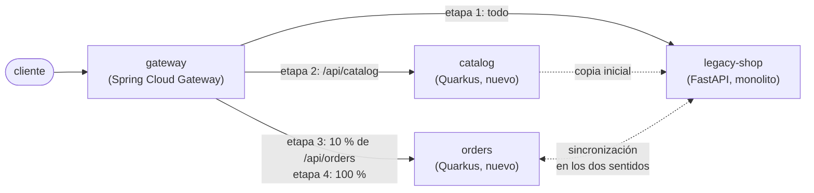

# 20 · Strangler Fig

> Reescribir un sistema entero y cambiarlo de golpe (*big bang*) casi siempre sale mal: tarda más de lo previsto, el negocio no se detiene mientras tanto y el día del cambio aparece todo lo que nadie sabía que el sistema viejo hacía. El Strangler Fig reemplaza el sistema **por partes**, con los dos funcionando a la vez, hasta que el viejo queda sin nada que hacer.

**Patrones:** Strangler Fig · Canary Release (enrutamiento por pesos) · Sincronización de datos durante la migración
**Stack:** Spring Cloud Gateway · Quarkus · FastAPI · **Infra:** PostgreSQL · **Tiempo estimado:** 1,5 a 2 h · **Requiere:** labs 04, 05 y 07

---

## El problema

La **tienda legada** ([`legacy-shop`](services/legacy-shop/app/main.py)) es un monolito FastAPI de 2012 con una sola base: catálogo y pedidos en las tablas `productos` y `pedidos`. Funciona, pero cada cambio es lento y riesgoso. El equipo quiere pasar a servicios nuevos (lab 05).

La tentación es reescribir todo y cambiar un viernes por la noche. El Strangler Fig (la "higuera estranguladora", que crece alrededor de un árbol hasta reemplazarlo) propone otra cosa:

1. Poner **delante** del legado algo que decida a dónde va cada petición. Aquí, un gateway.
2. Mover las rutas **de a una** al sistema nuevo, empezando por las más fáciles.
3. Poder **volver atrás** en cada paso.
4. Cuando el legado ya no recibe tráfico, apagarlo.

El cliente no se entera: siempre habla con el gateway y el contrato de la API no cambia.

## Las 5 etapas



| Etapa | `/api/catalog/**` | `/api/orders/**` | El legado |
|---|---|---|---|
| 1. Proxy transparente | legado | legado | Atiende todo |
| 2. Catálogo migrado | **nuevo** | legado | Atiende pedidos |
| 3. Canary | nuevo | **10 %** nuevo, 90 % legado | Atiende el 90 % de pedidos |
| 4. Pedidos migrados | nuevo | **100 %** nuevo | Solo recibe la sincronización |
| 5. Legado apagado | nuevo | nuevo | Sin tráfico: se puede apagar |

Cada etapa se activa **en caliente**: `PUT /admin/migration/stage/3`. El gateway no se reinicia, y los servicios tampoco.

### La etapa 1 no es un trámite

Poner el gateway como proxy transparente parece no cambiar nada, y por eso suele saltarse. Pero es el paso que permite todos los demás: desde ese momento, **todo** el tráfico pasa por un punto que se puede reconfigurar. Además, ahí se mide cómo usan el legado sus clientes, qué rutas existen de verdad y cuánto tarda cada una. Es la línea base para comparar.

## Cómo decide el gateway

[`Routes.java`](gateway/src/main/java/com/mercadoinventos/gateway/Routes.java) define tres rutas, en orden. Gana la primera cuyo predicado se cumple:

```java
.route("catalog-new", r -> r.order(1).path("/api/catalog/**")
    .and().predicate(exchange -> migration.catalogOnNew())          // ¿el catálogo ya se migró?
    .uri(catalog))
.route("orders-new", r -> r.order(2).path("/api/orders/**", "/api/orders")
    .and().predicate(exchange -> migration.orderToNew())            // ¿esta petición cae en el canary?
    .uri(orders))
.route("legacy", r -> r.order(10).path("/api/**")
    .and().predicate(exchange -> migration.legacyEnabled())         // todo lo demás, al legado
    .uri(legacy))
```

Los predicados leen [`MigrationState`](gateway/src/main/java/com/mercadoinventos/gateway/MigrationState.java) en **cada** petición, así que cambiar el estado cambia el enrutamiento al instante. El canary sortea cada petición: con 10 %, una de cada diez (en promedio) va al servicio nuevo. Cada respuesta trae dos cabeceras: `X-Route` (qué ruta eligió el gateway) y `X-Served-By` (quién respondió).

> Spring Cloud Gateway trae un predicado `Weight` que reparte por pesos desde la configuración. Aquí se escribió el estado a mano para poder cambiarlo con una petición y para que se vea cómo funciona. Con `Weight`, cambiar los pesos es editar la configuración y refrescar las rutas.

## Los datos: lo difícil de verdad

Mover una ruta es fácil. Lo difícil es que **los datos** sigan siendo los mismos para el cliente, venga quien venga a atenderlo.

### Catálogo: una copia inicial

El catálogo nuevo tiene su propia base. Al arrancar vacío, copia los productos del legado ([`CatalogImport`](services/catalog/src/main/java/com/mercadoinventos/catalog/CatalogImport.java)). Alcanza con una copia porque en este lab el catálogo es de **solo lectura**. Si el legado siguiera cambiando precios, habría que sincronizar en continuo, como con los pedidos.

### Pedidos: sincronización en los dos sentidos

Durante el canary, un mismo cliente crea pedidos a veces en el legado y a veces en el servicio nuevo. Y su siguiente petición puede ir a cualquiera de los dos. Por eso [`LegacySync`](services/orders/src/main/java/com/mercadoinventos/orders/LegacySync.java) corre cada segundo:

- **Nuevo → legado:** los pedidos creados en el servicio nuevo se copian al legado (`PUT /internal/orders/{id}`). Así, si un GET va al legado, el pedido está. Y, sobre todo, **un rollback no pierde pedidos**. La marca "pendiente de copiar" se guarda en la **misma transacción** que el pedido (una outbox reducida a una columna, lab 15): si el legado está caído, se reintenta.
- **Legado → nuevo:** los pedidos creados en el legado se copian al servicio nuevo (`GET /internal/orders?afterId=...`). Así, en la etapa 4, la historia de cada cliente está completa.

Tres decisiones que lo hacen funcionar:

| Problema | Solución en el lab |
|---|---|
| Los dos sistemas crean pedidos: ¿cómo no repetir ids? | **Rangos separados:** el legado usa 1001, 1002... y el nuevo, 500001, 500002... Un pedido tiene el mismo id en las dos bases |
| Copiar dos veces no puede duplicar | Las dos copias son **idempotentes** (`ON CONFLICT DO NOTHING` en el legado; "si no existe, insertar" en el nuevo) |
| Un pedido del legado puede confirmar después que uno con id mayor (lab 18) | Cada pasada vuelve a pedir los últimos 50 ids ya vistos. Como copiar es idempotente, repetir no daña |

Para esto hubo que **tocar el legado**: los endpoints `/internal/orders` y la columna `origen`. Estrangular un sistema casi siempre exige cambios pequeños en él.

## Arquitectura del lab

| Servicio | Qué es | Puerto |
|---|---|---|
| `gateway` | Spring Cloud Gateway: el único punto de entrada. `GET/PUT /admin/migration` | 8080 |
| `legacy-shop` | FastAPI: el monolito, con su base `legacy_shop` | 8120 |
| `catalog` | Quarkus: el catálogo nuevo, base `catalog` | 8101 |
| `orders` | Quarkus: pedidos nuevo, base `orders`. `GET/PUT /admin/sync` | 8102 |
| `postgres` | Las tres bases | 5432 |

El cliente solo debería usar el puerto 8080. Los demás están publicados para mirar adentro.

## Levántalo

```bash
cd labs/20-strangler-fig
docker compose up --build -d
./smoke.sh
```

El smoke recorre las 5 etapas, el canary y el rollback, y apaga el legado. Al terminar deja todo en la etapa 1. Más peticiones en [`requests.http`](requests.http). Para limpiar: `docker compose down -v`.

## Rómpelo

1. **Mira quién responde.** En cada etapa:
   ```bash
   curl -si localhost:8080/api/catalog/products | grep -i '^x-'
   ```
   `X-Route: legacy` + `X-Served-By: legacy-shop` en la etapa 1; `X-Route: catalog-new` + `X-Served-By: catalog` desde la 2.

2. **El canary.** Etapa 3, y cuenta quién atiende 100 peticiones:
   ```bash
   curl -X PUT localhost:8080/admin/migration/stage/3
   for i in $(seq 1 100); do curl -s -o /dev/null -D - localhost:8080/api/orders?customer=ana \
     | grep -i x-served-by; done | sort | uniq -c
   ```
   Alrededor de 10 `orders` y 90 `legacy-shop` (el smoke midió 22 de 200). Sube los pesos sin reiniciar nada:
   ```bash
   curl -X PUT localhost:8080/admin/migration -H 'Content-Type: application/json' -d '{"ordersToNewPercent":50}'
   ```

3. **Rollback inmediato.** Algo salió mal en el servicio nuevo:
   ```bash
   curl -X PUT localhost:8080/admin/migration -H 'Content-Type: application/json' -d '{"ordersToNewPercent":0}'
   ```
   La siguiente petición ya va al legado. Y los pedidos que se crearon en el servicio nuevo durante el canary siguen ahí: la sincronización los copió. En el smoke, de 30 pedidos, 6 los había creado el servicio nuevo, y después del rollback el legado mostraba los 31 del cliente. Sin esa sincronización, un rollback "borraría" pedidos ante los ojos del cliente.

4. **La ventana de la sincronización.** Crea un pedido directamente en el legado y búscalo enseguida en el servicio nuevo:
   ```bash
   ID=$(curl -s -X POST localhost:8120/api/orders -H 'Content-Type: application/json' \
     -d '{"customer":"zoe","sku":"INV-002","quantity":1}' | python3 -c "import json,sys; print(json.load(sys.stdin)['id'])")
   curl -s -o /dev/null -w '%{http_code}\n' localhost:8102/api/orders/$ID     # 404
   sleep 1.5; curl -s -o /dev/null -w '%{http_code}\n' localhost:8102/api/orders/$ID   # 200
   ```
   Durante ~1 s, el pedido existe en un lado y no en el otro. Con el canary sorteando **cada** petición, un cliente puede crear un pedido (legado) y no verlo en la siguiente (servicio nuevo). El ejercicio lo resuelve.

5. **El legado caído durante la transición.** En la etapa 3, `docker compose stop legacy-shop`: el 90 % de las peticiones a pedidos falla (medido: 35 de 40 con `500`, porque el nombre `legacy-shop` deja de existir en el DNS de Docker), pero el catálogo y el 10 % del canary siguen. En prod, la ruta del legado llevaría un circuit breaker con respuesta de respaldo (lab 11). El servicio nuevo deja un `WARNING` (`El legado no responde; se reintenta cada segundo`) y acumula los pedidos pendientes (`GET localhost:8102/admin/sync`). `docker compose start legacy-shop`: en un segundo, los pendientes llegan al legado.

6. **Apaga el legado.** Etapa 5 y sincronización apagada:
   ```bash
   curl -X PUT localhost:8080/admin/migration/stage/5
   curl -X PUT localhost:8102/admin/sync -H 'Content-Type: application/json' -d '{"enabled":false}'
   docker compose stop legacy-shop
   ```
   Todo sigue funcionando. Una ruta que nunca se migró (`/api/legacy-only`) da `404`: antes de apagar un legado de verdad, hay que confirmar con datos (los de la etapa 1) que nadie la usaba. El gateway no deja apagar el legado mientras recibe tráfico: `{"legacyEnabled": false}` en la etapa 3 responde `400`.

## ¿Qué cambia en dev y prod?

Este lab no trae overlays de ambiente. Lo que cambia:

| Aspecto | Local (este lab) | Prod |
|---|---|---|
| Estado de la migración | En memoria del gateway, por API | En configuración versionada (Git), aplicada por el pipeline. Con varias réplicas del gateway, el estado en memoria de cada una no sirve: tiene que salir de un lugar compartido |
| `/admin/migration` | Sin autenticación ⚠️ | Protegido, o inexistente (solo configuración) |
| Canary | Sorteo por petición | **Pegajoso** por cliente (cookie o hash del usuario), para que una persona no salte entre sistemas. Y se sube por pasos (1 %, 5 %, 25 %...) mirando errores y latencia (lab 10) |
| Decidir si avanzar | A mano | Métricas comparadas: tasa de error y p95 del servicio nuevo contra el legado. Si empeoran, rollback automático |
| Sincronización | Polling cada segundo, por HTTP | CDC sobre la base del legado (lab 15), o eventos. El polling sobre una API es simple, pero carga al legado |
| Duración | Minutos | Meses. El estado intermedio (dos sistemas y una sincronización) **es** el sistema durante ese tiempo: tiene que estar monitoreado como cualquier otro |

## Costo y cuándo NO usarlo

- **Dos sistemas a la vez** durante meses: el doble de operación, y una sincronización que también puede fallar.
- **El contrato del legado manda.** El servicio nuevo tiene que responder igual que el viejo, con sus defectos, al menos hasta que todos los clientes migren.
- **La sincronización de datos es la parte cara.** Las rutas de solo lectura (el catálogo) son fáciles. Las que escriben (pedidos) exigen ids que no choquen, copias idempotentes y aceptar un poco de atraso.
- **Hay que tocar el legado**, aunque sea poco.
- **Cuándo no:** si el sistema es chico y se puede reemplazar en días, o si no hay forma de interceptar sus entradas (un sistema que se usa por archivos que llegan por FTP, por ejemplo, pide otra estrategia). Y si el legado funciona y no estorba: migrar por migrar no es un objetivo.

## Ejercicio

Haz el canary **pegajoso por cliente**: que la decisión dependa de un hash del cliente (`customer` en el cuerpo, o una cabecera `X-Customer`) y no de un sorteo por petición. Con 10 %, el mismo 10 % de clientes va **siempre** al servicio nuevo. Escribe primero el test en [`StranglerRoutesTest`](gateway/src/test/java/com/mercadoinventos/gateway/StranglerRoutesTest.java): 50 peticiones del mismo cliente van todas al mismo lado. ¿Resuelve esto la ventana del experimento 4? ¿Qué pasa con un cliente que estaba en el 10 % cuando haces rollback?

## Para profundizar

- Martin Fowler, [*Strangler Fig Application*](https://martinfowler.com/bliki/StranglerFigApplication.html) (2004, actualizado en 2024).
- Sam Newman, *Monolith to Microservices* (2019), capítulos 3 y 4: Strangler Fig, *parallel run*, *branch by abstraction* y los patrones para separar los datos.
- Microsoft, [*Strangler Fig pattern*](https://learn.microsoft.com/azure/architecture/patterns/strangler-fig).
- Danilo Sato, [*Canary Release*](https://martinfowler.com/bliki/CanaryRelease.html).
- Siguiente: el [lab 21](../21-micro-frontends/) divide el frontend entre equipos.
