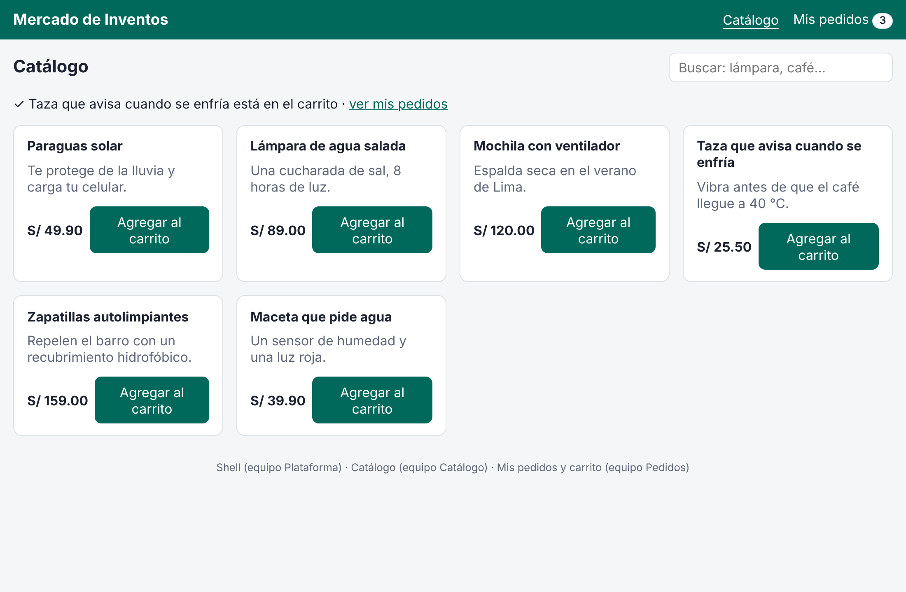
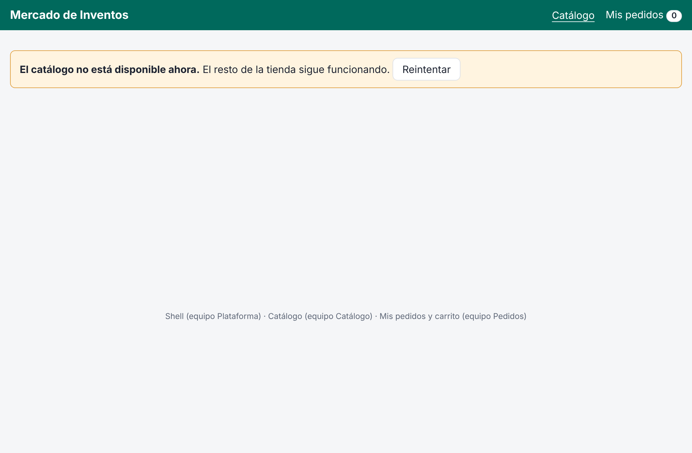
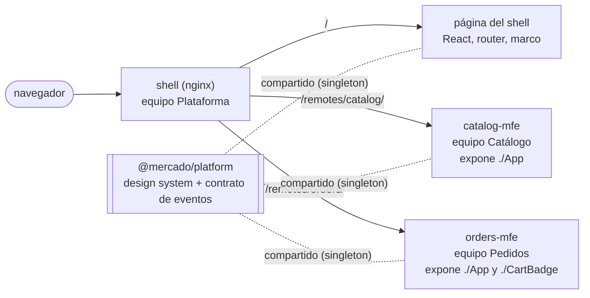
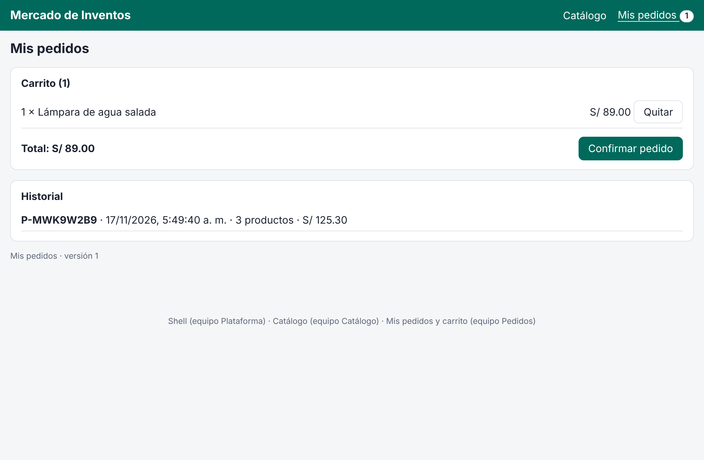
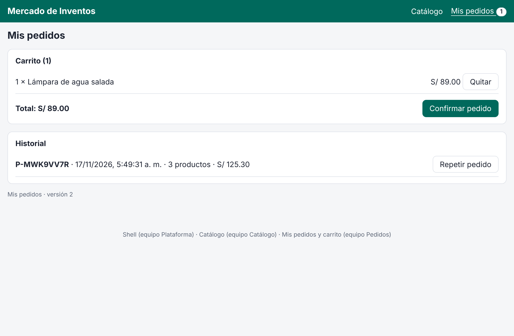

# 21 · Micro-frontends

> El backend ya está dividido en servicios con su equipo (lab 05), pero el frontend sigue siendo **uno**: cada cambio del equipo de catálogo espera el despliegue de toda la web, junto con los cambios de los demás equipos. Los micro-frontends dividen también la interfaz: cada equipo construye y despliega **su parte** de la pantalla, y una página contenedora (el *shell*) las junta en el navegador.

**Patrones:** Micro-frontends · Module Federation · Shell (App Host)
**Stack:** React + TypeScript · Vite · `@module-federation/vite` · **Infra:** — · **Tiempo estimado:** 1,5 h · **Requiere:** lab 09

---

| La tienda: el catálogo (equipo Catálogo) y el contador del carrito (equipo Pedidos), dentro del shell | Con el remoto del catálogo caído |
|---|---|
|  |  |

## El problema

Tres equipos trabajan en la misma web:

- **Plataforma:** el marco de la página (barra, navegación, pie).
- **Catálogo:** la lista de inventos y la búsqueda.
- **Pedidos:** el carrito, confirmar y el historial.

Con un solo proyecto de frontend:

- **Un despliegue para todos.** El arreglo urgente de pedidos espera a que catálogo termine su cambio a medias, o sale junto con él.
- **Un solo pipeline y un solo repositorio de dependencias.** Subir React o Vite es un proyecto de los tres equipos a la vez.
- **Una falla tumba todo.** Un error de renderizado en el catálogo deja la página en blanco, también para quien solo quería ver sus pedidos.

## El patrón



Cada equipo tiene **su** proyecto, **su** imagen y **su** contenedor ([`frontend/`](frontend/)). El shell no los incluye al compilar: los **descarga en el navegador** cuando hacen falta.

### Module Federation

Cada remoto publica un `remoteEntry.js`: un índice de lo que expone y de qué necesita compartido. El shell lo declara solo por nombre y URL ([`shell/vite.config.ts`](frontend/shell/vite.config.ts)):

```ts
remotes: {
  catalog: { type: 'module', name: 'catalog', entry: '/remotes/catalog/remoteEntry.js', ... },
  orders:  { type: 'module', name: 'orders',  entry: '/remotes/orders/remoteEntry.js', ... },
},
```

Y lo usa como un import cualquiera, pero perezoso ([`shell/src/App.tsx`](frontend/shell/src/App.tsx)):

```tsx
const CatalogApp = lazy(() => import('catalog/App'))   // baja el remoto la primera vez que se muestra
```

El remoto de pedidos expone **dos** piezas ([`orders/vite.config.ts`](frontend/orders/vite.config.ts)): la página "Mis pedidos" y el contador del carrito (`./CartBadge`), que el shell pone en **su** barra. El contador es código y estado del equipo de pedidos que se ve dentro del marco de otro equipo.

### Lo que se comparte y lo que no

[`federation.shared.ts`](frontend/platform/federation.shared.ts), igual para los tres:

| Compartido como singleton | Por qué |
|---|---|
| `react`, `react-dom` | Dos copias de React en una página rompen los hooks. El navegador descarga **una**: la del shell. Verificado en la pestaña *Network*: los remotos no bajan React |
| `@mercado/platform` | El design system ([tokens y componentes](frontend/platform/src/index.tsx)): una sola hoja de estilos, y los tres se ven como una aplicación |

Todo lo demás es de cada equipo, incluidas sus dependencias, sus estilos (con prefijo: `.catalog-…`, `.orders-…`) y sus claves en el almacenamiento del navegador (`orders:cart`).

### Cómo se comunican: eventos y URL, nunca imports

Ningún remoto importa código de otro. Hay dos canales, y los dos son contratos públicos:

1. **Eventos del navegador** ([`platform/src/events.ts`](frontend/platform/src/events.ts)), tipados:

   ```ts
   'mercado:add-to-cart': { sku: string; name: string; price: number }   // catálogo → pedidos
   'mercado:navigate':    { to: string; replace?: boolean }               // cualquiera → shell
   ```

   El catálogo **no sabe** que existe un carrito: emite `add-to-cart` y sigue. El carrito ([`orders/src/cart.ts`](frontend/orders/src/cart.ts)) lo escucha. Mañana un remoto de "favoritos" podría emitir el mismo evento, y pedidos no cambiaría.

2. **La URL.** Solo el shell cambia el historial; los remotos lo **leen** con `useLocation()` y piden navegar con un evento. La búsqueda del catálogo vive en la URL (`/catalogo?q=lampara`), y un pedido recién confirmado también (`/pedidos/P-MWK9UH8A`). Se puede compartir el link, y el botón "atrás" funciona.

Cambiar un evento (renombrarlo, quitarle un campo) rompe a otro equipo, igual que cambiar una API REST. Se agrega, no se cambia.

### Aislamiento de fallas

Cada remoto va dentro de un *error boundary* ([`RemoteBoundary.tsx`](frontend/shell/src/RemoteBoundary.tsx)). Si su `remoteEntry.js` no llega (contenedor caído, `502`) o falla al renderizar, solo **su** recuadro muestra un aviso. La barra, la navegación y el otro remoto siguen.

### Desplegar sin reconstruir el shell

El `remoteEntry.js` de cada remoto se sirve con `Cache-Control: no-cache`, y sus demás archivos llevan un hash en el nombre y se cachean un año ([nginx del remoto](frontend/orders/nginx/default.conf)). El `remoteEntry.js` es el **puntero** a la versión desplegada: al cambiar el contenedor, la siguiente carga de página ya usa la versión nueva.

## Arquitectura del lab

| Servicio | Qué es | Puerto |
|---|---|---|
| `shell` | nginx: la página del shell y la puerta a los remotos (`/remotes/<equipo>/`) | 3000 |
| `catalog-mfe` | nginx con el build del remoto de catálogo | — (por el shell) |
| `orders-mfe` | nginx con el build del remoto de pedidos. La versión se fija al construir (`ORDERS_VERSION`) | — (por el shell) |

El shell **no** depende de los remotos en `compose.yaml`: arranca aunque estén caídos. Los productos, el carrito y los pedidos viven en el navegador. En un sistema real, cada remoto llamaría al backend de su equipo (un BFF, lab 09). Este lab trata de la composición de la interfaz.

## Levántalo

```bash
cd labs/21-micro-frontends
docker compose up --build -d
./smoke.sh
```

Abre http://localhost:3000. Más peticiones en [`requests.http`](requests.http). Para limpiar: `docker compose down`.

### Modo desarrollo: cada equipo por su lado

```bash
cd frontend/catalog && npm install && npm run dev    # http://localhost:5174/remotes/catalog/  (solo el catálogo)
cd frontend/orders  && npm install && npm run dev    # http://localhost:5175/remotes/orders/   (solo pedidos)
cd frontend/shell   && npm install && npm run dev    # http://localhost:5173  (el shell, con los dos remotos por proxy)
```

Cada remoto tiene una página propia ([`catalog/src/main.tsx`](frontend/catalog/src/main.tsx)) para trabajar sin el shell ni los otros equipos. La de pedidos trae un botón que emite el mismo evento que emitiría el catálogo: así se prueba el contrato sin tener el catálogo.

Tests: `npm test` en cada carpeta (los eventos en `platform`, el router en `shell`, la búsqueda en `catalog`, el carrito en `orders`).

## Rómpelo

1. **Mira qué baja el navegador.** DevTools, pestaña *Network*, recarga en `/catalogo`. Llegan `remoteEntry.js` de los dos remotos (el de pedidos por el contador de la barra) y el código del catálogo. React aparece **una** vez, servido por el shell. Ve a "Mis pedidos": recién ahí baja el código de esa página.

2. **El contrato de eventos.** En la consola del navegador, haz de "otro equipo":
   ```js
   window.dispatchEvent(new CustomEvent('mercado:add-to-cart', { detail: { sku: 'X-1', name: 'Invento de consola', price: 10 } }))
   ```
   El contador de la barra sube. Pedidos no sabe ni le importa quién lo emitió.

3. **Tumba un remoto.**
   ```bash
   docker compose stop catalog-mfe
   ```
   Recarga `/catalogo`: el aviso de la captura de arriba, pero la barra y el contador funcionan, y "Mis pedidos" también. `docker compose start catalog-mfe` y "Reintentar". Prueba lo mismo con `orders-mfe`: el contador muestra `–` y el catálogo sigue.

4. **Despliega una versión nueva de pedidos, sin tocar el shell.** La versión 2 agrega "Repetir pedido" al historial:
   ```bash
   ORDERS_VERSION=2 docker compose up -d --build orders-mfe
   ```
   Recarga "Mis pedidos": dice "versión 2" y aparece el botón. El shell no se reconstruyó ni se reinició (`docker compose ps`: el mismo tiempo de arranque). **Rollback:** `docker compose up -d orders-mfe` vuelve a la imagen `1.0.0`, que sigue en tu máquina: sin compilar nada.

   | Pedidos v1 | Pedidos v2, desplegado solo |
   |---|---|
   |  |  |

5. **Rompe la regla del singleton.** En [`catalog/vite.config.ts`](frontend/catalog/vite.config.ts), cambia `shared,` por `shared: {},` (y borra el `import { shared }`, que queda sin usar), y reconstruye solo el catálogo: `docker compose up -d --build catalog-mfe`. Ahora el catálogo trae **su propio** React, pero lo renderiza el React del shell. Resultado, medido: el catálogo muestra el aviso de "no disponible" y la consola dice `Cannot read properties of null (reading 'useSyncExternalStore')`. Son los hooks de un React llamados desde el árbol de otro. El error boundary lo contiene: la barra y pedidos siguen. Vuelve a dejarlo como estaba.

## ¿Qué cambia en dev y prod?

Este lab no trae overlays de ambiente. Lo que cambia:

| Aspecto | Local (este lab) | Prod |
|---|---|---|
| De dónde se sirven los remotos | Contenedores nginx detrás del shell | Un CDN, con rutas por prefijo (`/remotes/catalog/` → el bucket del equipo de catálogo) |
| Qué versión carga el shell | La que esté desplegada (URL fija + `no-cache`) | Igual, o un **manifiesto** (`mf-manifest.json`) que dice qué versión de cada remoto usar: permite canary y rollback por remoto sin redeploy |
| Compatibilidad | Las tres versiones de React fijas en `19.3.1` | `requiredVersion` en los singletons, y una regla de equipo: subir React es una decisión de todos, coordinada |
| Fallas | Error boundary con "Reintentar" | Lo mismo, más métricas de errores por remoto (lab 10) para saber qué equipo rompió qué |
| Pruebas | Unitarias por equipo + smoke por HTTP | También pruebas de contrato de los eventos, y pruebas de punta a punta del shell con las versiones desplegadas de cada remoto |

## Costo y cuándo NO usarlo

- **Más piezas** que construir, desplegar y vigilar. Tres pipelines donde había uno.
- **Más bytes** si no se comparte bien, y una carga inicial con más peticiones.
- **Consistencia visual**: sin un design system compartido y una disciplina de estilos, la web parece hecha por tres empresas.
- **Las dependencias compartidas acoplan.** Subir React de versión vuelve a ser un cambio coordinado entre todos los equipos.
- **Cuándo no:** con un solo equipo, casi siempre. Y con varios equipos que se coordinan bien, un monorepo con módulos y un solo despliegue suele alcanzar (es el mismo argumento del monolito modular, lab 04). Los micro-frontends pagan cuando hay equipos que **necesitan** desplegar su parte por su cuenta, varias veces por semana.

## Ejercicio

El catálogo quiere mostrar **"✓ en el carrito"** en los inventos que ya están en el carrito. Esa información es del equipo de pedidos. Agrega al contrato un evento `mercado:cart-changed` (`{ skus: string[] }`) que pedidos emita cada vez que cambia el carrito, y haz que el catálogo lo escuche. ¿Qué pasa si el catálogo se monta **después** de la última emisión? Pista: un evento `mercado:cart-request` que pedidos responda, o que pedidos guarde el último estado en un lugar que el catálogo pueda leer. ¿Cuál acopla menos a los dos equipos? Escribe primero el test en [`events.test.ts`](frontend/platform/src/events.test.ts).

## Para profundizar

- Cam Jackson, [*Micro Frontends*](https://martinfowler.com/articles/micro-frontends.html) (martinfowler.com, 2019).
- Luca Mezzalira, *Building Micro-Frontends* (O'Reilly).
- Michael Geers, [micro-frontends.org](https://micro-frontends.org/): el contrato de eventos y los "fragmentos" de cada equipo.
- [Module Federation](https://module-federation.io/) y su [integración con Vite](https://module-federation.io/integrations/build-tool/vite).
- Siguiente: el [lab 22](../22-integrador/) junta los patrones de la guía en un solo sistema.
